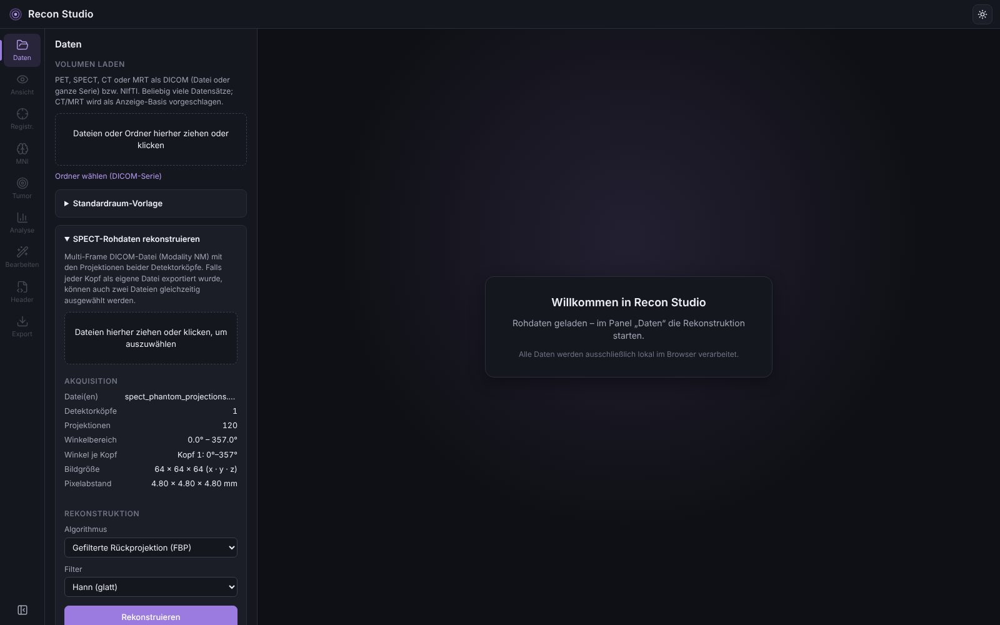
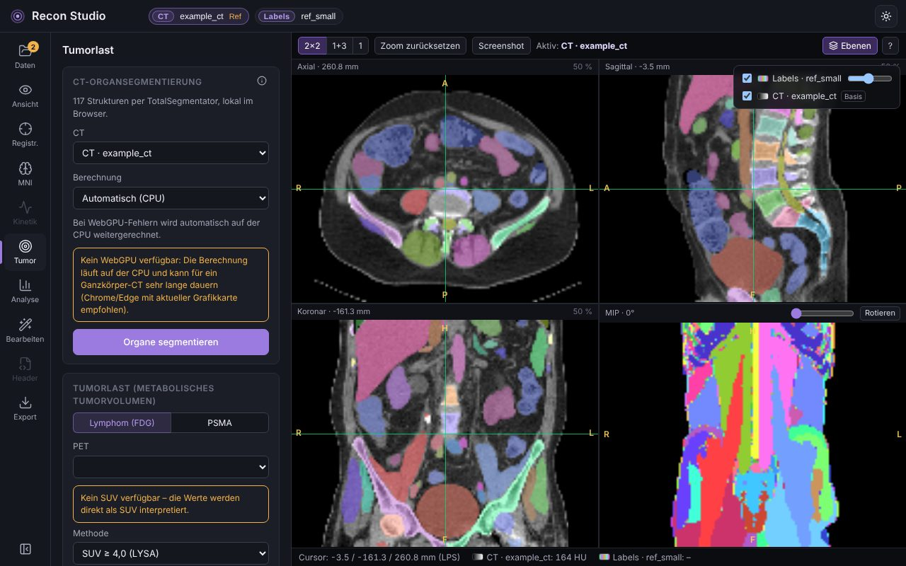
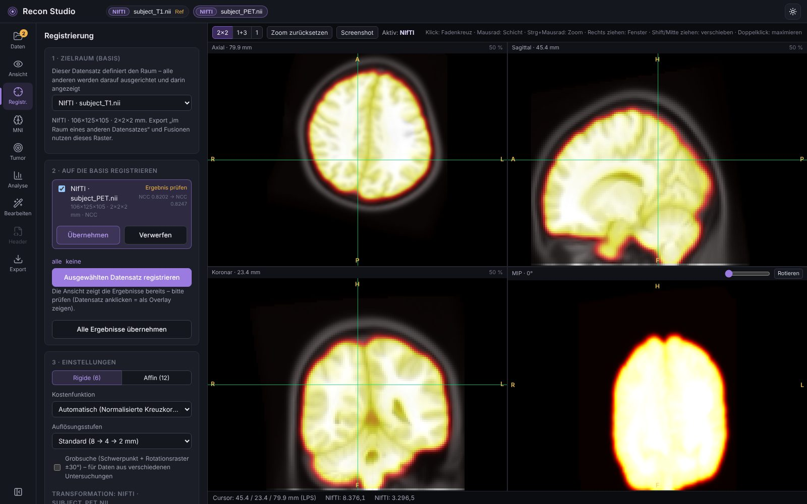
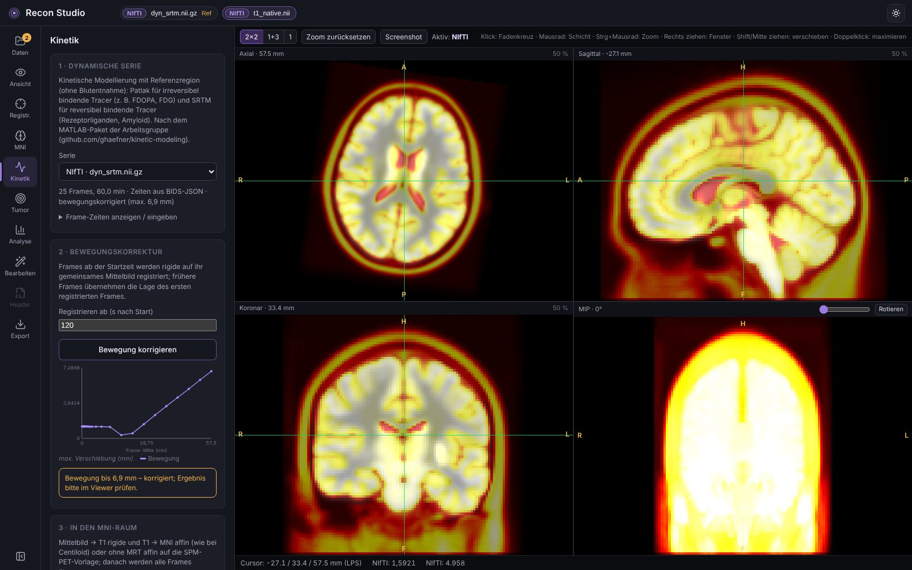
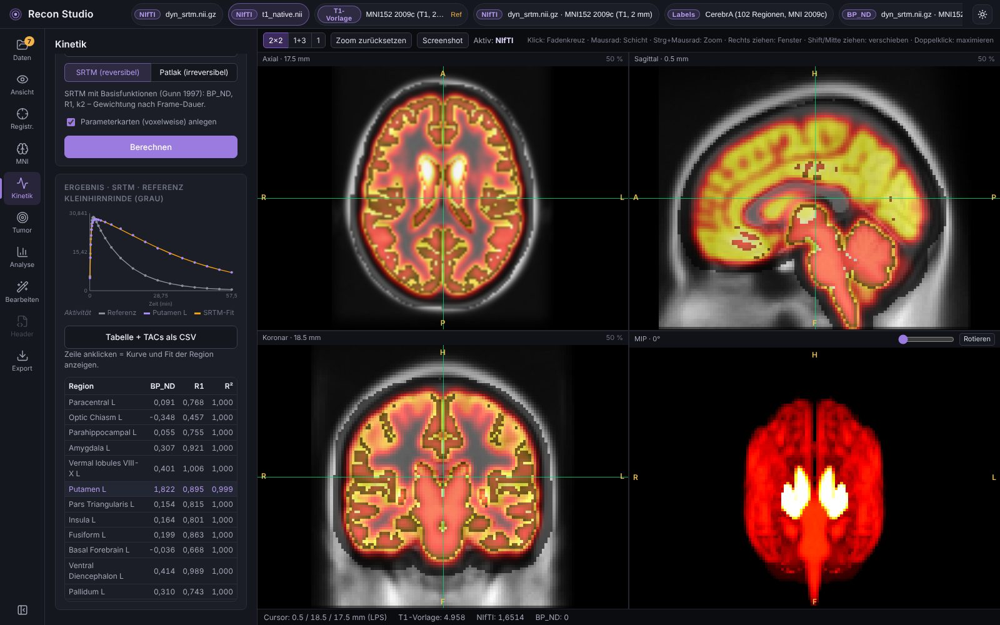
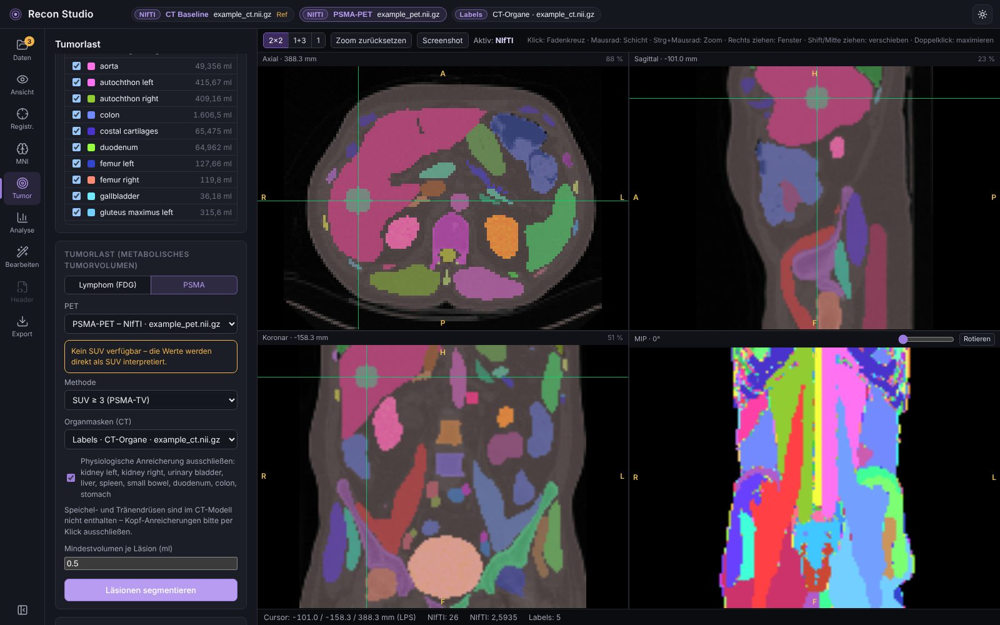
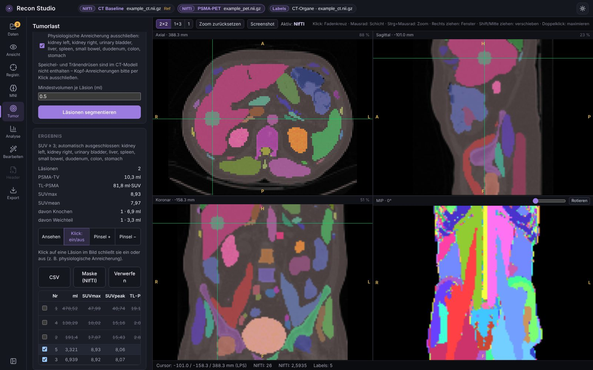
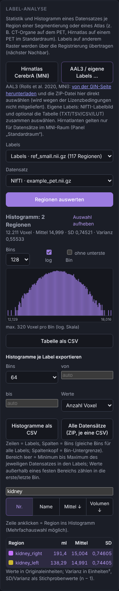
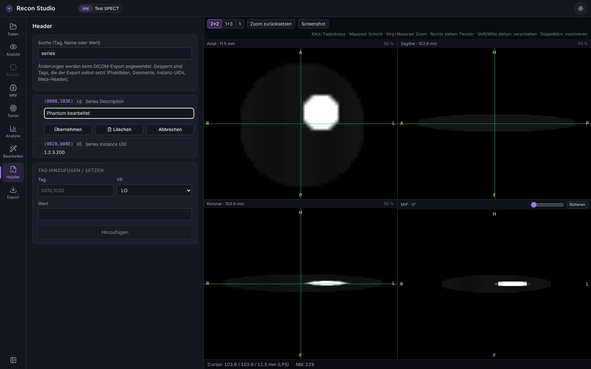
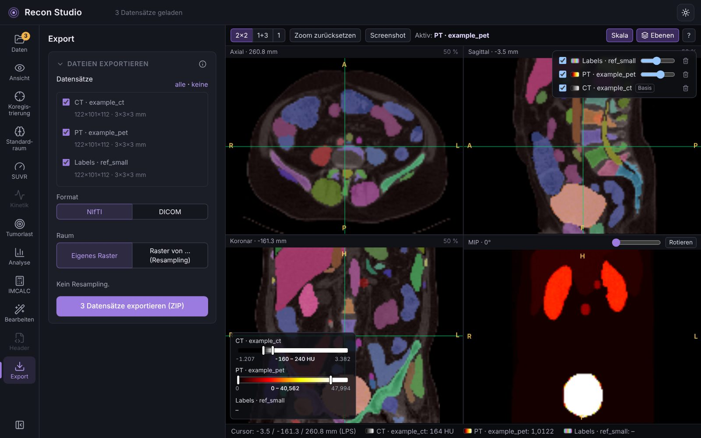

# Recon Studio – Handbuch

Schritt-für-Schritt-Anleitungen für alle Funktionen. Die Bilder zeigen synthetische Phantome bzw. öffentliche
Beispieldaten (keine Patientendaten).

**Inhalt**
1. [Oberfläche](#1-oberfläche)
2. [Daten laden](#2-daten-laden)
3. [SPECT-Rohdaten rekonstruieren](#3-spect-rohdaten-rekonstruieren)
4. [Ansicht, Ebenen und Fusion](#4-ansicht-ebenen-und-fusion)
5. [Koregistrierung (Patientenraum)](#5-koregistrierung-patientenraum)
6. [Standardraum (MNI), Atlas und SUVR](#6-standardraum-mni-atlas-und-suvr)
7. [Centiloid](#7-centiloid)
8. [Kinetik (dynamisches PET)](#8-kinetik-dynamisches-pet)
   – [8a. Dosimetrie (SPECT/CT)](#8a-dosimetrie-spectct)
9. [CT-Organsegmentierung](#9-ct-organsegmentierung)
10. [Segmentierung & MTV](#10-segmentierung--mtv)
11. [Analyse und Label-Analyse](#11-analyse-und-label-analyse)
    – [IMCALC: voxelweise Rechnung](#imcalc-voxelweise-rechnung)
12. [Bearbeiten](#12-bearbeiten)
13. [DICOM-Header](#13-dicom-header)
14. [Export](#14-export)
15. [Tipps und Fehlerbehebung](#15-tipps-und-fehlerbehebung)

---

## 1. Oberfläche

- **Linke Leiste**: die Arbeitsbereiche *Daten, Ansicht, Koregistrierung, Standardraum, Centiloid & SUVR (SUVR), Kinetik,
  Dosimetrie, Segmentierung & MTV, Analyse, IMCALC, Bearbeiten, Header, Export*. Ein Klick auf den aktiven Bereich klappt das Seitenpanel ein und aus
  (ebenso das Symbol unten links). Ausgegraute Bereiche nennen im Tooltip den Grund (z. B. „Header nur für DICOM“).
  Beim Wechsel des Bereichs bleibt alles erhalten – laufende Berechnungen, Ergebnisse, aufgeklappte Karten.
- **Seitenpanel**: Die Breite lässt sich am rechten Rand mit der Maus ziehen (Doppelklick = Standardbreite; mit
  Tastaturfokus ←/→). Die Breite bleibt im Browser gespeichert – praktisch für breite Ergebnistabellen.
  Längere Erläuterungen (Methodik, Literatur, Formate) stecken hinter dem **ⓘ** neben der Kartenüberschrift.
  **Karten** lassen sich per Klick auf die Überschrift auf- und zuklappen; rechts steht ihr Status (z. B.
  *✓ korrigiert*, *läuft*, *25 Frames*). Erledigte Schritte (z. B. Bewegungskorrektur, Normalisierung) klappen von
  selbst zu.
- **Kopfzeile**: die **Aktivitätsanzeige** – laufende Berechnungen (Laden, Koregistrierung, Normalisierung,
  CT-Segmentierung, Kinetik, Centiloid, Export …) mit Fortschritt, kurz *fertig* nach Abschluss, Fehler mit ⚠.
  Ein Klick öffnet den zuständigen Bereich (dort lässt sich abbrechen). Ohne laufende Aufgabe steht dort die Zahl der
  geladenen Datensätze. Rechts oben: helles/dunkles Design.
- **Viewer** (rechts): Layout 2×2, 1+3 oder Einzelbild, *Zoom zurücksetzen*, *Screenshot* (PNG).
  Rechts in der Viewer-Leiste: **SUV | Counts/Bq/ml**, **Skala** (Farbskala ein/aus), **Ebenen** (siehe
  [Abschnitt 4](#4-ansicht-ebenen-und-fusion)) und **?** (Maus- und Tastenbedienung).
  - **SUV | Counts/Bq/ml** (nur sichtbar, wenn ein Datensatz SUV-Angaben im Header hat) schaltet für die ganze App um,
    ob PET/SPECT als SUV oder mit den Originalwerten aus dem Header (Counts, Bq/ml) angezeigt und ausgewertet werden –
    Viewer, Farbskala, Analyse, Bearbeiten. Die Wahl bleibt im Browser gespeichert; ohne Wahl wird beim Laden eines PET
    mit SUV-Angaben SUV eingestellt. Segmentierung & MTV rechnet unabhängig davon immer in SUV, die Dosimetrie immer mit
    Counts bzw. Bq/ml.
  Die **Farbskala** unten links zeigt für jede sichtbare Ebene Farbtabelle und Fenster (Min/Max in SUV, HU, BP_ND …) und
  bei Labelbildern die Region unter dem Cursor; sie erscheint auch im Screenshot. Sie ist zugleich Bedienelement:
  - Der Balken umfasst den ganzen Wertebereich des Datensatzes (Zahlen links/rechts darunter); die beiden **weißen
    Griffe** markieren Fenster-Minimum und -Maximum (Mitte: aktuelles Fenster). Unterhalb des Fensters gilt die erste,
    oberhalb die letzte Farbe der Farbtabelle.
  - **Griff ziehen**: Fenster-Minimum bzw. -Maximum verschieben,
  - **Bereich zwischen den Griffen ziehen**: ganzes Fenster verschieben,
  - **Rechtsklick** auf den Balken: Farbtabelle wählen – Graustufen, Invertiert, Hot, DaT (Schwarz–Grün–Gelb–Hellrot, typische
    DaTSCAN-Darstellung), Blau (Schwarz–Blau–Hellblau–Weiß), Blau–Weiß–Rot (Z-Werte, Differenzen), Regenbogen.
  Statuszeile unten: Position in mm (Patientenkoordinaten LPS) und die Werte aller sichtbaren Ebenen unter dem
  Fadenkreuz – je Ebene mit Farbbalken ihrer Farbtabelle, Modalität und Schlagwort bzw. Dateiname; bei Labelbildern
  der Name der Region.

| Maus | Wirkung |
|---|---|
| Klick | Fadenkreuz setzen (alle Schnitte folgen) |
| Mausrad | Schicht wechseln |
| Strg/⌘ + Mausrad | Zoom |
| Rechts ziehen | Fenster (Kontrast/Helligkeit) der obersten Ebene |
| Shift oder mittlere Taste ziehen | Bild verschieben |
| Doppelklick | Ansicht maximieren / zurück |
| MIP: Regler oder *Rotieren* | Projektionswinkel |

Alles wird lokal im Browser berechnet; Daten werden nirgendwohin hochgeladen.

---

## 2. Daten laden

1. Bereich **Daten** öffnen.
2. Dateien oder ganze Ordner in das Feld *„Dateien oder Ordner hierher ziehen“* ziehen oder anklicken
   (*Ordner wählen* für eine DICOM-Serie).
   - DICOM: Einzeldatei, Serie oder Multi-Frame, auch Dateien ohne Endung (macOS-Exporte).
   - NIfTI: `.nii` oder `.nii.gz`.
   - Mehrere Serien in einem Upload werden **getrennt** geladen; nicht lesbare Dateien werden übersprungen und gemeldet.
3. **Was eingeblendet wird**: Der erste Datensatz ist die Basis der Ansicht. **Ein CT wird beim Laden immer Basis**
   (sofern die Basis noch kein CT ist), ein MRT derselben Körperregion ersetzt eine PET/SPECT-Basis; ein PET/SPECT derselben Region (oder mit gleichem Frame of Reference) wird darüber eingeblendet, ebenso
   Labelbilder auf dem Raster eines angezeigten Datensatzes. Alles andere – z. B. ein zweites PET, ein T1 neben einem
   Ganzkörper-CT, Daten einer anderen Region – wird geladen, aber **nicht eingeblendet**; ein Hinweis unten rechts nennt
   diese Datensätze. Einblenden über **Ebenen** im Viewer oder das Auge in der Datensatzliste.
   **Patient-ID** (Feld oberhalb der Liste, optional): wird allen exportierten NIfTI- und CSV-Dateien vorangestellt
   (`P0815_…nii`, `P0815_…csv`, auch in ZIP-Archiven solcher Dateien) sowie der Projektdatei (`P0815_Recon-Projekt_….recon`); DICOM-Exporte bleiben unverändert. Die ID wird im
   Projekt mitgespeichert.
4. **Datensatzliste**: eine Zeile je Datensatz mit Modalität (farbig), Schlagwort, Name und *Basis*-Markierung.
   - Klick auf die Zeile: Details (Bezeichnung, Modalität, Aufnahme, Matrix, Voxelgröße, Koordinaten, Dynamik) und Schlagwort.
   - **Aufnahmedatum und -uhrzeit** stehen klein unter dem Namen und in den Details – aus dem DICOM-Header
     (Aufnahmezeitpunkt, bei Serien der früheste; fehlt er, Serien-, Erstellungs- oder Studiendatum mit Hinweis).
     NIfTI-Dateien enthalten kein Datum.
   - 👁 ein-/ausblenden · ✎ **aktiv** setzen – darauf beziehen sich Analyse, Bearbeiten, Header und Export.
   - ⋯: *Als Basis der Ansicht*, *Datensatz entfernen*.
   - **Bezeichnung** ändern (Details): Der Name wird Teil der Exportdateinamen; leer = Originalname (bleibt darunter
     sichtbar).
   - **Modalität** ändern (Details, alle Datensätze außer Labelbildern): PET, SPECT, CT, MRT oder Sonstige;
     *automatisch* nimmt den Wert aus dem DICOM-Header bzw. die Erkennung. NIfTI-Dateien enthalten keine Modalität –
     Recon Studio erkennt sie aus einer BIDS-JSON-Datei, dem Dateinamen (`_pet`, `_T1w`, `ct`, `spect` …),
     dynamischen Daten (→ PET) oder dem Wertebereich (Luft und Knochen → CT). Davon hängen u. a. CT-Fensterpresets, SUV
     und die Vorauswahl in Registrierung, Centiloid und Segmentierung & MTV ab. Beim DICOM-Export wird die gewählte
     Modalität in den Header (0008,0060) geschrieben.
   - **Als Basis der Ansicht** (Details oder ⋯): jeder Datensatz, gleich welcher Modalität, kann Basis sein.
   - **Schlagwort** eintragen (z. B. *Baseline*, *Follow-up*, *CT nativ*) – es erscheint überall in Auswahllisten,
     Statuszeile und Ebenen.
5. **Labelbilder** (Atlas, CT-Organe, Läsionsmasken) werden beim Laden automatisch erkannt und als farbiges
   Label-Overlay mit Regionsnamen angelegt, wenn
   - die Datei aus Recon Studio exportiert wurde (Regionsnamen stehen im NIfTI-Header),
   - es eine TotalSegmentator-Ausgabe ist,
   - eine Tabelle mit gleichem Namen mitgeladen wird (z. B. `AAL3v1.nii` + `AAL3v1.nii.txt`), oder
   - der Dateiname auf ein Labelbild hindeutet (`…_seg`, `…_dseg`, `labels`, `aseg` …).
6. Unter **Standardraum-Vorlage** (aufklappen) lassen sich MNI- und SPM-Vorlagen oder eigene Vorlagen laden
   (siehe [Abschnitt 6](#6-standardraum-mni-atlas-und-suvr)).

### Projekt speichern und öffnen

Karte **Projekt** im Bereich *Daten*:

- **Projekt speichern** legt die ganze Sitzung als eine Datei `Recon-Projekt_….recon` ab. Sie enthält:
  - alle Datensätze (DICOM-Originaldateien mit Header, NIfTI-Volumen, Bearbeitungen, dynamische Frames,
    Labelbilder mit Regionsnamen, Vorlagen);
  - Registrierungen, Schlagworte, Anzeige (Basis, Ebenen, Fenster, Farbtabellen) und die Normalisierung;
  - Centiloid- und MTV-Ergebnisse.
- Kinetik-Tabellen und Label-Analysen werden nach dem Öffnen per Klick neu berechnet.
- **Projekt öffnen …** (auch auf der Startseite oder per Ziehen der `.recon`-Datei ins Ladefeld) ersetzt die
  aktuelle Sitzung nach Rückfrage.
- Die Datei enthält die Patientendaten der geladenen Bilder – vertraulich behandeln.

---

## 3. SPECT-Rohdaten rekonstruieren

1. Bereich **Daten** → *SPECT-Rohdaten rekonstruieren* aufklappen.
2. Die Projektionsdatei (DICOM NM Multi-Frame) auswählen; wurde jeder Detektorkopf einzeln exportiert, beide Dateien
   gleichzeitig wählen.
3. Unter *Akquisition* prüfen: Köpfe, Projektionen, Winkelbereich, Matrix, Pixelabstand.
4. *Rekonstruktion* wählen:
   - **FBP** mit Filter (Ram-Lak scharf … Butterworth extra weich), oder
   - **OSEM** mit Subsets und Iterationen.
5. **Rekonstruieren** – Fortschrittsbalken, *Abbrechen* möglich. Das Ergebnis wird als SPECT-Datensatz angelegt.

---

## 4. Ansicht, Ebenen und Fusion

Bereich **Ansicht** – eine Karte je angezeigter Ebene (oben = oberste Ebene):

1. **Farbtabelle**: Graustufen, invertiert, Hot, DaT, Blau, Blau–Weiß–Rot, Regenbogen, Atlas-Regionen (auch per Rechtsklick auf
   die Farbskala im Viewer).
2. **Fenster**: *Min*/*Max* eintragen, *Auto*, oder Presets (PET: SUV 0–5/10/15; CT: Weichteil, Lunge, Knochen,
   Gehirn, Leber). Alternativ im Bild mit der rechten Maustaste ziehen oder die Griffe der Farbskala im Viewer
   verschieben ([Abschnitt 1](#1-oberfläche)).
3. **Deckkraft** (Overlays) und **anzeigen** (Häkchen = Ebene ein/aus).
4. *↑ nach oben* / *↓ nach unten*: Reihenfolge; *als Basis*: Ebene wird Referenz; *aus Ansicht entfernen*.
5. **Fusion exportieren** (Karte unten, aufklappen): die sichtbaren Ebenen so, wie sie angezeigt werden, als RGB-Datensatz –
   DICOM Secondary Capture (ZIP) oder NIfTI RGB, im Raster der Basis oder axial.

Label-Ebenen werden ohne Interpolation (nächster Nachbar) dargestellt.

**Ebenen-Schnellwahl im Viewer:** Der Knopf **Ebenen** oben rechts im Viewer blendet eine kleine Liste über den
Schnittbildern ein – in jedem Bereich, z. B. während Kinetik, Segmentierung & MTV oder Analyse. Häkchen = Ebene sichtbar,
Regler = Deckkraft. Datensätze unter *nicht eingeblendet* werden per Häkchen als Overlay hinzugefügt. Der **Papierkorb**
am Zeilenende entfernt einen Datensatz: erster Klick → *Löschen?*, zweiter Klick innerhalb von 3 s bestätigt. Der Knopf
schaltet die Liste wieder aus; der Zustand bleibt gespeichert.

**MIP** (unten in der Ebenen-Liste): Datensatz und Farbtabelle der MIP-Ansicht lassen sich getrennt wählen – auch ein
Datensatz, der in den Schnittbildern ausgeblendet ist. *Automatisch* nimmt PET, sonst SPECT, sonst CT (eingeblendete
zuerst), sonst die Basis; *LUT wie Datensatz* übernimmt dessen Farbtabelle. Das Fenster wird mit dem Datensatz geteilt
(Ziehen in der MIP ändert es). Die Wahl wird in der Projektdatei gespeichert.

---

## 5. Koregistrierung (Patientenraum)

Ausrichtung der Datensätze **eines Patienten** zueinander – für jede Körperregion (Ganzkörper wie Hirn): PET/SPECT auf
das CT oder MRT, Folgeuntersuchungen auf die Basis. Dynamische Serien werden über ihr Mittelbild registriert; alle
Frames folgen. Die Normalisierung in einen Standardraum ist davon getrennt ([Abschnitt 6](#6-standardraum-mni-atlas-und-suvr))
und nimmt alle hier registrierten Datensätze mit.

Der Bereich **Koregistrierung** hat drei Karten; erledigte Karten klappen ein und zeigen ihren Stand im Kopf.

1. **1 · Basis**: den Datensatz wählen, der den Raum definiert (meist CT oder MRT).
2. **2 · Datensätze**: die Datensätze, die auf die Basis registriert werden.
   - Datensätze **derselben Aufnahme** stehen eingerückt unter ihrem Datensatz („folgt …“) und bewegen sich automatisch
     mit: gleiche FrameOfReference (z. B. PET zum CT) oder eine Organkarte, die zum CT gehört (auch eine wieder geladene
     „Labels_CT-Organe_…“-Datei).
   - Status je Zeile: ○ Patientenkoordinaten, ✎ manuell/Landmarken, ◐ Ergebnis prüfen, ✓ registriert, ⚠ Koordinaten
     (Basis und Datensatz überlappen kaum).
   - Angehakte Datensätze mit *… automatisch registrieren* nacheinander berechnen, dann *Übernehmen*/*Verwerfen*
     (einzeln) oder *Alle Ergebnisse übernehmen*.
   - Klick auf eine Zeile wählt den Datensatz für Karte 3.
3. **3 · Ausrichten**: ein Datensatz (Auswahl oben; Datensätze einer Aufnahme lassen sich auch *einzeln* ausrichten)
   mit drei Reitern in der empfohlenen Reihenfolge:
   - **① Landmarken (optional)**: grob über zwei anatomische Punkte ausrichten, siehe unten. Offen, wenn die
     Koordinatensysteme nicht zusammenpassen.
   - **② Automatisch**: *Rigide (6)* oder *Affin (12)*, Kostenfunktion (automatisch: Kreuzkorrelation bei gleicher
     Modalität, sonst normalisierte Mutual Information), Auflösungsstufen, **Grobsuche** (Schwerpunkt +
     Rotationsraster ±30°) und *Startlage beibehalten*; *Jetzt registrieren*, danach *Übernehmen*/*Verwerfen*.
   - **Manuell**: Verschiebung und Drehung als Zahlen (mm, °), *In 90°-Schritten drehen*, optional Schieberegler;
     Drehpunkt Volumenmitte oder Landmarke 1.
   - **▸ Erweitert**: Matrix speichern/laden, auf Patientenkoordinaten zurücksetzen, Ursprung dauerhaft in die Datei
     übernehmen.

Die Basis lässt sich später wechseln – bestehende Registrierungen bleiben erhalten. Die Bilder zeigen noch den früheren
Aufbau.

### Reiter ① Landmarken (verschiedene Koordinatensysteme)

NIfTI-Dateien liegen manchmal nicht im selben Koordinatensystem wie die DICOM-Daten derselben Studie. Häufige Gründe:
- Der Ursprung wurde neu gesetzt, z. B. mit SPM „Set origin/Reorient“.
- Die Datei hat keine Lageangaben (sform/qform-Code 0; dann gelten nur die Voxelgröße und der Ursprung 0).
- Ein Konverter hat die Daten neu zentriert.

Die Datensatz-Details zeigen dazu *Patientenkoordinaten* (sform/qform bzw. „keine Lageangaben“) und den *Ursprung*.
Überlappen Basis und gewählter Datensatz kaum (⚠), öffnet *Ausrichten* den Reiter **① Landmarken**.

Jeder Datensatz bekommt zwei Landmarken – an denselben anatomischen Punkten in Basis und Datensatz, z. B.
**Landmarke 1** = Nasenspitze und **Landmarke 2** = Scheitel (Ganzkörper) bzw. vordere und hintere Kommissur (Hirn).

1. **Landmarken setzen …** öffnet den Setz-Modus. Der Viewer zeigt dabei immer nur **einen** Datensatz:
   - Mit *Basis* / *Datensatz* umschalten.
   - Im Viewer auf den Punkt klicken (Fadenkreuz).
   - *Landmarke 1 hier setzen* bzw. *Landmarke 2 hier setzen*.
   - Gesetzte Landmarken erscheinen als Markierung im Viewer: **B1/B2** (Basis, orange), **D1/D2** (Datensatz, türkis).
   - *zeigen* springt zur Landmarke, *löschen* entfernt sie.
2. **Ursprung setzen auf Landmarke 1**: Der Datensatz wird verschoben, bis seine Landmarke 1 auf der Landmarke 1 der
   Basis liegt.
   - Der Viewer zeigt danach beide Datensätze; das Fadenkreuz steht auf Landmarke 1.
   - Ein Hinweis im Viewer meldet, um wie viele Millimeter verschoben wurde.
3. **Mit Landmarke 2 ausrichten**: Zusätzlich wird um Landmarke 1 gedreht, bis die Richtung zu Landmarke 2 stimmt.
   - Weichen die Abstände Landmarke 1–2 in Basis und Datensatz deutlich ab, erscheint ein Hinweis.
   - Eine verbleibende Drehung um diese Achse im Reiter *Manuell* ausgleichen: Drehpunkt *Landmarke 1 (Ursprung)*,
     90°-Schritte.
4. Datensätze derselben Aufnahme (z. B. PET zum CT der NIfTI-Studie, die Organkarte) folgen automatisch.
5. **Weiter: automatisch registrieren →** öffnet Reiter ② – die Landmarkenausrichtung ist die Startlage. Mit
   eingeschalteter Grobsuche sorgt *Startlage beibehalten* dafür, dass nur ±10° / ±10 mm um diese Lage gesucht wird.
6. Optional unter *▸ Erweitert*: **Ursprung dauerhaft in die Datei übernehmen** (wie SPM „Set origin“), für Basis oder Datensatz und auf
   Wunsch für alle Datensätze derselben Aufnahme:
   - Landmarke 1 wird zu (0,0,0); die Lage zu den anderen Datensätzen bleibt erhalten.
   - Der NIfTI-Export enthält den neuen Ursprung. Der DICOM-Export schreibt eine neue Serie mit neuer FrameOfReference.
   - *Zurück auf Original-Ursprung* macht das rückgängig.
   - Vor einer Normalisierung ausführen.

Landmarken werden in der Projektdatei gespeichert.

---

## 6. Standardraum (MNI), Atlas und SUVR

Räumliche Normalisierung in den MNI-Standardraum – **nur für Hirnuntersuchungen**. Grundlage ist *ein* Datensatz des
Patienten; **alle** Datensätze des Patientenraums werden anschließend mit übertragen und lassen sich dann
atlasbasiert auswerten oder im Standardraum speichern.

### 6.1 Normalisierung

1. Datensätze laden und im Bereich **Koregistrierung** aufeinander ausrichten (z. B. PET auf das CT des PET/CT oder auf
   das T1-MRT, [Abschnitt 5](#5-koregistrierung-patientenraum)). Datensätze mit gemeinsamen Patientenkoordinaten
   (PET und CT derselben PET/CT-Untersuchung) passen bereits zueinander.
2. Bereich **Standardraum** öffnen, Karte **1 · Normalisierung**:
   - **Grundlage (Patientendatensatz)**: am besten das T1-MRT, sonst das Hirn-PET/SPECT oder das **Kopf-CT**.
   - **Kontrast** und **Vorlage** werden passend vorgeschlagen und bei Bedarf automatisch geladen:

     | Grundlage | Vorlage |
     |---|---|
     | T1-MRT | MNI152 2009c (T1, 2 mm) |
     | PET | SPM12 PET (Perfusion) |
     | SPECT | SPM12 SPECT (Perfusion) |
     | CT | SPM12 Transmission (Schwächungsbild, Knochen hell) |

     Eigene Vorlagen (z. B. Amyloid-PET, auch 4D/adaptiv) im Bereich *Daten* → *Standardraum-Vorlage*.
   - *Affin (12)* oder *Affin + nichtlinear* (nur bei gleichem Kontrast von Datensatz und Vorlage), optional
     *Nur Gehirn der Vorlage verwenden*.
   - CT: nur ein Kopf-CT verwenden (bei Ganzkörper-CT vorher auf den Kopf zuschneiden). Die HU-Werte werden für die
     Anpassung auf −1000 bis 2000 begrenzt.
3. **Normalisieren und alle Datensätze übertragen**. Angezeigt wird die Ähnlichkeit vorher → nachher.

### 6.2 Alle Datensätze im Standardraum

1. Nach der Normalisierung werden **alle Datensätze des Patientenraums** über ihre Koregistrierung und die
   Normalisierung in den Standardraum resampelt und als `… · MNI` angelegt (Karte **2 · Datensätze im Standardraum**):
   - Labelbilder (z. B. CT-Organe) mit nächstem Nachbarn und Regionsnamen,
   - dynamische Serien Frame für Frame (Kinetik direkt im Standardraum),
   - Schlagworte werden übernommen.
2. Die Ansicht wechselt in den Standardraum (Vorlage als Basis, übertragenes PET darüber); die übrigen Datensätze stehen
   unter **Ebenen**.
3. *Erneut übertragen / Auswahl*: andere Interpolation oder einzelne Datensätze – ältere Kopien werden ersetzt.
4. **SPM/CAT12** (Karte aufklappen): ein in SPM/CAT12 berechnetes Verformungsfeld `y_*.nii` laden (statt selbst zu normalisieren) bzw.
   die App-Normalisierung als `y_*.nii` speichern.

### 6.3 Atlas und SUVR

1. Bereich **Centiloid & SUVR** (Leiste: *SUVR*), Karte **Atlas & SUVR**: *CerebrA-Atlas laden* (102 Regionen, mitgeliefert) oder *Eigener Atlas …*
   (Labelbild + Tabelle, oder direkt die AAL3-ZIP-Datei von [gin.cnrs.fr](https://www.gin.cnrs.fr/en/tools/aal/)).
2. **Datensatz** im Standardraum wählen (z. B. das übertragene PET).
3. **Referenzregion**: Kleinhirnrinde, Kleinhirn gesamt, Pons/Hirnstamm, ganzes Gehirn oder *Eigene Auswahl …*.
4. **Regionen auswerten** – Tabelle mit Volumen, Mittelwert und SUVR; sortierbar nach Name, Index oder SUVR.
5. *Tabelle als CSV* exportieren oder *SUVR-Bild anlegen* (neuer Datensatz = Bild / Referenzmittel).
   Mit **⤢** über der Tabelle öffnet sie sich groß über dem Viewer.

---

## 7. Centiloid

Bereich **Centiloid & SUVR** (Leiste: *SUVR*), Karte **Centiloid**.

1. **Centiloid-VOIs laden …**: `Centiloid_Std_VOI.zip` von GAAIN herunterladen (Link in der Karte) und die ZIP-Datei
   direkt auswählen. Die VOIs werden wegen der GAAIN-Nutzungsbedingungen nicht mitgeliefert.
   *VOIs anzeigen* blendet sie als Labels ein.
2. **Kalibrierung** wählen:
   - *Florbetaben – Recon-Studio-Pipeline (GAAIN-kalibriert)* bzw. *PiB – Recon-Studio-Pipeline* für die automatische
     MRT-Pipeline der App (Standard),
   - *… Standard (Rowe 2017 / Klunk 2015)* für Daten, die extern mit der SPM8-Standardmethode normalisiert wurden,
   - oder *Eigene Gleichung …* (Steigung, Achsenabschnitt, Referenzregion).
3. **Automatisch**: PET und T1-MRT wählen → *Centiloid bestimmen*
   (PET → T1 rigide, T1 → MNI **affin**, VOI-Auswertung). An den GAAIN-Referenzdaten (35 Probanden) weicht das
   Ergebnis im Mittel um ca. 4 CL (PiB) bzw. 6 CL (Florbetaben) von der Standardmethode ab (Details: `src/centiloid/README-calibration.md`).
   Ohne MRT: *ohne MRT (PET-only)* – dazu vorher eine PET-Vorlage laden; diese Variante ist nicht validiert.
4. Oder **Vorhandenen Datensatz im MNI-Raum auswerten**: Datensatz wählen → *Auswerten*. Die GAAIN-kalibrierte
   Gleichung gilt nur für Datensätze aus der affinen Normalisierung der App.
5. Ergebnis: Centiloid-Wert, VOI-Tabelle (Volumen, Mittel, SUVR), Warnungen (z. B. Aufnahmezeitfenster, Tracer).

---

## 8. Kinetik (dynamisches PET)

Referenzregion-Modelle für dynamische Hirn-PET-Daten, ohne Blutentnahme. Nachbau ausgewählter Teile des MATLAB-Pakets der
Arbeitsgruppe ([ghaefner/kinetic-modeling](https://github.com/ghaefner/kinetic-modeling)):

- **Patlak (Referenz)** für irreversibel bindende Tracer (z. B. FDOPA): Ki_ref in 1/min aus der Steigung von
  C/C_ref gegen ∫C_ref/C_ref ab einer Startzeit t*.
- **SRTM** (vereinfachtes Referenzgewebemodell) für reversibel bindende Tracer (Rezeptorliganden): BP_ND, R1, k2.
  Gelöst mit Basisfunktionen (Gunn et al. 1997), gewichtet nach Frame-Dauer.

**Daten laden** (Bereich *Daten*):
- eine dynamische DICOM-Serie; die Frames erkennt die App an wiederholten Schichtpositionen, die Zeiten liest sie aus
  dem Header;
- oder ein 4D-NIfTI, am besten zusammen mit der BIDS-Datei `*.json` (`FrameTimesStart`, `FrameDuration`).

Der Datensatz zeigt das zeitgewichtete Mittelbild; die Karte nennt die Zahl der Frames. Im Bereich **Ansicht** hat die
Ebenenkarte eines dynamischen Datensatzes den Regler **Zeit**:
- durch die Frames schieben, mit *◀ Frame* / *Frame ▶* einzeln weiterschalten, *▶ Abspielen* oder zurück zum *Mittelbild*;
- *Fenster je Frame automatisch anpassen* (Standard), weil frühe Frames viel heller sind als späte.

1. Bereich **Kinetik** öffnen.
2. **1 · Dynamische Serie**: Serie wählen. Frame-Zahl, Dauer und Quelle der Zeiten prüfen.
   - Unter *Frame-Zeiten anzeigen / eingeben* stehen die Zeiten aller Frames.
   - Fehlen Zeiten (NIfTI ohne JSON), die Frame-Dauern in Sekunden eintragen.
3. **2 · Bewegungskorrektur**: *Registrieren ab* (Standard 120 s), *Referenz* wählen und **Bewegung korrigieren**.
   - Als Referenz dient das Summenbild der registrierten Frames oder ein einzelner Frame.
   - Frames ab der Startzeit werden rigide auf die Referenz registriert; frühere Frames übernehmen die Lage des ersten
     registrierten Frames.
   - Das Diagramm zeigt die Verschiebung je Frame. Ab 2 mm erscheint ein Hinweis.
4. **3 · In den MNI-Raum**: **T1-MRT** wählen (empfohlen) oder *ohne MRT (SPM-PET-Vorlage)*.
   - *Registrierungsbild*: das Summenbild eines Zeitfensters (Standard 0–10 min) wird auf das T1 bzw. die Vorlage
     registriert. Frühe Frames ähneln einer Perfusionsaufnahme und passen am besten zur SPM-Vorlage.
   - Dann **Frames in den MNI-Raum übertragen**.
   - Das Mittelbild wird rigide auf das T1 und das T1 affin auf MNI152 2009c registriert (wie bei Centiloid). Danach
     werden alle Frames übertragen.
   - Es entsteht ein dynamischer Datensatz `… · MNI`.
   - **Alternative:** im Bereich **Standardraum** normalisieren (Grundlage T1, PET oder CT, [Abschnitt 6](#6-standardraum-mni-atlas-und-suvr)).
     Dort wird die dynamische Serie mit allen anderen Datensätzen Frame für Frame übertragen; Schritt 3 entfällt dann,
     und die Serie im MNI-Raum ist unter *1 · Dynamische Serie* direkt wählbar.
5. **4 · Referenzregion und Modell**:
   1. Atlas laden bzw. wählen (*CerebrA-Atlas laden*; AAL3 über den Bereich *Analyse*).
   2. **Referenzregion** wählen: Kleinhirnrinde (Standard), Kleinhirn gesamt oder Pons.
   3. Modell wählen: **SRTM** oder **Patlak** (dazu t* in Minuten, Standard 15).
   4. Optional *Parameterkarten anlegen*, dann **Berechnen**.

6. **Ergebnis**:
   - Tabelle je Atlasregion: BP_ND, R1 und R² bzw. Ki_ref und R².
   - Ein Klick auf eine Region zeigt ihre Zeit-Aktivitäts-Kurve mit der Referenz und bei SRTM den Modell-Fit; bei
     Patlak zusätzlich den Patlak-Plot mit Fitgerade.
   - *Tabelle + TACs als CSV* speichert die Parameter und alle Regionskurven.
   - **Parameterkarten** (neue Datensätze im MNI-Raum, anzeigbar, exportierbar, in der Label-Analyse auswertbar):
     - SRTM: **BP_ND** (eingeblendet), **R1** (relativer Einstrom), **k2**, **k2a** = k2/(1+BP_ND) und **R²** (Fitgüte).
     - Patlak: **Ki_ref** (eingeblendet), **V** (Achsenabschnitt) und **R²** (Linearität ab t*).
     - Die Ergebniskarte listet alle Karten; *einblenden* legt eine Karte als oberste Ebene in die Ansicht.

**Validierung** (synthetisches dynamisches Hirnphantom aus CerebrA-Regionen mit bekannten Parametern):
- 25 Frames über 60 min, 6 mm Glättung, 3 % Rauschen;
- Lage im Scanner verschoben und gedreht, Bewegung bis 7 mm zwischen den Frames.

Mit T1 erreicht die App die Werte, die nach der Glättung überhaupt erreichbar sind:

| | Vorgabe | nach Glättung erreichbar | App |
|---|---|---|---|
| BP_ND Putamen / Caudatus / Kortex | 3,0 / 2,5 / 0,5 | 1,93 / 1,61 / 0,19 | 1,82 / 1,50 / 0,19 |
| Ki_ref Putamen / Caudatus / Kortex (1/min) | 0,012 / 0,010 / 0,003 | 0,0091 / 0,0075 / 0,0024 | 0,0087 / 0,0073 / 0,0024 |

Die Differenz zur Vorgabe ist Partialvolumeneffekt (Glättung).

**Ohne MRT** wurde ein zweites Phantom geprüft: realistische Textur aus einem statischen Hirn-PET, 102 CerebrA-Regionen,
Bewegung bis 4,5 mm, Normalisierung über das Summenbild 0–10 min auf die SPM-PET-Vorlage.
- Korrelation mit den Sollwerten: r = 0,87 (SRTM) bzw. 0,93 (Patlak).
- Die Referenzregion ergibt ≈ 0, und Kortex sowie weiße Substanz stimmen gut.
- Das Striatum liegt 20–40 % zu niedrig: kleine Strukturen werden durch die PET-only-Normalisierung leicht verfehlt.
  Benachbarte Regionen wie Nucleus accumbens erhalten Signal aus dem Putamen.
- Für Aussagen zu kleinen Strukturen daher möglichst ein T1 verwenden.

Grenzen:
- nur Referenzregion-Modelle (kein arterieller Input);
- keine Partialvolumenkorrektur;
- Logan und MRTM aus dem MATLAB-Paket sind noch nicht übernommen.

Die Frames sollten zerfallskorrigiert sein; bei nicht korrigierten DICOM-Daten warnt die App.

---

## 8a. Dosimetrie (SPECT/CT)

Energiedosis (Gy) für Radionuklidtherapien (Lu-177, Tb-161, I-131, Y-90) aus 1–4 quantitativen SPECT/CT- oder
PET/CT-Zeitpunkten, je Organ/Läsion und als Voxel-Dosiskarte mit Dosis-Volumen-Histogramm. **Forschungswerkzeug, kein
zertifiziertes Medizinprodukt.** Grundlage ist die SPECT-Rekonstruktion des Geräts (OSEM mit CT-Schwächungs-, Streu-
und Auflösungskorrektur) in **Counts** (mit Kalibrierfaktor) oder ein quantitatives Bild in **Bq/ml** (PET,
quantitative SPECT; kein Faktor nötig). Die eigene Rekonstruktion der App ist dafür nicht geeignet. Werte immer mit
Counts bzw. Bq/ml, unabhängig vom Umschalter SUV im Viewer.

**Ablauf (Bereich Dosimetrie in der linken Seitenleiste)**
1. **Zeitpunkte:** Die geladenen Datensätze werden automatisch zu **Aufnahmen** gruppiert – über FrameOfReference,
   Studie und Aufnahmezeit aus dem DICOM-Header (CT und SPECT/PET innerhalb von 90 min); beim ersten Öffnen wird je
   Aufnahme mit Funktionsbild ein Zeitpunkt angelegt.
   - **Zeitachse** oben: Injektion bei 0, Zeitpunkte als Marker in Stunden p.i. (grün = vollständig, gelb =
     unvollständig, grau gestrichelt = weitere Aufnahme, nicht verwendet – Klick fügt sie hinzu). Ohne Injektionszeit
     zeigt die Achse Stunden ab der ersten Aufnahme.
   - **Je Zeitpunkt eine Karte** mit Datum/Uhrzeit, Stunden p.i. und den Rollen *SPECT/PET* (mit Einheit Counts oder
     Bq/ml), *CT*, *Organe* und *Läsionen*, jeweils per Auswahl änderbar (zeitlich nahe Datensätze stehen oben).
     Fehlt eine Organkarte, segmentiert *segmentieren* das CT mit dem gewählten Modell
     ([Abschnitt 9](#9-ct-organsegmentierung)).
   - **Status:** t p.i., Dauer, Kalibrierung, registriert. **Warnungen:** CT mehr als 3 h von der Aufnahme entfernt,
     mehrere Funktionsbilder in einer Aufnahme, kein Datum, kein CT.
   - Klick auf den Kopf einer Karte: t p.i., Dauer und Zerfallskorrektur überschreiben, Aktivität im Sichtfeld
     (MBq, % der injizierten Aktivität), *Im Viewer zeigen* (CT als Basis, Funktionsbild, Organe und Läsionen als
     Overlay), *Zeitpunkt entfernen*.
   - **Nicht zugeordnet:** Datensätze ohne Datum oder Bezug (z. B. NIfTI) lassen sich einem Zeitpunkt zuordnen.
     *Zuordnung aus den Aufnahmen übernehmen* setzt die Zeitpunkte neu aus der Gruppierung (manuelle Zeiten und von
     Hand zugeordnete Labelbilder bleiben).
   - Injektion (Zeit, Aktivität) aus dem Header, überschreibbar; Aufnahmedauer = Zeit pro Projektion × Projektionen ×
     Detektoren.
   - *Zeitpunkte registrieren*: rigide CT-CT-Registrierung aller Zeitpunkte auf T1; Funktionsbild und Labelbilder
     werden mitbewegt. Nötig für die Voxel-Dosiskarte, für Labelbilder „alle Zeitpunkte“ und die Läsionszuordnung.
2. **Nuklid und Kalibrierung:**
   - Nuklid (Vorschlag aus dem Header) und mittlere Elektronenenergie pro Zerfall (β⁻ + Konversions- und
     Auger-Elektronen) nach ICRP Publication 107 (Summen nach MIRDspecs): Lu-177 147,92 keV, Tb-161 202,48 keV,
     I-131 191,84 keV, Y-90 933,1 keV. Ein eigener Wert kann eingetragen werden. Die Photonenenergie (Lu-177 35,09,
     Tb-161 36,52, I-131 382,75 keV/Zerfall) wird angezeigt, geht aber nur über einen Dosis-Voxel-Kernel ein.
   - Halbwertszeiten ebenfalls nach ICRP 107: Lu-177 6,647 d, Tb-161 6,906 d, I-131 8,021 d, Y-90 64,1 h (gelten auch
     für den Nuklid-Editor im DICOM-Header).
   - **Kamera-Profil**: Name, Kalibrierfaktor in cps/MBq (Kamera + Kollimator + Energiefenster + Rekonstruktion),
     optional Recovery-Koeffizienten aus einem Kugelphantom („Volumen ml : RC; …“). Profile werden im Browser
     gespeichert, das gewählte auch in der Projektdatei; Import/Export als JSON.
   - Umrechnung: MBq = Counts / (Dauer × Kalibrierfaktor), mit Korrektur des Zerfalls während der Aufnahme
     (λT / (1 − e^−λT)), außer das Bild ist bereits zerfallskorrigiert.
   - **Kalibrierfaktor aus Phantomaufnahme bestimmen:** Phantom-SPECT (ganzes Phantom im Sichtfeld) wählen, bekannte
     Aktivität und Messzeit (Aktivimeter) eingeben; Aufnahmezeit und -dauer kommen aus dem Header. Faktor =
     Counts / Dauer / A(Aufnahmebeginn), Zerfall vor und während der Aufnahme korrigiert. *In Kamera-Profil übernehmen*
     ersetzt den Faktor des gewählten Profils oder legt ein neues an.
   - Bilder in **Bq/ml** brauchen keinen Faktor: MBq = Summe × Voxelvolumen; auf die Injektion zerfallskorrigierte
     Bilder (ADMIN) werden auf die Aufnahmezeit zurückgerechnet.
3. **Regionen:** Automatisch übernommene Labelbilder sind angehakt; weitere anhaken (CT-Organe, Läsionen aus der
   Segmentierung & MTV, eigene Segmentierungen als NIfTI), abgewählte werden nicht erneut übernommen. Je Labelbild
   den Zeitpunkt oder *alle Zeitpunkte* (nach der Registrierung) wählen. Regionen gleichen Namens werden über die
   Zeitpunkte verbunden; vorausgewählt sind Nieren, Leber, Milz, Harnblase und Läsionen. *RC* wendet den
   Recovery-Koeffizienten an (Läsionen).
   **Läsionen über Zeitpunkte:** Haben mehrere Zeitpunkte ein eigenes Läsionsbild, werden die Läsionen nach der
   Registrierung über ihre Schwerpunkte einander zugeordnet (optimale Paarung, höchstens 20 mm Abstand, einstellbar).
   Die Tabelle zeigt je Läsion von T1 den Partner und den Abstand; per Auswahl korrigierbar. Gemessen wird unter dem
   Namen der T1-Läsion, Läsionen ohne Partner zählen nicht.
   Läsionen kommen aus **Segmentierung & MTV** (nur die dort bestätigten). Ändern sich Labelbilder nach der Messung –
   Läsion bestätigt/abgewählt, Organkarte neu segmentiert, Zuordnung korrigiert –, erscheint *Labelbilder geändert –
   neu messen*. *Aktivitäten messen* integriert die Aktivitätskonzentration über jede Region;
   die Masse kommt aus der CT-Dichte (1 + HU/1000, oberhalb von Wasser 1 + 0,6·HU/1000).
4. **Kurven und Dosis:** Je Region Diagramm, Fit, zeitintegrierte Aktivität (TIA ± Unsicherheit aus der
   Fit-Kovarianz), Dosis und für die Nieren die BED.
   - Modelle: monoexponentiell, biexponentiell mit Aufnahmephase, Trapez + Ausläufer, ein Zeitpunkt nach Hänscheid
     (TIA = A(t)·2t/ln2) oder Madsen (TIA = A(t)·e^λt/λ mit Populations-T_eff).
   - *Automatisch*: 1 Zeitpunkt → Hänscheid (Madsen, wenn T_eff eingetragen ist); 2 → monoexponentiell; ≥ 3 →
     biexponentiell, wenn die Aktivität zwischen den ersten Zeitpunkten noch steigt, sonst monoexponentiell; ab 5
     Punkten nach AICc. Die Auswaschung ist nie langsamer als der physikalische Zerfall.
   - Dosis = TIA × Elektronenenergie / Masse (lokale Energiedeposition).
   - BED = D + D²·λ / ((μ + λ)·α/β), λ = ln2/T_eff, μ = ln2/T_rep – für **jede Region**, für die α/β und
     Reparatur-Halbwertszeit eingetragen sind (Zeile anklicken, Felder unter dem Modell). Für die Nieren gelten ohne
     eigene Werte die Vorgaben α/β = 2,6 Gy, T_rep = 2,8 h (unter der Tabelle, editierbar); für andere Organe und
     Läsionen gibt es bewusst keine Vorgaben.
   - **D2/D50/D98** kommen aus der Voxel-Dosiskarte: bis sie berechnet ist, steht in der Spalte *nach Voxelkarte*;
     Labelbilder, die weder zu T1 gehören noch für alle Zeitpunkte gelten, zeigen *nicht auf T1*.
   - **Akaike-Gewichte** (ab 4 Zeitpunkten; mono gegen biexponentiell ab 5) mit der gewichteten TIA – zur Information,
     das Ergebnis nutzt das gewählte Modell.
   - **Unsicherheit nach EANM 2018:** relative Unsicherheiten für Kalibrierung, Recovery und Volumen eintragen (aus
     eigenen Messungen; keine Vorgaben); sie werden mit der Fit-Unsicherheit quadratisch addiert (k = 1) und je Region
     mit Anteilen angezeigt.
   - Tabelle groß über dem Viewer und als CSV (alle Messpunkte, Modell, T_eff, TIA, Dosis, Unsicherheit mit Anteilen,
     BED, DVH-Werte).
   - **Bericht anzeigen** öffnet den Bericht groß über dem Viewer (dort *Drucken / PDF*, *HTML*, Schließen mit Esc);
     **HTML** lädt ihn herunter, **PDF** öffnet direkt den Druckdialog. Inhalt: alle Zwischenergebnisse – Zeitpunkte mit Datum, t p.i., Dauer,
     Kalibrierung und Registrierung, Aktivitäten, Modell und Parameter, Akaike-Gewichte, TIA und Dosis mit
     Unsicherheit, BED, DVH, Methodenvergleich, Methodik und Quellen; Kurven als Grafik. Dateiname mit Patient-ID.
5. **Voxel-Dosiskarte:** auf dem Raster des SPECT von Zeitpunkt 1; alle Zeitpunkte werden über die Registrierung
   abgetastet.
   - Je Voxel monoexponentiell (log-linear) oder Trapez + Ausläufer; bei einem Zeitpunkt Hänscheid.
   - Ohne Kernel: lokale Energiedeposition mit der CT-Dichte (geeignet für Lu-177 und Tb-161; für I-131 fehlen die
     Photonen, für Y-90 die mm-Reichweite der β-Teilchen).
   - Mit **Dosis-Voxel-Kernel**: Tabelle „i j k S“ laden (Voxel-S-Werte für Wasser, z. B. nach Lanconelli et al. 2012,
     in der Voxelgröße des SPECT; nur ein Oktant genügt). Faltung per FFT, Dichteskalierung ρ_Wasser/ρ.
   - Die Rechnung läuft im Hintergrund (Seite bleibt bedienbar) und lässt sich abbrechen.
   - Mit Kernel wird zusätzlich die lokale Deposition gerechnet: **Methodenvergleich** je Region (mittlere Dosis lokal /
     Kernel, Abweichung in %) als Plausibilitätsprüfung. In Lunge und Knochen ist auch die Faltung mit Wasserkernel nur
     eine Näherung (bei I-131 unterschätzt die lokale Deposition dort deutlich).
   - Ergebnis als Datensatz „Dosis (Gy)“ (anzeigen, analysieren, exportieren); DVH mit D2 %, D50 % und D98 % je Region
     in der Tabelle und als Diagramm.

**Grenzen:** Keine Monte-Carlo-Rechnung und keine deformierbare Registrierung. Photonen-Kreuzdosis zwischen Organen nur
mit Kernel. Totzeit wird nicht korrigiert (bei hohen Zählraten, z. B. I-131 oder frühen Lu-177-Aufnahmen, beachten).
Knochenmark sowie Speichel- und Tränendrüsen sind nicht in der CT-Segmentierung enthalten (eigene Segmentierung laden).

**Quellen:** MIRD-Pamphlet 23 und 26 (quantitative Lu-177-SPECT), EANM-Empfehlungen 2022 zur Dosimetrie von
Lu-177-SSTR- und PSMA-Liganden, EANM-Leitfaden 2018 zur Unsicherheitsanalyse; Hänscheid et al. und Madsen et al.
(ein Zeitpunkt); Lanconelli et al., Phys Med Biol 2012 (Voxel-S-Werte); ICRP Publication 107 (Eckerman & Endo 2008,
Zerfallsdaten).

---

## 9. CT-Organsegmentierung

1. CT laden, Bereich **Segmentierung & MTV** öffnen.
2. Karte **CT-Organsegmentierung**: CT und **Modell** wählen → **Organe segmentieren**.
   - **TotalSegmentator „total“ 3 mm** (Standard, ≈ 66 MB): 117 Strukturen – Organe, Knochen, Gefäße, Muskeln.
   - **TotalSegmentator Organe 1,5 mm** (≈ 125 MB): 24 Organe auf feinerem Raster, etwas genauer (v. a. Nebennieren,
     Pankreas), etwa dreifache Rechenzeit – mit WebGPU empfohlen.
     Für Ganzkörper-CTs reicht der Browser-Speicher meist nicht (Meldung mit Arbeitsspeicher-Bedarf): dann das 3-mm-Modell
     nehmen oder das CT vorher auf die Region zuschneiden (*Bearbeiten → VOI → Auf VOI zuschneiden*).
   - **MOOSE Organe 1,5 mm** (≈ 122 MB, CC BY 4.0): 19 Organe inkl. Gehirn und Schilddrüsenlappen, auf Low-Dose-CTs aus
     PET/CT trainiert (ENHANCE-PET); auf AMOS gleichauf mit TotalSegmentator 1,5 mm. Gleiche Speichergrenze.
   - Beim ersten Mal wird das Modell geladen und im Browser gespeichert.
   - Mit WebGPU (Chrome/Edge) läuft es auf der Grafikkarte, sonst auf der CPU (Hinweis in Gelb). Auf dem Mac
     (Apple Silicon) ist die CPU mit allen Kernen schneller als WebGPU – *Automatisch* wählt dort die CPU.
   - Fortschritt: *Kachel i/N · vergangen · noch ca.*; die erste Kachel dauert länger. *Abbrechen* jederzeit.
3. Ergebnis: ein Label-Datensatz *CT-Organe* mit bis zu 117 Strukturen (Organe, Knochen, Gefäße, Muskeln) als Overlay.

4. **Regionsliste** (Karte *Regionen* unter dem MTV-Ergebnis bzw. in der Ebenenkarte im Bereich *Ansicht*): Suche, Häkchen blenden Regionen ein/aus (*alle* / *keine* / *nur Treffer*), Klick auf eine Region
   setzt das Fadenkreuz hinein; Volumen je Region in ml.
5. Die Organe stehen danach in Segmentierung & MTV und Label-Analyse zur Verfügung und lassen sich als NIfTI exportieren
   (Regionsnamen bleiben beim Wiederladen erhalten).

### Modellvergleich

Karte **Modellvergleich** (aufklappen) im selben Bereich: CT wählen, optional ein **Referenz-Labelbild** (z. B. eine
manuelle Segmentierung, als NIfTI mit Regionentabelle geladen), Modelle anhaken → **vergleichen**.

- Die Modelle laufen nacheinander; die Tabelle zeigt Laufzeit (WebGPU/CPU) und Zahl der Strukturen.
- Mit Referenz zusätzlich der **Dice** je Struktur und der Mittelwert über die Strukturen, die alle Modelle und die
  Referenz enthalten. Strukturen werden über ihre Namen zugeordnet („right kidney“ → kidney_right, Herzteile → Herz usw.).
- Die Referenz muss im Koordinatensystem des CTs liegen. *Ergebnisse als Label-Datensätze behalten* fügt die
  Segmentierungen als Datensätze hinzu. ⤢ vergrößert die Tabelle, CSV-Export.

Ergebnisse auf öffentlichen Expertendaten (AMOS 2022) und das Werkzeug zum Nachrechnen:
`tools/ctseg-benchmark/RESULTS.md`. Geprüft, aber nicht aufgenommen: MONAI SegResNet (unzuverlässig: in 2 von 10 Fällen
fast vollständiges Versagen).

---

## 10. Segmentierung & MTV

1. PET (und optional CT mit Organsegmentierung) laden; Bereich **Segmentierung & MTV**.
2. Indikation wählen: **Lymphom (FDG)** oder **PSMA** – setzt passende Methoden und Ausschlussorgane.
3. **PET / SPECT** wählen. Bei DICOM mit Dosis/Gewicht wird in SUV gerechnet. Ohne SUV (z. B. Therapie-SPECT in
   Counts) gelten die Schwellen in der Einheit des Bildes: *41 % des Läsionsmaximums* (Erkennung ab einem Anteil des
   Bildmaximums), *Anteil des Bildmaximums*, *Leber-basiert* oder eine *eigene Schwelle* in Counts bzw. Bq/ml; die
   Kennwerte heißen dann Max/Mittel/Peak statt SUV. Die bestätigten Läsionen stehen als Labelbild
   „Läsionen · <Datensatz>“ auch der **Dosimetrie** zur Verfügung (je SPECT eines Zeitpunkts einmal segmentieren).
4. **Methode**:
   - feste SUV-Schwelle (Lymphom 4,0 oder 2,5; PSMA 3),
   - **41 % SUVmax** je Läsion,
   - **leberbasiert** (PERCIST: 1,5 × Lebermittel + 2 × SD) – Leber-VOI per *Leber-VOI automatisch* (mit CT-Organen)
     oder aus einer gezeichneten VOI.
5. **Organmasken (CT)** wählen: Läsionen überwiegend in Organen mit physiologischer Anreicherung (FDG: Gehirn, Herz,
   Nieren, Blase; PSMA: Nieren, Blase, Leber, Milz, Darm, Magen) werden automatisch ausgeschlossen.
6. **Mindestvolumen** je Läsion, dann **Läsionen segmentieren**.
   **Läsion manuell (Fadenkreuz):** Fadenkreuz in eine Läsion setzen, *Grenze (% des Maximums)* wählen (Vorgabe 40 %)
   und *Läsion am Fadenkreuz hinzufügen*: gesucht wird das Maximum im Umkreis von 10 mm, von dort wächst die Läsion in
   3D über alle verbundenen Voxel mit mindestens diesem Anteil des Maximums (höchstens 60 mm weit, vorhandene Läsionen
   bleiben unberührt). Die Läsion wird als bestätigt übernommen; ohne automatische Segmentierung entsteht ein Ergebnis
   nur aus manuellen Zielläsionen – z. B. für die Dosimetrie auf dem SPECT des ersten Zeitpunkts.

7. **Ergebnis**: Läsionszahl, TMTV bzw. PSMA-TV, TLG bzw. TL-PSMA, SUVmax, SUVmean, bei PSMA Knochen/Weichteil,
   bei Lymphom Dmax. Tabelle je Läsion (Volumen, SUVmax, SUVpeak, Organ); durchgestrichen = ausgeschlossen.
8. **Korrigieren**: *Klick: ein/aus* (Klick auf eine Läsion im Bild schließt sie ein oder aus), *Pinsel +* / *Pinsel −*
   ergänzt bzw. entfernt Voxel; Häkchen in der Tabelle.
9. Export: **CSV** (Kennzahlen und Läsionstabelle) und **Maske (NIfTI)** (Labelbild der eingeschlossenen Läsionen).
10. **Durchsehen und Bereinigen** (Kasten *Durchsehen* im Ergebnis): *Durchsehen starten* springt zur ersten offenen
    Läsion (Reihenfolge nach SUVmax). **✓ Bestätigen** bzw. **✗ Verwerfen** markiert sie als geprüft und springt zur
    nächsten offenen; ◀/▶ blättern. Tastatur: *Enter* = bestätigen, *Entf* = verwerfen, ←/→ = blättern. Die Tabelle
    zeigt den Status (✓ bestätigt, ✗ verworfen, · offen), der Balken den Fortschritt; der CSV-Export enthält die
    Spalte *geprüft*. **Bereinigen** entfernt alle ausgeschlossenen bzw. verworfenen Läsionen endgültig und nummeriert die
    übrigen neu (1 = höchster SUVmax). *Ergebnis löschen* verwirft das ganze Tumorlast-Ergebnis.
11. Das Ergebnis ist zugleich ein eigener Datensatz **„Läsionen · <PET>“** (Labelbild, eine Region je eingeschlossener
    Läsion, Name mit Organ/Knochen): Er steht in der Datensatzliste, unter **Ebenen**, in der Farbskala (Läsion unter
    dem Cursor), in der **Label-Analyse** (z. B. Statistik je Läsion auf einem anderen PET), im **Export** (NIfTI mit
    Läsionsnamen, auch in einen anderen Raum) und wird im **Projekt** gespeichert. Ein- und Ausschließen sowie
    Pinselkorrekturen ändern ihn sofort mit; Entfernen des Datensatzes verwirft das Tumorlast-Ergebnis.

---

## 11. Analyse und Label-Analyse

Bereich **Analyse**.

**Große Tabellen**: Der Knopf **⤢** über jeder Ergebnistabelle (hier, in Atlas & SUVR, Centiloid, Kinetik und
Tumorlast) öffnet sie groß über dem Viewer – mit Suche, Sortierung per Klick auf den Spaltenkopf und **CSV**-Export.
Ein Klick auf eine Zeile wirkt wie in der kleinen Tabelle (z. B. Region ins Histogramm). Schließen mit ✕ oder Esc.

### 11.1 Alle Datensätze und Detailanalyse

1. **Alle Datensätze**: Matrix, Voxelgröße, Min, Mittel, Median, Max, SD und Varianz in der jeweiligen Einheit.
   Klick auf eine Zeile wählt den Datensatz für die Detailanalyse.
2. **VOI auf allen Datensätzen** (wenn eine VOI gezeichnet ist): die VOI wird über die Registrierung auf jeden
   Datensatz übertragen (Volumen, Mittel, Peak, Max, SD, Varianz).
3. **Detailanalyse**: Einheit (Originalwerte oder **SUV** aus dem DICOM-Header), Statistik und **Histogramm**
   (Bins, log. Skala, *ohne unterste Bin*).

### 11.2 Label-Analyse

1. **Labels** wählen (CT-Organe, Atlas, Läsionsmaske, geladenes Labelbild). Hirnatlanten direkt laden:
   *Hirnatlas CerebrA (MNI)* oder *AAL3 / eigene Labels …* (AAL3-ZIP oder NIfTI + Tabelle).
   Hat ein Labelbild keine Regionsnamen, erscheint ein Hinweis mit *TotalSegmentator-Organnamen zuweisen* bzw.
   *Labeltabelle laden …*.
2. **Datensatz** wählen (z. B. das PET). Labels auf einem anderen Raster werden über die Registrierung übertragen.
3. **Regionen auswerten**: Tabelle je Region mit Volumen, Mittel, SD, Varianz, Median, Min, Max; Suche und Sortierung
   (Nr., Name, Mittel, Volumen).
4. **Histogramm**: ohne Auswahl über alle Regionen; Klick auf Zeilen wählt eine oder mehrere Regionen
   (*Auswahl aufheben*). Darüber Voxelzahl, Mittel, SD, Varianz der Auswahl.
5. **Tabelle als CSV**: Tabelle oben, darunter Angaben zu Datensatz, Labels, Einheit
   (Semikolon, Dezimalkomma – für Excel).
6. **Histogramme je Label exportieren**: Bins, Bereich (*von/bis*, leer = automatisch), *Anzahl Voxel* oder *Anteil %*,
   dann *Histogramme als CSV* (Zeilen = Labels, Spalten = Bins) oder *Alle Datensätze (ZIP, je eine CSV)*.
   Für Bin-genaue Vergleiche mehrerer Datensätze einen festen Bereich eintragen.

Hinweis: Die macOS-Vorschau (Leertaste) zeigt solche CSV-Dateien unvollständig an – in Excel öffnen.

---

### IMCALC: voxelweise Rechnung

Bereich **IMCALC** (Leiste zwischen *Analyse* und *Bearbeiten*). Jedes Ergebnis ist ein **neuer Datensatz** im
Bildraum der Eingaben – anzeigen, exportieren (NIfTI, mit Patient-ID), im Projekt speichern und weiterverarbeiten
(Label-Analyse, Atlas/SUVR, erneut IMCALC).

- **Raster:** Rechnungen mit mehreren Datensätzen brauchen **dasselbe Raster** (gleiche Matrix und Geometrie, z. B. alle
  im MNI-Standardraum). Nicht passende Datensätze sind ausgegraut (Tooltip nennt das Raster). Daten verschiedener
  Patienten vorher normalisieren ([Abschnitt 6](#6-standardraum-mni-atlas-und-suvr)). Labelbilder sind ausgenommen;
  dynamische Serien gehen mit ihrem Mittelbild ein.
- **Einheit:** gerechnet wird mit den angezeigten Werten (SUV, wenn eingestellt; sonst Originalwerte).
- **Werte** (Karte unter den Rechnungen): Werte des gewählten **Datensatzes** direkt ändern – *Werte ≥ Grenzwert
  ersetzen*, *Werte ≤ Grenzwert ersetzen*, *Werte in Bereich [a, b] ersetzen*, *Auf Bereich [min, max] begrenzen*,
  *Linear umrechnen: a · x + b*. Eingabe in Originaleinheit oder SUV; angezeigt wird, wie viele Voxel betroffen sind;
  *Anwenden*. Anders als die Rechnungen oben ändert das den Datensatz selbst (kein neuer Datensatz); *Rückgängig* und
  *Original* im *Verlauf* darunter (derselbe Verlauf wie unter *Bearbeiten*).

| Operation | Eingabe | Ergebnis |
|---|---|---|
| **Linear** | 1 Datensatz, a, b | a · X + b |
| **Zwei Datensätze** | X₁, X₂ | a · X₁ + b · X₂ (a = 1, b = −1: Differenz), X₁ · X₂ oder X₁ / X₂ (Division durch ≈ 0 → 0) |
| **Gruppe** | ≥ 2 Datensätze | voxelweiser **Mittelwert** und **Standardabweichung** (Stichprobe, n − 1) – zwei Datensätze |
| **Z-Transformation** | N Individuen + Mittelwert- und SD-Karte einer Vergleichskohorte | N **Z-Karten** (Individuum − Mittelwert) / SD; Voxel mit SD ≈ 0 → 0 |

Ablauf Z-Karten: Kontrollen in den Standardraum bringen → *Gruppe* → Mittelwert- und SD-Karte; dann
*Z-Transformation*: Patienten anhaken, die beiden Karten werden vorgeschlagen → **Z-Karten berechnen**. Die Z-Karten
(Einheit „z“) erscheinen in **Blau–Weiß–Rot**, Fenster −4 … +4 (negativ = unter der Norm, z. B. Hypometabolismus);
Differenzbilder ebenfalls mit symmetrischem Fenster. Namen werden vorgeschlagen und lassen sich ändern; die Karte
*Ergebnisse* listet alle Ergebnisse der Sitzung (*einblenden*).

## 12. Bearbeiten

Bereich **Bearbeiten**. Die Werte-Operationen (Grenzwert ersetzen, begrenzen, linear umrechnen) stehen im Bereich
**IMCALC** (Karte *Werte*, siehe unten).

1. **VOI**: oben in der Karte den **Datensatz** wählen, auf den die VOI-Operationen wirken (macht ihn zum aktiven
   Datensatz; eine gesetzte VOI wird dabei verworfen). *Kugel* oder *Quader* am Fadenkreuz (Radius/Größe in mm) oder
   *Pinsel* (malen/radieren, schichtweise).
   Statistik (Volumen, Mittel, Max, Min, Peak 1 ml); *Bereich innen/außen*, *Aktion* (Wert setzen, skalieren) →
   *Auf VOI anwenden*; *Auf VOI zuschneiden*; *VOI löschen*.
2. **Triple-Window-CT** (Karte aufklappen; braucht ein CT und seine Organkarte aus der CT-Organsegmentierung,
   [Abschnitt 9](#9-ct-organsegmentierung)): erzeugt einen künstlichen CT-Datensatz für den schnellen anatomischen
   Überblick in **einem** Fenster. Alle Voxel stehen im Weichteilfenster (Standard 40/400); Voxel der Lungen und der
   Trachea werden so umgerechnet, dass sie wie im Lungenfenster (−600/1500) erscheinen, Voxel des Skeletts wie im
   Knochenfenster (300/1500). Fenster als Zentrum/Breite änderbar. Damit die gröbere Organkarte (3 mm) keine
   Treppen erzeugt, werden Lungen- und Skelettmaske weichgezeichnet (*Kantenglättung*, Standard 6 mm FWHM) und für
   jedes CT-Voxel interpoliert; die Fenster gehen an der Grenze über ±0,75 mm weich ineinander über. Optional markiert
   ein **schwarzer Rand** die Grenze (*Lunge* beidseits der Pleuragrenze, *Knochen* außen; Standard 0 = ohne). Ist das CT die Basis der Ansicht, ersetzt der neue Datensatz
   „CT 3W · Triple-Window …“ es dort (das Original bleibt unter *Ebenen*). Die Werte sind keine echten HU mehr
   (Einheit „HU*“) – nicht für Messungen oder Diagnostik; beim DICOM-Export heißt die Serie
   „Triple-Window (kuenstlich, nicht diagnostisch)“, Fenster 40/400.
3. **Filter**: Gauß-Glättung (FWHM in mm).
4. **Geometrie**: Spiegeln (R↔L, A↔P, H↔F), Drehen (↻ 90° / ↺ 90°), Resampling auf neue Voxelgröße.
   Die Schritte wirken auf **alle geladenen Datensätze**; einzelne lassen sich in der Liste *Betroffene Datensätze*
   abwählen (Vorlagen sind vorab abgewählt, dynamische Daten nicht möglich).
   - Gespiegelt und gedreht wird um die Mitte des aktiven Datensatzes und entlang der Patientenachsen, so dass
     übereinanderliegende Datensätze (z. B. PET und CT mit unterschiedlichem Raster oder Bildausschnitt)
     deckungsgleich bleiben. Datensätze im Standardraum werden um ihre eigene Mitte bearbeitet.
   - Drehen setzt axiale Schichten voraus; andere Datensätze werden übersprungen und genannt.
   - Resampling gibt allen angehakten Datensätzen dieselbe Voxelgröße; Labelbilder werden dabei mit nächstem Nachbarn
     interpoliert.
   - *Rückgängig* nimmt einen gemeinsamen Schritt in allen beteiligten Datensätzen zurück.
5. **Verlauf**: *Rückgängig* nimmt den letzten Schritt zurück, *Original* verwirft alle Bearbeitungen
   (neu berechnet aus dem Original, keine Kopien im Speicher).

---

## 13. DICOM-Header

1. DICOM-Datensatz aktiv machen, Bereich **Header**.
2. **Suche** nach Tag (`0010,0010`), Name oder Wert; Sequenzen aufklappen; bei Serien Datei auswählen.
3. Wert anklicken → ändern → *Übernehmen* (VR wird geprüft); *Löschen*; *Abbrechen*.
4. **Tag hinzufügen / setzen**: Tag, VR, Wert → *Hinzufügen* (für alle Dateien oder eine einzelne).
5. Änderungen werden beim **DICOM-Export** angewendet. Gesperrt sind Tags, die der Export selbst setzt
   (Pixeldaten, Geometrie, Instanz-UIDs, Meta-Header).
6. **Radionuklid** (PET/SPECT): Die Karte zeigt das eingetragene Nuklid (Code, Halbwertszeit, Radiopharmazeutikum).
   Zur Auswahl stehen F-18, C-11, Cu-64, Ga-68, Tc-99m, I-123, I-131, Y-90, Lu-177 und Tb-161, jeweils mit
   Halbwertszeit und Positronenanteil. *Nuklid übernehmen* schreibt beim Export in allen Dateien der Serie die
   Radiopharmaceutical Information Sequence (0054,0016) neu: Nuklid-Code (0054,0300), Halbwertszeit (0018,1075),
   Positronenanteil (0018,1076) und optional das Radiopharmazeutikum (0018,0031). Aktivität, Injektionszeit und
   alle anderen Angaben bleiben erhalten. Die SUV-Berechnung in der App verwendet sofort die neue Halbwertszeit.
   Der Nuklid-Code ist der SNOMED-CT-Code aus dem DICOM-Standard (CID 18/4020, Schema `SCT`, z. B. `35337001`
   `^68^Gallium`). Für Tb-161 definiert DICOM keinen Code; dort wird das private Schema `99RECON` verwendet.

---

## 14. Export

Bereich **Export**, Karte **Dateien exportieren**:

1. **Datensätze** anhaken (vorausgewählt: der aktive; *alle* / *keine*). Jede Zeile nennt Matrix und Voxelgröße.
2. **Format**:
   - **NIfTI** – mit Orientierung (sform/qform); Labelbilder mit Regionsnamen im Header; NIfTI-Quellen ohne
     Änderungen mit ihrem Original-Header.
   - **DICOM** – DICOM-Quellen mit Original-Header (alle Elemente byte-genau, neue UIDs, ImageType DERIVED; nach
     Crop/Drehung/Resampling als neue Serie aus Vorlage), andere Datensätze als Secondary Capture.
3. **Raum**:
   - **Eigenes Raster** (Standard): **kein Resampling** – jeder Datensatz behält Matrix und Voxelgröße, das PET
     bleibt in seiner Auflösung. Bei NIfTI steht die **Koregistrierung im Header**: In SPM, FSL oder 3D Slicer
     liegen PET und CT ohne Resampling deckungsgleich. DICOM-Serien behalten ihre Original-Lage (Hinweis, wenn ein
     gewählter Datensatz registriert ist).
   - **Raster von … (Resampling)**: alle gewählten Datensätze über ihre Registrierung in das Raster eines Datensatzes
     (*wie Ziel*, eigene *Matrix* oder *Voxelgröße*); Interpolation nächster Nachbar, trilinear oder B-Spline,
     Labelbilder immer nächster Nachbar.
4. **PET-Werte als SUV speichern** (nur NIfTI; erscheint, wenn ein gewählter PET-Datensatz aus DICOM mit Dosis,
   Injektionszeit und Gewicht stammt): Werte × SUV-Faktor (der Faktor steht dabei), Dateiname mit `_SUV`,
   Header-Feld *descrip* „SUVbw“. Datensätze ohne SUV-Angaben bleiben in Originalwerten (Hinweis).
5. DICOM-Optionen: „[bearbeitet]“ in der SeriesDescription, Fensterwerte anpassen; **Anonymisierung** (Karte darunter):
   Patienten-, Geräte- und Freitextangaben entfernen, UIDs ersetzen; Zeiten und optional Gewicht/Größe bleiben für
   die SUV-Berechnung erhalten.
6. **Exportieren**: eine Datei wird direkt gespeichert, **mehrere als ein ZIP** (`Export_<n>_Datensaetze.zip`; DICOM-Serien
   je in einem Ordner). Ist im Bereich *Daten* eine **Patient-ID** eingetragen, beginnen NIfTI-Dateien und das ZIP
   mit `<ID>_`. Fortschritt in der Karte und in der Aktivitätsanzeige.
7. Fusionen: Bereich **Ansicht** → *Fusion exportieren* ([Abschnitt 4](#4-ansicht-ebenen-und-fusion)).
   Analyse-Tabellen: CSV-Knöpfe in den jeweiligen Karten oder **⤢** → *CSV*.
8. Ganze Sitzung: **Projekt speichern** im Bereich *Daten* ([Abschnitt 2](#projekt-speichern-und-öffnen)).

---

## 15. Tipps und Fehlerbehebung

- **Erster Aufruf**: Die Seite lädt sich einmal selbst neu (ein Service Worker aktiviert die „Cross-Origin-Isolation“);
  danach rechnet die CT-Segmentierung auf der CPU mit mehreren Threads (ca. 2–3× schneller). In privaten Fenstern
  ohne Service Worker läuft sie mit einem Thread.
- **Browser**: Chrome oder Edge mit aktueller Grafikkarte für die CT-Segmentierung (WebGPU). Safari/Firefox rechnen die
  Segmentierung ggf. auf der CPU (langsamer). Bei sehr großen Datensätzen kann der Browser-Speicher knapp werden –
  andere Tabs schließen.
- **SUV** erfordert DICOM-PET mit Dosis, Injektionszeit und Gewicht; NIfTI enthält diese Angaben nicht
  (Werte dann in Bq/ml bzw. Originaleinheiten).
- **Labels werden nicht erkannt** oder heißen *Region n*: in der Label-Analyse Namen zuweisen oder Tabelle laden;
  Dateien aus aktuellen Versionen von Recon Studio speichern die Namen selbst.
- **Koregistrierung weit daneben** (Daten aus verschiedenen Untersuchungen): *Grobsuche* aktivieren, ggf. *Affin* wählen.
- **Normalisierung mit CT schlägt fehl**: nur ein Kopf-CT verwenden (Ganzkörper-CT vorher auf den Kopf zuschneiden);
  bei Hirn-PET/CT ist meist das T1 oder das PET die bessere Grundlage.
- **Seite neu geladen – alles weg?** Sitzungen regelmäßig als Projekt speichern (*Daten* → *Projekt speichern*).
- **Hirnatlas liefert keine Regionen**: Der Datensatz muss im MNI-Raum liegen (Abschnitt 6).
- **Lange Dateinamen** im Panel: Schlagworte vergeben – sie ersetzen die Namen in Auswahllisten weitgehend.
- **Datensatz nach dem Laden nicht sichtbar**: Er wurde absichtlich nicht eingeblendet (andere Region, zweites PET …) –
  über **Ebenen** oder das Auge in der Datensatzliste einblenden.
