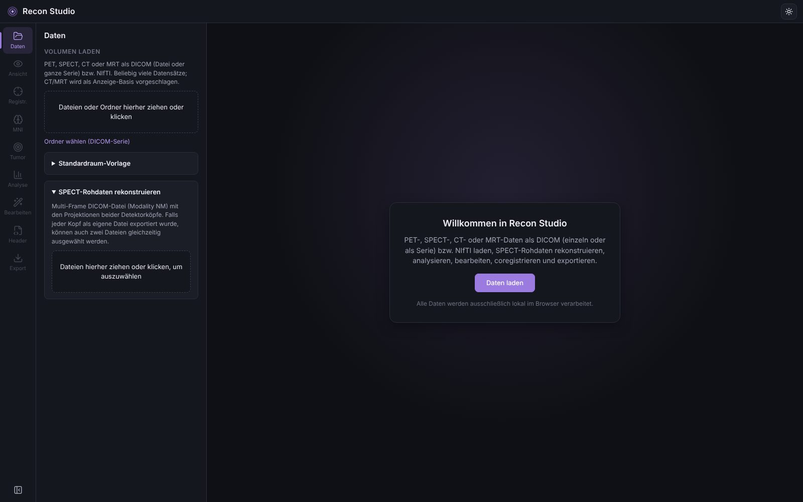
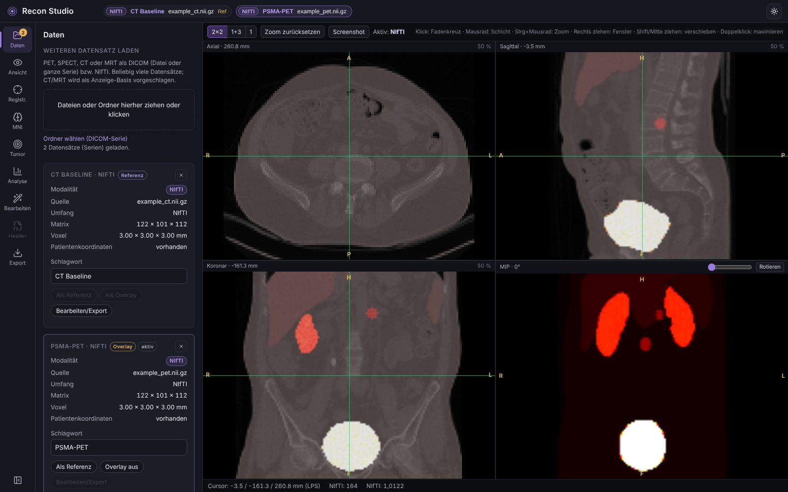
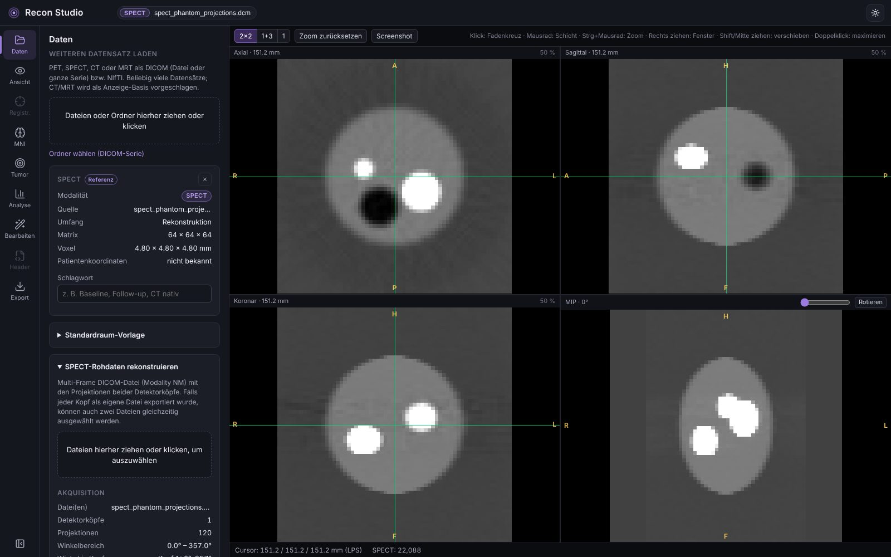
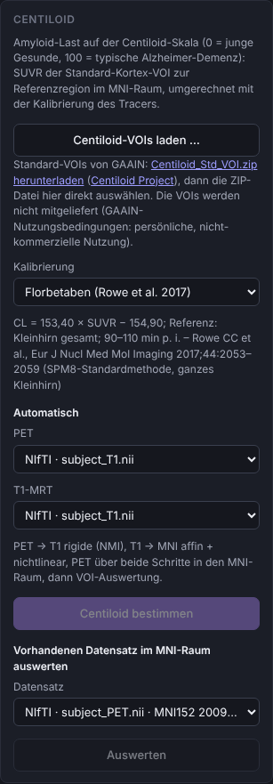
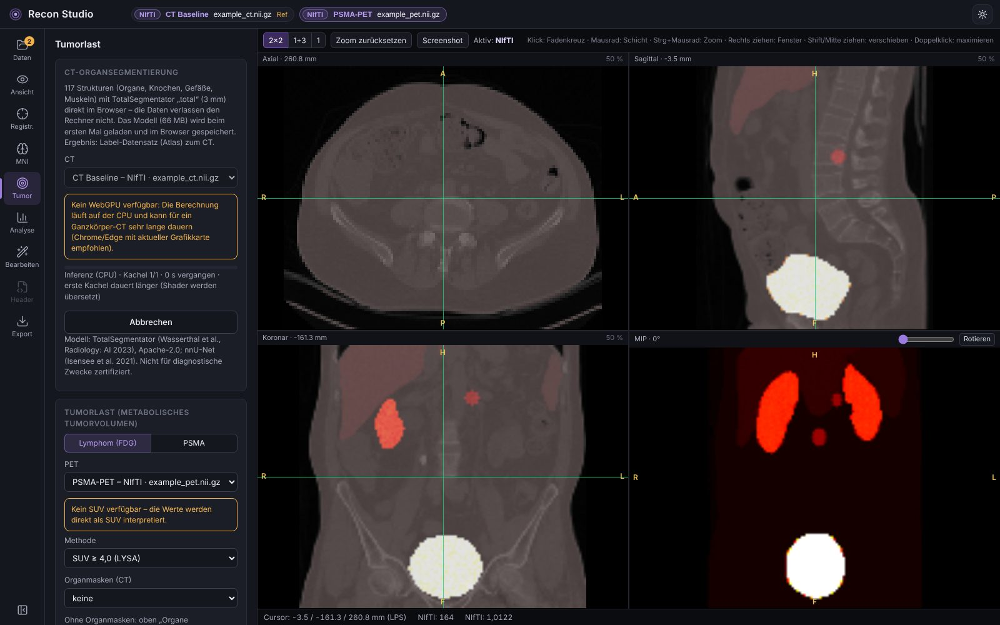

# Recon Studio – Handbuch

Schritt-für-Schritt-Anleitungen für alle Funktionen. Die Bilder zeigen synthetische Phantome bzw. öffentliche
Beispieldaten (keine Patientendaten).

**Inhalt**
1. [Oberfläche](#1-oberfläche)
2. [Daten laden](#2-daten-laden)
3. [SPECT-Rohdaten rekonstruieren](#3-spect-rohdaten-rekonstruieren)
4. [Ansicht, Ebenen und Fusion](#4-ansicht-ebenen-und-fusion)
5. [Registrierung (Coregistrierung)](#5-registrierung-coregistrierung)
6. [Standardraum (MNI), Atlas und SUVR](#6-standardraum-mni-atlas-und-suvr)
7. [Centiloid](#7-centiloid)
8. [CT-Organsegmentierung](#8-ct-organsegmentierung)
9. [Tumorlast (MTV)](#9-tumorlast-mtv)
10. [Analyse und Label-Analyse](#10-analyse-und-label-analyse)
11. [Bearbeiten](#11-bearbeiten)
12. [DICOM-Header](#12-dicom-header)
13. [Export](#13-export)
14. [Tipps und Fehlerbehebung](#14-tipps-und-fehlerbehebung)

---

## 1. Oberfläche

- **Linke Leiste**: die Arbeitsbereiche *Daten, Ansicht, Registrierung, MNI (Standardraum), Tumor, Analyse,
  Bearbeiten, Header, Export*. Ein Klick auf den aktiven Bereich klappt das Seitenpanel ein und aus (ebenso das
  Symbol unten links).
- **Kopfzeile**: ein Chip je geladenem Datensatz (Modalität, Schlagwort, Dateiname; *Ref* = Referenz/Basis).
  Ein Klick auf einen Chip macht den Datensatz **aktiv** – darauf beziehen sich Analyse, Bearbeiten, Header und Export.
  Rechts oben: helles/dunkles Design.
- **Viewer** (rechts): Layout 2×2, 1+3 oder Einzelbild, *Zoom zurücksetzen*, *Screenshot* (PNG).
  Statuszeile unten: Position in mm (Patientenkoordinaten LPS) und Werte aller Ebenen unter dem Fadenkreuz.

| Maus | Wirkung |
|---|---|
| Klick | Fadenkreuz setzen (alle Schnitte folgen) |
| Mausrad | Schicht wechseln |
| Strg/⌘ + Mausrad | Zoom |
| Rechts ziehen | Fenster (Kontrast/Helligkeit) der obersten Ebene |
| Shift oder mittlere Taste ziehen | Bild verschieben |
| Doppelklick | Ansicht maximieren / zurück |
| MIP: Regler oder *Rotieren* | Projektionswinkel |

Alles wird lokal im Browser berechnet; Daten werden nirgendwohin hochgeladen.

---

## 2. Daten laden

1. Bereich **Daten** öffnen.
2. Dateien oder ganze Ordner in das Feld *„Dateien oder Ordner hierher ziehen“* ziehen oder anklicken
   (*Ordner wählen* für eine DICOM-Serie).
   - DICOM: Einzeldatei, Serie oder Multi-Frame, auch Dateien ohne Endung (macOS-Exporte).
   - NIfTI: `.nii` oder `.nii.gz`.
   - Mehrere Serien in einem Upload werden **getrennt** geladen; nicht lesbare Dateien werden übersprungen und gemeldet.
3. Jeder Datensatz erscheint als Karte (Modalität, Matrix, Voxelgröße, Patientenkoordinaten).
   - **Schlagwort** eintragen (z. B. *Baseline*, *Follow-up*, *CT nativ*) – es erscheint überall in Auswahllisten und
     in der Kopfzeile.
   - *Als Referenz*: Datensatz definiert den Anzeigeraum (Basis). CT/MRT wird automatisch Basis.
   - *Als Overlay* / *Overlay aus*: über der Basis einblenden.
   - *Bearbeiten/Export*: Datensatz aktiv machen.
   - *×*: Datensatz entfernen.
4. **Labelbilder** (Atlas, CT-Organe, Läsionsmasken) werden beim Laden automatisch erkannt und als farbiges
   Label-Overlay mit Regionsnamen angelegt, wenn
   - die Datei aus Recon Studio exportiert wurde (Regionsnamen stehen im NIfTI-Header),
   - es eine TotalSegmentator-Ausgabe ist,
   - eine Tabelle mit gleichem Namen mitgeladen wird (z. B. `AAL3v1.nii` + `AAL3v1.nii.txt`), oder
   - der Dateiname auf ein Labelbild hindeutet (`…_seg`, `…_dseg`, `labels`, `aseg` …).
5. Unter **Standardraum-Vorlage** (aufklappen) lassen sich MNI- und SPM-Vorlagen oder eigene Vorlagen laden
   (siehe [Abschnitt 6](#6-standardraum-mni-atlas-und-suvr)).

---

## 3. SPECT-Rohdaten rekonstruieren

1. Bereich **Daten** → *SPECT-Rohdaten rekonstruieren* aufklappen.
2. Die Projektionsdatei (DICOM NM Multi-Frame) auswählen; wurde jeder Detektorkopf einzeln exportiert, beide Dateien
   gleichzeitig wählen.
3. Unter *Akquisition* prüfen: Köpfe, Projektionen, Winkelbereich, Matrix, Pixelabstand.
4. *Rekonstruktion* wählen:
   - **FBP** mit Filter (Ram-Lak scharf … Butterworth extra weich), oder
   - **OSEM** mit Subsets und Iterationen.
5. **Rekonstruieren** – Fortschrittsbalken, *Abbrechen* möglich. Das Ergebnis wird als SPECT-Datensatz angelegt.

---

## 4. Ansicht, Ebenen und Fusion

Bereich **Ansicht** – eine Karte je angezeigter Ebene (oben = oberste Ebene):

1. **Farbtabelle**: Graustufen, invertiert, Hot, Regenbogen, Atlas-Regionen.
2. **Fenster**: *Min*/*Max* eintragen, *Auto*, oder Presets (PET: SUV 0–5/10/15; CT: Weichteil, Lunge, Knochen,
   Gehirn, Leber). Alternativ im Bild mit der rechten Maustaste ziehen.
3. **Deckkraft** (Overlays) und **anzeigen** (Häkchen = Ebene ein/aus).
4. *↑ nach oben* / *↓ nach unten*: Reihenfolge; *als Basis*: Ebene wird Referenz; *aus Ansicht entfernen*.
5. **Fusion exportieren** (unten): die sichtbaren Ebenen so, wie sie angezeigt werden, als RGB-Datensatz –
   DICOM Secondary Capture (ZIP) oder NIfTI RGB, im Raster der Basis oder axial.

Label-Ebenen werden ohne Interpolation (nächster Nachbar) dargestellt.

---

## 5. Registrierung (Coregistrierung)

1. Bereich **Registr.** öffnen.
2. **1 · Zielraum (Basis)**: den Datensatz wählen, der den Raum definiert (meist CT oder MRT).
3. **2 · Auf die Basis registrieren**: die zu registrierenden Datensätze anhaken (*alle* / *keine*).
   Labelbilder, Vorlagen und abgeleitete Datensätze werden nicht automatisch angehakt.
   Je Zeile: Status (*Patientenkoordinaten*, *registriert*, *Ergebnis prüfen* …) und die gewählte Kostenfunktion.
4. **3 · Einstellungen** (optional): *Rigide (6)* oder *Affin (12)*, Kostenfunktion (automatisch: Kreuzkorrelation bei
   gleicher Modalität, sonst normalisierte Mutual Information), Auflösungsstufen, **Grobsuche** für Daten aus
   verschiedenen Untersuchungen (Schwerpunkt + Rotationsraster ±30°).
5. **Registrieren** – die Datensätze werden nacheinander berechnet (Fortschritt, *Abbrechen*).
6. Ergebnisse prüfen: Die Ansicht zeigt das Ergebnis bereits; Klick auf eine Zeile blendet den Datensatz als Overlay ein.
   Dann *Übernehmen* oder *Verwerfen* (einzeln) bzw. *Alle Ergebnisse übernehmen*.

7. **Manuelle Feinkorrektur** (Karte *Transformation*): Verschiebung/Drehung anpassen; Matrix als JSON speichern/laden.
8. Die Basis lässt sich später wechseln – bestehende Registrierungen bleiben erhalten.

---

## 6. Standardraum (MNI), Atlas und SUVR

### 6.1 Normalisierung

1. Subjekt-Datensätze laden (z. B. T1-MRT + PET) und das PET zuerst auf das T1 registrieren ([Abschnitt 5](#5-registrierung-coregistrierung)).
2. Bereich **MNI** öffnen, unter *Vorlage* den Standardraum wählen bzw. laden:
   - *MNI152 2009c (T1, 2 mm)* für T1-MRT,
   - *SPM12 PET* (Perfusion) für Hirn-PET ohne MRT, *SPM12 SPECT* für Perfusions-SPECT,
   - eigene Vorlagen im Bereich *Daten* → *Standardraum-Vorlage* (z. B. Amyloid-PET-Vorlage, auch 4D/adaptiv).
3. *Normalisierung schätzen*: **Subjekt** (meist das T1) und **Kontrast** wählen, dann
   *Affin (12)* oder *Affin + nichtlinear* (nur bei gleichem Kontrast von Subjekt und Vorlage),
   optional *Nur Gehirn der Vorlage verwenden*.
4. **Normalisierung starten**. Das Subjekt wird als neuer Datensatz im Standardraum angelegt; angezeigt wird die
   Ähnlichkeit vorher → nachher.

### 6.2 Weitere Datensätze übertragen

1. Karte **In Standardraum übertragen**: Datensätze anhaken, die mit dem Subjekt registriert sind (z. B. das PET).
2. Interpolation wählen, **Übertragen**. Jeder Datensatz wird über seine Registrierung und die Normalisierung des
   Subjekts in den Standardraum resampelt und als `… · MNI152 …` angelegt.
3. **SPM/CAT12**: ein in SPM/CAT12 berechnetes Verformungsfeld `y_*.nii` laden (statt selbst zu normalisieren) bzw.
   die App-Normalisierung als `y_*.nii` speichern.

### 6.3 Atlas und SUVR

1. Karte **Atlas & SUVR**: *CerebrA-Atlas laden* (102 Regionen, mitgeliefert) oder *Eigener Atlas …*
   (Labelbild + Tabelle, oder direkt die AAL3-ZIP-Datei von [gin.cnrs.fr](https://www.gin.cnrs.fr/en/tools/aal/)).
2. **Datensatz** im Standardraum wählen (z. B. das übertragene PET).
3. **Referenzregion**: Kleinhirnrinde, Kleinhirn gesamt, Pons/Hirnstamm, ganzes Gehirn oder *Eigene Auswahl …*.
4. **Regionen auswerten** – Tabelle mit Volumen, Mittelwert und SUVR; sortierbar nach Name, Index oder SUVR.
5. *Tabelle als CSV* exportieren oder *SUVR-Bild anlegen* (neuer Datensatz = Bild / Referenzmittel).

---

## 7. Centiloid

1. **Centiloid-VOIs laden …**: `Centiloid_Std_VOI.zip` von GAAIN herunterladen (Link in der Karte) und die ZIP-Datei
   direkt auswählen. Die VOIs werden wegen der GAAIN-Nutzungsbedingungen nicht mitgeliefert.
   *VOIs anzeigen* blendet sie als Labels ein.
2. **Kalibrierung** wählen:
   - *Florbetaben – Recon-Studio-Pipeline (GAAIN-kalibriert)* bzw. *PiB – Recon-Studio-Pipeline* für die automatische
     MRT-Pipeline der App (Standard),
   - *… Standard (Rowe 2017 / Klunk 2015)* für Daten, die extern mit der SPM8-Standardmethode normalisiert wurden,
   - oder *Eigene Gleichung …* (Steigung, Achsenabschnitt, Referenzregion).
3. **Automatisch**: PET und T1-MRT wählen → *Centiloid bestimmen*
   (PET → T1 rigide, T1 → MNI **affin**, VOI-Auswertung). An den GAAIN-Referenzdaten (35 Probanden) weicht das
   Ergebnis im Mittel um ca. 6 CL von der Standardmethode ab (Details: `src/centiloid/README-calibration.md`).
   Ohne MRT: *ohne MRT (PET-only)* – dazu vorher eine PET-Vorlage laden; diese Variante ist nicht validiert.
4. Oder **Vorhandenen Datensatz im MNI-Raum auswerten**: Datensatz wählen → *Auswerten*. Die GAAIN-kalibrierte
   Gleichung gilt nur für Datensätze aus der affinen Normalisierung der App.
5. Ergebnis: Centiloid-Wert, VOI-Tabelle (Volumen, Mittel, SUVR), Warnungen (z. B. Aufnahmezeitfenster, Tracer).

---

## 8. CT-Organsegmentierung

1. CT laden, Bereich **Tumor** öffnen.
2. Karte **CT-Organsegmentierung**: CT wählen → **Organe segmentieren**.
   - Beim ersten Mal wird das Modell (≈ 66 MB) geladen und im Browser gespeichert.
   - Mit WebGPU (Chrome/Edge) läuft es auf der Grafikkarte, sonst auf der CPU (Hinweis in Gelb).
   - Fortschritt: *Kachel i/N · vergangen · noch ca.*; die erste Kachel dauert länger. *Abbrechen* jederzeit.
3. Ergebnis: ein Label-Datensatz *CT-Organe* mit bis zu 117 Strukturen (Organe, Knochen, Gefäße, Muskeln) als Overlay.

4. **Regionsliste**: Suche, Häkchen blenden Regionen ein/aus (*alle* / *keine* / *nur Treffer*), Klick auf eine Region
   setzt das Fadenkreuz hinein; Volumen je Region in ml.
5. Die Organe stehen danach in Tumorlast und Label-Analyse zur Verfügung und lassen sich als NIfTI exportieren
   (Regionsnamen bleiben beim Wiederladen erhalten).

---

## 9. Tumorlast (MTV)

1. PET (und optional CT mit Organsegmentierung) laden; Bereich **Tumor**.
2. Indikation wählen: **Lymphom (FDG)** oder **PSMA** – setzt passende Methoden und Ausschlussorgane.
3. **PET** wählen. Bei DICOM mit Dosis/Gewicht wird in SUV gerechnet; sonst erscheint ein Hinweis
   (Werte werden direkt als SUV interpretiert).
4. **Methode**:
   - feste SUV-Schwelle (Lymphom 4,0 oder 2,5; PSMA 3),
   - **41 % SUVmax** je Läsion,
   - **leberbasiert** (PERCIST: 1,5 × Lebermittel + 2 × SD) – Leber-VOI per *Leber-VOI automatisch* (mit CT-Organen)
     oder aus einer gezeichneten VOI.
5. **Organmasken (CT)** wählen: Läsionen überwiegend in Organen mit physiologischer Anreicherung (FDG: Gehirn, Herz,
   Nieren, Blase; PSMA: Nieren, Blase, Leber, Milz, Darm, Magen) werden automatisch ausgeschlossen.
6. **Mindestvolumen** je Läsion, dann **Läsionen segmentieren**.

7. **Ergebnis**: Läsionszahl, TMTV bzw. PSMA-TV, TLG bzw. TL-PSMA, SUVmax, SUVmean, bei PSMA Knochen/Weichteil,
   bei Lymphom Dmax. Tabelle je Läsion (Volumen, SUVmax, SUVpeak, Organ); durchgestrichen = ausgeschlossen.
8. **Korrigieren**: *Klick: ein/aus* (Klick auf eine Läsion im Bild schließt sie ein oder aus), *Pinsel +* / *Pinsel −*
   ergänzt bzw. entfernt Voxel; Häkchen in der Tabelle.
9. Export: **CSV** (Kennzahlen und Läsionstabelle) und **Maske (NIfTI)** (Labelbild der eingeschlossenen Läsionen).

---

## 10. Analyse und Label-Analyse

Bereich **Analyse**.

### 10.1 Alle Datensätze und Detailanalyse

1. **Alle Datensätze**: Matrix, Voxelgröße, Min, Mittel, Median, Max, SD und Varianz in der jeweiligen Einheit.
   Klick auf eine Zeile wählt den Datensatz für die Detailanalyse.
2. **VOI auf allen Datensätzen** (wenn eine VOI gezeichnet ist): die VOI wird über die Registrierung auf jeden
   Datensatz übertragen (Volumen, Mittel, Peak, Max, SD, Varianz).
3. **Detailanalyse**: Einheit (Originalwerte oder **SUV** aus dem DICOM-Header), Statistik und **Histogramm**
   (Bins, log. Skala, *ohne unterste Bin*).

### 10.2 Label-Analyse

1. **Labels** wählen (CT-Organe, Atlas, Läsionsmaske, geladenes Labelbild). Hirnatlanten direkt laden:
   *Hirnatlas CerebrA (MNI)* oder *AAL3 / eigene Labels …* (AAL3-ZIP oder NIfTI + Tabelle).
   Hat ein Labelbild keine Regionsnamen, erscheint ein Hinweis mit *TotalSegmentator-Organnamen zuweisen* bzw.
   *Labeltabelle laden …*.
2. **Datensatz** wählen (z. B. das PET). Labels auf einem anderen Raster werden über die Registrierung übertragen.
3. **Regionen auswerten**: Tabelle je Region mit Volumen, Mittel, SD, Varianz, Median, Min, Max; Suche und Sortierung
   (Nr., Name, Mittel, Volumen).
4. **Histogramm**: ohne Auswahl über alle Regionen; Klick auf Zeilen wählt eine oder mehrere Regionen
   (*Auswahl aufheben*). Darüber Voxelzahl, Mittel, SD, Varianz der Auswahl.
5. **Tabelle als CSV**: Tabelle oben, darunter Angaben zu Datensatz, Labels, Einheit
   (Semikolon, Dezimalkomma – für Excel).
6. **Histogramme je Label exportieren**: Bins, Bereich (*von/bis*, leer = automatisch), *Anzahl Voxel* oder *Anteil %*,
   dann *Histogramme als CSV* (Zeilen = Labels, Spalten = Bins) oder *Alle Datensätze (ZIP, je eine CSV)*.
   Für Bin-genaue Vergleiche mehrerer Datensätze einen festen Bereich eintragen.

Hinweis: Die macOS-Vorschau (Leertaste) zeigt solche CSV-Dateien unvollständig an – in Excel öffnen.

---

## 11. Bearbeiten

Bereich **Bearbeiten** (wirkt auf den aktiven Datensatz):

1. **Werte**: *Werte ≥ Grenzwert ersetzen*, *Werte ≤ Grenzwert ersetzen*, *Werte in Bereich [a, b] ersetzen*,
   *Auf Bereich [min, max] begrenzen*, *Linear umrechnen: a · x + b*.
   Eingabe in Originaleinheit oder SUV; angezeigt wird, wie viele Voxel betroffen sind; *Anwenden*.
2. **VOI**: *Kugel* oder *Quader* am Fadenkreuz (Radius/Größe in mm) oder *Pinsel* (malen/radieren, schichtweise).
   Statistik (Volumen, Mittel, Max, Min, Peak 1 ml); *Bereich innen/außen*, *Aktion* (Wert setzen, skalieren) →
   *Auf VOI anwenden*; *Auf VOI zuschneiden*; *VOI löschen*.
3. **Filter**: Gauß-Glättung (FWHM in mm).
4. **Geometrie**: Spiegeln (R↔L, A↔P, H↔F), Drehen (↻ 90° / ↺ 90°), Resampling auf neue Voxelgröße.
5. **Verlauf**: *Rückgängig* nimmt den letzten Schritt zurück, *Original* verwirft alle Bearbeitungen
   (neu berechnet aus dem Original, keine Kopien im Speicher).

---

## 12. DICOM-Header

1. DICOM-Datensatz aktiv machen, Bereich **Header**.
2. **Suche** nach Tag (`0010,0010`), Name oder Wert; Sequenzen aufklappen; bei Serien Datei auswählen.
3. Wert anklicken → ändern → *Übernehmen* (VR wird geprüft); *Löschen*; *Abbrechen*.
4. **Tag hinzufügen / setzen**: Tag, VR, Wert → *Hinzufügen* (für alle Dateien oder eine einzelne).
5. Änderungen werden beim **DICOM-Export** angewendet. Gesperrt sind Tags, die der Export selbst setzt
   (Pixeldaten, Geometrie, Instanz-UIDs, Meta-Header).

---

## 13. Export

Bereich **Export** (aktiver Datensatz):

1. **Datensatz (eigener Raum)**:
   - *Als DICOM speichern* – bei DICOM-Quellen mit Original-Header (alle Elemente byte-genau, neue UIDs, ImageType
     DERIVED); nach Crop/Drehung/Resampling als neue Serie aus Vorlage; Serien als ZIP.
   - *Als NIfTI speichern* – mit Orientierung (sform/qform); Labelbilder mit Regionsnamen im Header.
   - **Anonymisierung** (optional): Patienten-, Geräte- und Freitextangaben entfernen, UIDs ersetzen; Zeiten und
     optional Gewicht/Größe bleiben für die SUV-Berechnung erhalten.
2. **In Zielraum exportieren / resampeln**:
   1. Datensätze anhaken.
   2. **Zielraum** (Raster eines anderen Datensatzes) wählen; *wie Ziel*, eigene *Matrix* oder *Voxelgröße*.
   3. Interpolation (nächster Nachbar, trilinear, B-Spline; Labelbilder immer nächster Nachbar).
   4. Format *DICOM* (Header der Quelle, Geometrie und Frame of Reference des Ziels) oder *NIfTI* → *Exportieren*.
3. Fusionen: Bereich **Ansicht** → *Fusion exportieren* ([Abschnitt 4](#4-ansicht-ebenen-und-fusion)).
   Analyse-Tabellen: CSV-Knöpfe in den jeweiligen Karten.

---

## 14. Tipps und Fehlerbehebung

- **Erster Aufruf**: Die Seite lädt sich einmal selbst neu (ein Service Worker aktiviert die „Cross-Origin-Isolation“);
  danach rechnet die CT-Segmentierung auf der CPU mit mehreren Threads (ca. 2–3× schneller). In privaten Fenstern
  ohne Service Worker läuft sie mit einem Thread.
- **Browser**: Chrome oder Edge mit aktueller Grafikkarte für die CT-Segmentierung (WebGPU). Safari/Firefox rechnen die
  Segmentierung ggf. auf der CPU (langsamer). Bei sehr großen Datensätzen kann der Browser-Speicher knapp werden –
  andere Tabs schließen.
- **SUV** erfordert DICOM-PET mit Dosis, Injektionszeit und Gewicht; NIfTI enthält diese Angaben nicht
  (Werte dann in Bq/ml bzw. Originaleinheiten).
- **Labels werden nicht erkannt** oder heißen *Region n*: in der Label-Analyse Namen zuweisen oder Tabelle laden;
  Dateien aus aktuellen Versionen von Recon Studio speichern die Namen selbst.
- **Registrierung weit daneben** (Daten aus verschiedenen Untersuchungen): *Grobsuche* aktivieren, ggf. *Affin* wählen.
- **Hirnatlas liefert keine Regionen**: Der Datensatz muss im MNI-Raum liegen (Abschnitt 6).
- **Lange Dateinamen** im Panel: Schlagworte vergeben – sie ersetzen die Namen in Auswahllisten weitgehend.
