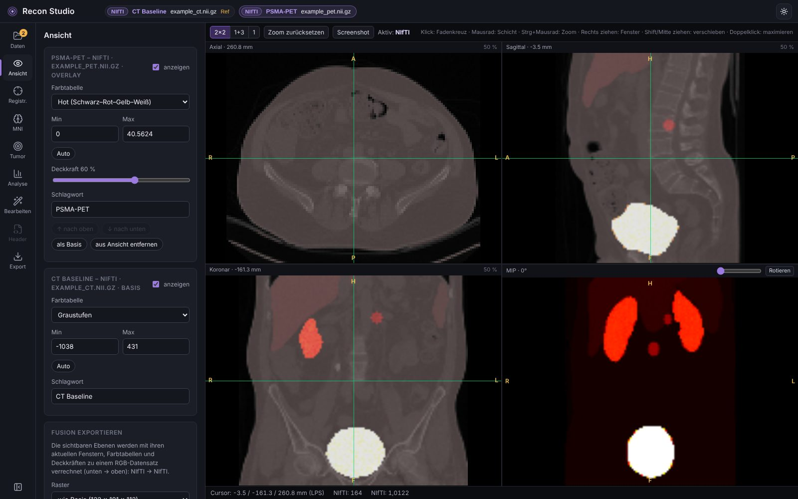
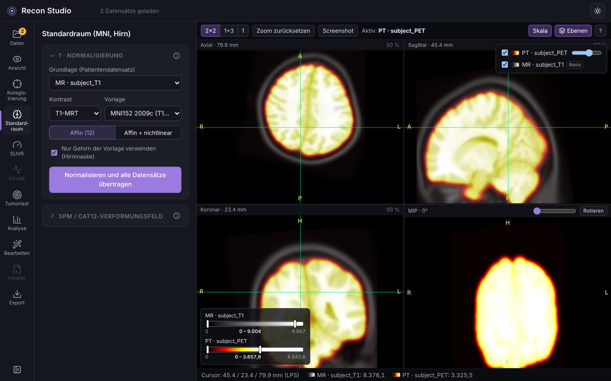
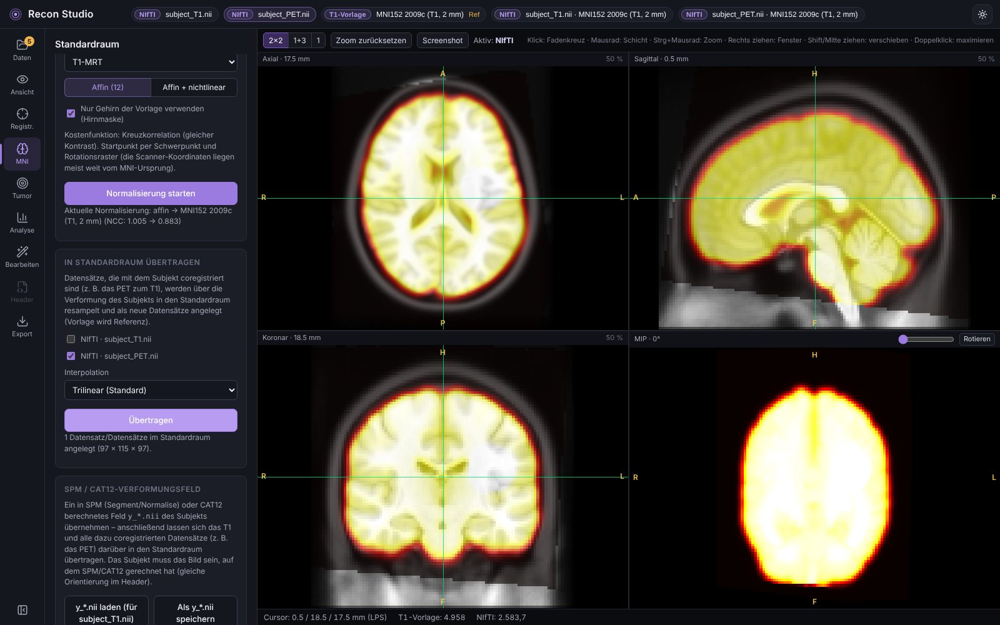
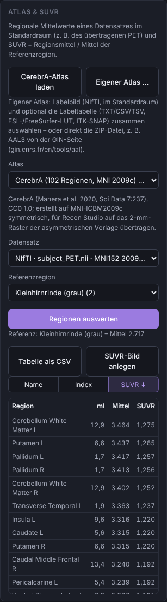
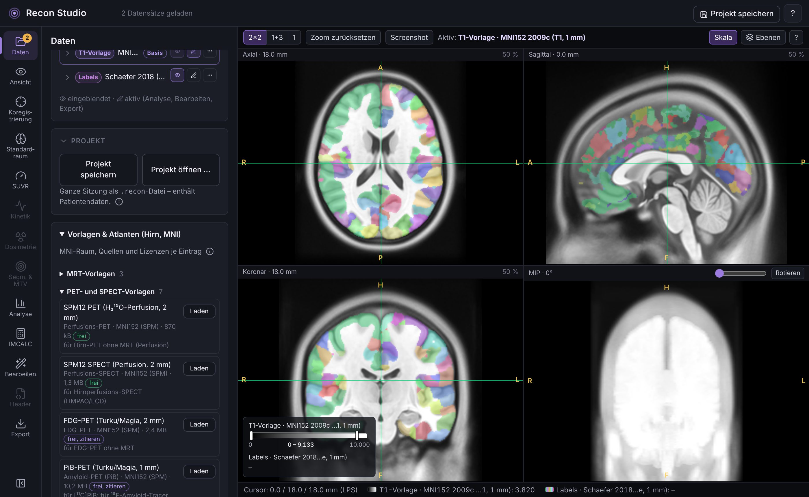
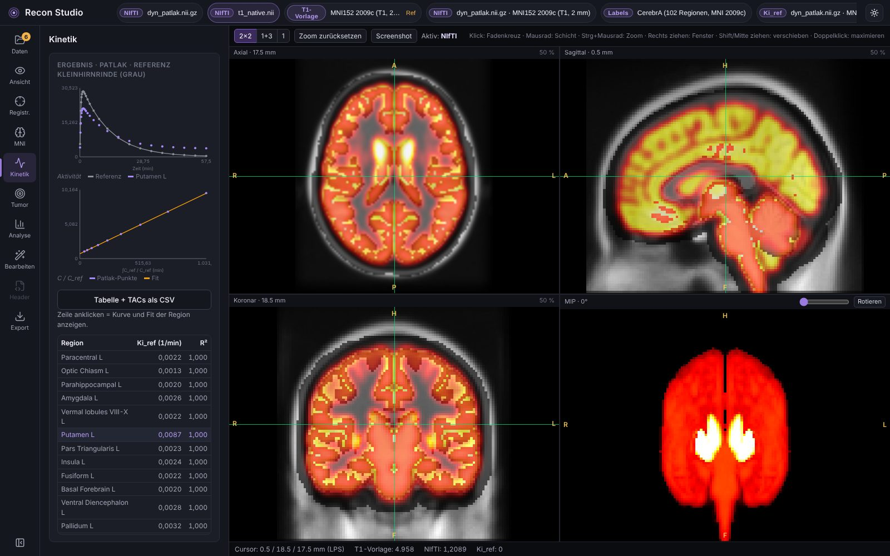
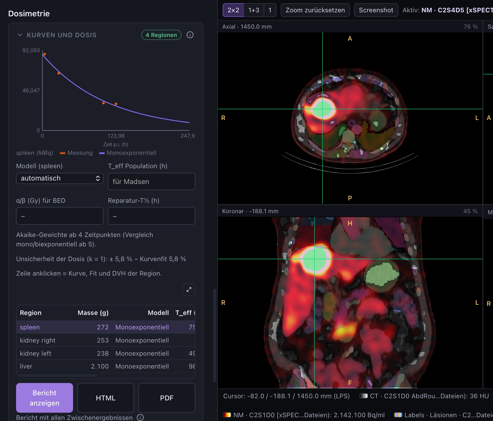
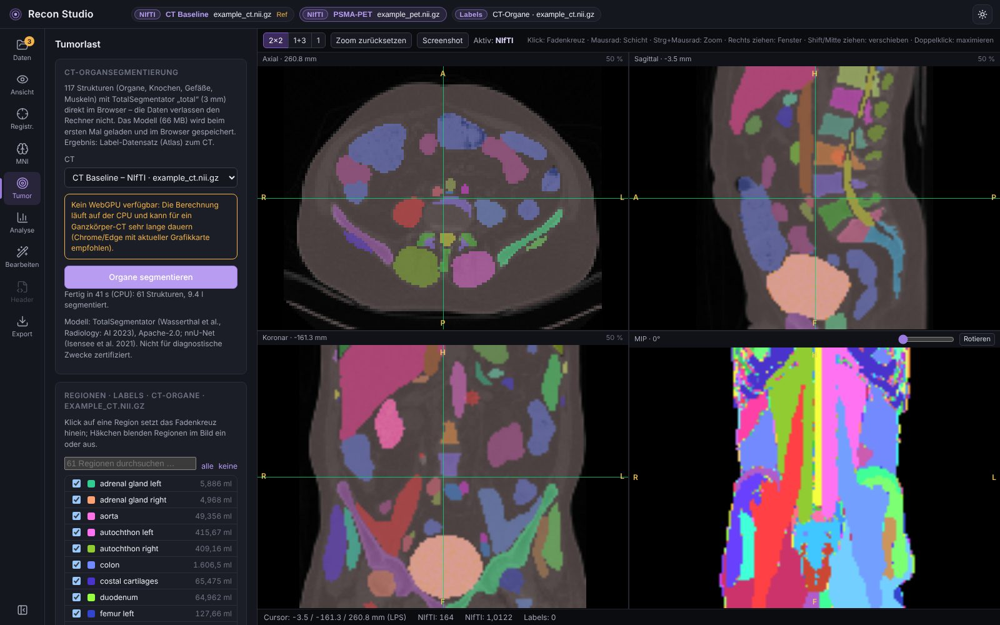
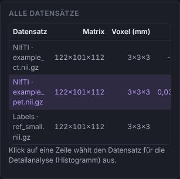
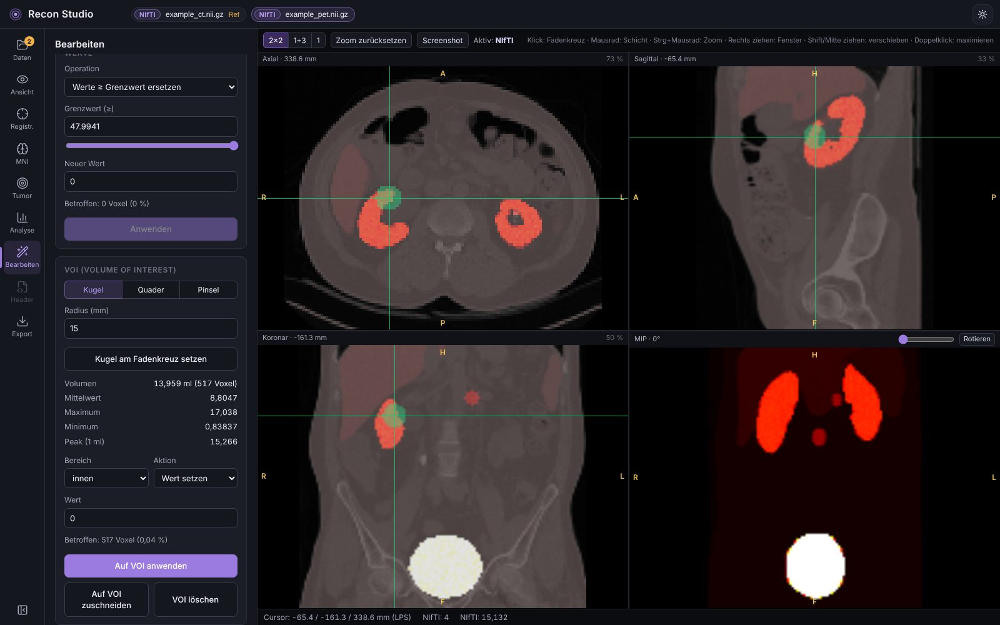

# Recon Studio – Handbuch

Schritt-für-Schritt-Anleitungen für alle Funktionen. Die Bilder zeigen synthetische Phantome bzw. öffentliche
Beispieldaten; die Abbildung in Kapitel 9 stammt aus einer realen xSPECT/CT-Dosimetrie (ohne Patientenkennung).

**Inhalt**
1. [Oberfläche](#1-oberfläche)
2. [Daten laden](#2-daten-laden)
3. [SPECT-Rohdaten rekonstruieren](#3-spect-rohdaten-rekonstruieren)
4. [Ansicht, Ebenen und Fusion](#4-ansicht-ebenen-und-fusion)
5. [Koregistrierung (Patientenraum)](#5-koregistrierung-patientenraum)
6. [Standardraum (MNI), Atlas und SUVR](#6-standardraum-mni-atlas-und-suvr)
7. [Centiloid](#7-centiloid)
8. [Kinetik (dynamisches PET)](#8-kinetik-dynamisches-pet)
9. [Dosimetrie (SPECT/CT)](#9-dosimetrie-spectct)
10. [CT-Organsegmentierung](#10-ct-organsegmentierung)
11. [Segmentierung & Läsionen](#11-segmentierung--läsionen)
12. [VOI Analyse und Label-Analyse](#12-voi-analyse-und-label-analyse)
    – [IMCALC: voxelweise Rechnung](#imcalc-voxelweise-rechnung)
13. [Bearbeiten](#13-bearbeiten)
14. [DICOM-Header](#14-dicom-header)
15. [Export](#15-export)
16. [Tipps und Fehlerbehebung](#16-tipps-und-fehlerbehebung)
17. [Lizenz](#17-lizenz)
18. [Impressum und Datenschutz](#18-impressum-und-datenschutz)

---

## 1. Oberfläche


- **Linke Leiste**: die Arbeitsbereiche *Daten, Ansicht, Koregistrierung, Standardraum, SUVR & Centiloid, Kinetik,
  Dosimetrie, Segmentierung & Läsionen, VOI Analyse, IMCALC, Bearbeiten, Header, Export*. Ein Klick auf den aktiven Bereich klappt das Seitenpanel ein und aus
  (ebenso das Symbol unten links). Ausgegraute Bereiche nennen im Tooltip den Grund (z. B. „Header nur für DICOM“).
  Beim Wechsel des Bereichs bleibt alles erhalten – laufende Berechnungen, Ergebnisse, aufgeklappte Karten.
- **Seitenpanel**: Die Breite lässt sich am rechten Rand mit der Maus ziehen (Doppelklick = Standardbreite; mit
  Tastaturfokus ←/→). Die Breite bleibt im Browser gespeichert – praktisch für breite Ergebnistabellen.
  Längere Erläuterungen (Methodik, Literatur, Formate) stecken hinter dem **ⓘ** neben der Kartenüberschrift.
  **Karten** lassen sich per Klick auf die Überschrift auf- und zuklappen; rechts steht ihr Status (z. B.
  *✓ korrigiert*, *läuft*, *25 Frames*). Erledigte Schritte (z. B. Bewegungskorrektur, Normalisierung) klappen von
  selbst zu.
- **Kopfzeile**: die **Aktivitätsanzeige** – laufende Berechnungen (Laden, Koregistrierung, Normalisierung,
  CT-Segmentierung, Kinetik, Centiloid, Export …) mit Fortschritt, kurz *fertig* nach Abschluss, Fehler mit ⚠.
  Ein Klick öffnet den zuständigen Bereich (dort lässt sich abbrechen). Ohne laufende Aufgabe steht dort die Zahl der
  geladenen Datensätze. Rechts oben: **Projekt speichern** (ganze Sitzung als `.recon`-Datei, siehe [Projekt](#projekt-speichern-und-öffnen)) und **?** (dieses Handbuch groß über dem Viewer; Links im Inhaltsverzeichnis springen zum Abschnitt, Esc schließt).
- **Viewer** (rechts): Layout 2×2, 1+3 oder Einzelbild, *Zoom zurücksetzen*, *Screenshot* (PNG).
  Rechts in der Viewer-Leiste: **SUV | Counts/Bq/ml**, **Skala** (Farbskala ein/aus), **Ebenen** (siehe
  [Abschnitt 4](#4-ansicht-ebenen-und-fusion)) und **?** (Maus- und Tastenbedienung).
  - **SUV | Counts/Bq/ml** (nur sichtbar, wenn ein Datensatz SUV-Angaben im Header hat) schaltet für die ganze App um,
    ob PET/SPECT als SUV oder mit den Originalwerten aus dem Header (Counts, Bq/ml) angezeigt und ausgewertet werden –
    Viewer, Farbskala, Analyse, Bearbeiten. Die Wahl bleibt im Browser gespeichert; ohne Wahl wird beim Laden eines PET
    mit SUV-Angaben SUV eingestellt. Segmentierung & Läsionen rechnet unabhängig davon immer in SUV, die Dosimetrie immer mit
    Counts bzw. Bq/ml.
  - SUV (Körpergewicht) nach dem herstellerneutralen QIBA-Verfahren: Einheit BQML, Zerfallskorrektur START oder ADMIN.
    Bei START wird die Dosis auf die Serienzeit zerfallskorrigiert. Liegt diese nach der frühesten Aufnahmezeit der
    Bilder (nachträglich neu erzeugte Serie), gilt stattdessen die GE-Scanzeit (0009,100D), falls vorhanden, sonst die
    früheste Aufnahmezeit.
  Die **Farbskala** unten links zeigt für jede sichtbare Ebene Farbtabelle und Fenster (Min/Max in SUV, HU, BP_ND …) und
  bei Labelbildern die Region unter dem Cursor; sie erscheint auch im Screenshot. Sie ist zugleich Bedienelement:
  - Der Balken umfasst den ganzen Wertebereich des Datensatzes (Zahlen links/rechts darunter); die beiden **weißen
    Griffe** markieren Fenster-Minimum und -Maximum (Mitte: aktuelles Fenster). Unterhalb des Fensters gilt die erste,
    oberhalb die letzte Farbe der Farbtabelle.
  - **Griff ziehen**: Fenster-Minimum bzw. -Maximum verschieben,
  - **Bereich zwischen den Griffen ziehen**: ganzes Fenster verschieben,
  - **Rechtsklick** auf den Balken: Farbtabelle wählen – Graustufen, Invertiert, Hot, DaT (Schwarz–Grün–Gelb–Hellrot, typische
    DaTSCAN-Darstellung), Blau (Schwarz–Blau–Hellblau–Weiß), Blau–Weiß–Rot (Z-Werte, Differenzen), Regenbogen.
  Statuszeile unten: Position in mm (Patientenkoordinaten LPS) und die Werte aller sichtbaren Ebenen unter dem
  Fadenkreuz – je Ebene mit Farbbalken ihrer Farbtabelle, Modalität und Schlagwort bzw. Dateiname; bei Labelbildern
  der Name der Region.

| Maus | Wirkung |
|---|---|
| Klick | Fadenkreuz setzen (alle Schnitte folgen) |
| Mausrad | Schicht wechseln |
| Strg/⌘ + Mausrad | Zoom |
| Rechts ziehen | Fenster (Kontrast/Helligkeit) der obersten Ebene |
| Shift oder mittlere Taste ziehen | Bild verschieben |
| Doppelklick | Ansicht maximieren / zurück |
| MIP: Regler oder *Rotieren* | Projektionswinkel |

Alles wird lokal im Browser berechnet; Daten werden nirgendwohin hochgeladen.

---

## 2. Daten laden


1. Bereich **Daten** öffnen.
2. Dateien oder ganze Ordner in das Feld *„Dateien oder Ordner hierher ziehen“* ziehen oder anklicken
   (*Ordner wählen* für eine DICOM-Serie).
   - DICOM: Einzeldatei, Serie oder Multi-Frame, auch Dateien ohne Endung (macOS-Exporte).
   - NIfTI: `.nii` oder `.nii.gz`.
   - Mehrere Serien in einem Upload werden **getrennt** geladen; nicht lesbare Dateien werden übersprungen und gemeldet.
3. **Was eingeblendet wird**: Der erste Datensatz ist die Basis der Ansicht. **Ein CT wird beim Laden immer Basis**
   (sofern die Basis noch kein CT ist), ein MRT derselben Körperregion ersetzt eine PET/SPECT-Basis; ein PET/SPECT derselben Region (oder mit gleichem Frame of Reference) wird darüber eingeblendet, ebenso
   Labelbilder auf dem Raster eines angezeigten Datensatzes. Alles andere – z. B. ein zweites PET, ein T1 neben einem
   Ganzkörper-CT, Daten einer anderen Region – wird geladen, aber **nicht eingeblendet**; ein Hinweis unten rechts nennt
   diese Datensätze. Einblenden über **Ebenen** im Viewer oder das Auge in der Datensatzliste.
   **Patient-ID** (Feld oberhalb der Liste, optional): wird allen exportierten NIfTI- und CSV-Dateien vorangestellt
   (`P0815_…nii`, `P0815_…csv`, auch in ZIP-Archiven solcher Dateien) sowie der Projektdatei (`P0815_Recon-Projekt_….recon`); DICOM-Exporte bleiben unverändert. Die ID wird im
   Projekt mitgespeichert.
4. **Datensatzliste**: eine Zeile je Datensatz mit Modalität (farbig), Schlagwort, Name und *Basis*-Markierung.
   - Klick auf die Zeile: Details (Bezeichnung, Modalität, Aufnahme, Matrix, Voxelgröße, Koordinaten, Dynamik) und Schlagwort.
   - **Aufnahmedatum und -uhrzeit** stehen klein unter dem Namen und in den Details – aus dem DICOM-Header
     (Aufnahmezeitpunkt, bei Serien der früheste; fehlt er, Serien-, Erstellungs- oder Studiendatum mit Hinweis).
     NIfTI-Dateien enthalten kein Datum.
   - 👁 ein-/ausblenden · ✎ **aktiv** setzen – darauf beziehen sich Analyse, Bearbeiten, Header und Export.
   - ⋯: *Als Basis der Ansicht*, *Datensatz entfernen*.
   - **Bezeichnung** ändern (Details): Der Name wird Teil der Exportdateinamen; leer = Originalname (bleibt darunter
     sichtbar).
   - **Modalität** ändern (Details, alle Datensätze außer Labelbildern): PET, SPECT, CT, MRT oder Sonstige;
     *automatisch* nimmt den Wert aus dem DICOM-Header bzw. die Erkennung. NIfTI-Dateien enthalten keine Modalität –
     Recon Studio erkennt sie aus einer BIDS-JSON-Datei, dem Dateinamen (`_pet`, `_T1w`, `ct`, `spect` …),
     dynamischen Daten (→ PET) oder dem Wertebereich (Luft und Knochen → CT). Davon hängen u. a. CT-Fensterpresets, SUV
     und die Vorauswahl in Registrierung, Centiloid und Segmentierung & Läsionen ab. Beim DICOM-Export wird die gewählte
     Modalität in den Header (0008,0060) geschrieben.
   - **Als Basis der Ansicht** (Details oder ⋯): jeder Datensatz, gleich welcher Modalität, kann Basis sein.
   - **Schlagwort** eintragen (z. B. *Baseline*, *Follow-up*, *CT nativ*) – es erscheint überall in Auswahllisten,
     Statuszeile und Ebenen.
5. **Labelbilder** (Atlas, CT-Organe, Läsionsmasken) werden beim Laden automatisch erkannt und als farbiges
   Label-Overlay mit Regionsnamen angelegt, wenn
   - die Datei aus Recon Studio exportiert wurde (Regionsnamen stehen im NIfTI-Header),
   - es eine TotalSegmentator-Ausgabe ist,
   - eine Tabelle mit gleichem Namen mitgeladen wird (z. B. `AAL3v1.nii` + `AAL3v1.nii.txt`), oder
   - der Dateiname auf ein Labelbild hindeutet (`…_seg`, `…_dseg`, `labels`, `aseg` …).
6. Unter **Vorlagen & Atlanten (Hirn, MNI)** (aufklappen) lassen sich mitgelieferte Vorlagen, Gewebekarten und
   Hirnatlanten laden, selbst heruntergeladene Atlanten einlesen oder eigene Vorlagen laden
   (siehe [Abschnitt 6.4](#64-vorlagen-und-atlanten-katalog)).

### Projekt speichern und öffnen

Karte **Projekt** im Bereich *Daten*:

- **Projekt speichern** legt die ganze Sitzung als eine Datei `Recon-Projekt_….recon` ab. Sie enthält:
  - alle Datensätze (DICOM-Originaldateien mit Header, NIfTI-Volumen, Bearbeitungen, dynamische Frames,
    Labelbilder mit Regionsnamen, Vorlagen);
  - Registrierungen, Schlagworte, Anzeige (Basis, Ebenen, Fenster, Farbtabellen) und die Normalisierung;
  - Centiloid- und MTV-Ergebnisse.
- Kinetik-Tabellen und Label-Analysen werden nach dem Öffnen per Klick neu berechnet.
- **Projekt öffnen …** (auch auf der Startseite oder per Ziehen der `.recon`-Datei ins Ladefeld) ersetzt die
  aktuelle Sitzung nach Rückfrage.
- Die Datei enthält die Patientendaten der geladenen Bilder – vertraulich behandeln.

---

## 3. SPECT-Rohdaten rekonstruieren


1. Bereich **Daten** → *SPECT-Rohdaten rekonstruieren* aufklappen.
2. Die Projektionsdatei (DICOM NM Multi-Frame) auswählen; wurde jeder Detektorkopf einzeln exportiert, beide Dateien
   gleichzeitig wählen.
3. Unter *Akquisition* prüfen: Köpfe, Projektionen, Winkelbereich, Matrix, Pixelabstand.
4. *Rekonstruktion* wählen:
   - **FBP** mit Filter (Ram-Lak scharf … Butterworth extra weich), oder
   - **OSEM** mit Subsets und Iterationen.
5. **Rekonstruieren** – Fortschrittsbalken, *Abbrechen* möglich. Das Ergebnis wird als SPECT-Datensatz angelegt.


---

## 4. Ansicht, Ebenen und Fusion



Bereich **Ansicht** – eine Karte je angezeigter Ebene (oben = oberste Ebene):

1. **Farbtabelle**: Graustufen, invertiert, Hot, DaT, Blau, Blau–Weiß–Rot, Regenbogen, Atlas-Regionen (auch per Rechtsklick auf
   die Farbskala im Viewer).
2. **Fenster**: *Min*/*Max* eintragen, *Auto*, oder Presets (PET: SUV 0–5/10/15; CT: Weichteil, Lunge, Knochen,
   Gehirn, Leber). Alternativ im Bild mit der rechten Maustaste ziehen oder die Griffe der Farbskala im Viewer
   verschieben ([Abschnitt 1](#1-oberfläche)).
3. **Deckkraft** (Overlays) und **anzeigen** (Häkchen = Ebene ein/aus).
4. *↑ nach oben* / *↓ nach unten*: Reihenfolge; *als Basis*: Ebene wird Referenz; *aus Ansicht entfernen*.
5. **Fusion exportieren** (Karte unten, aufklappen): die sichtbaren Ebenen so, wie sie angezeigt werden, als RGB-Datensatz –
   DICOM Secondary Capture (ZIP) oder NIfTI RGB, im Raster der Basis oder axial.

Label-Ebenen werden ohne Interpolation (nächster Nachbar) dargestellt.

**Ebenen-Schnellwahl im Viewer:** Der Knopf **Ebenen** oben rechts im Viewer blendet eine kleine Liste über den
Schnittbildern ein – in jedem Bereich, z. B. während Kinetik, Segmentierung & Läsionen oder Analyse. Häkchen = Ebene sichtbar,
Regler = Deckkraft. Datensätze unter *nicht eingeblendet* werden per Häkchen als Overlay hinzugefügt. Der **Papierkorb**
am Zeilenende entfernt einen Datensatz: erster Klick → *Löschen?*, zweiter Klick innerhalb von 3 s bestätigt. Der Knopf
schaltet die Liste wieder aus; der Zustand bleibt gespeichert. Mit Datumsangaben im Header ist die Liste **nach
Aufnahmezeitpunkt sortiert** und nach Aufnahme gruppiert (Überschrift mit Datum und Uhrzeit; Organkarte, Läsionsbild und
Dosiskarte stehen bei ihrer Aufnahme, Datensätze ohne Datum am Ende). Die Zeichenreihenfolge der Overlays ändert sich
dadurch nicht.

**MIP** (unten in der Ebenen-Liste): Datensatz und Farbtabelle der MIP-Ansicht lassen sich getrennt wählen – auch ein
Datensatz, der in den Schnittbildern ausgeblendet ist. *Automatisch* nimmt PET, sonst SPECT, sonst CT (eingeblendete
zuerst), sonst die Basis; *LUT wie Datensatz* übernimmt dessen Farbtabelle. Das **Fenster der MIP** ist unabhängig:
Regler *Min*/*Max* unter der Farbtabelle (oder Rechts-Ziehen in der MIP) ändern nur die MIP, *wie Datensatz* kehrt zum
Fenster des Datensatzes zurück. Die Wahl wird in der Projektdatei gespeichert.

**Klick in die MIP** setzt das Fadenkreuz auf den hellsten Punkt entlang des angeklickten Sehstrahls – die Schnittbilder
springen auf diese axiale Schicht und Position (z. B. direkt in eine Läsion). Ohne Aktivität entlang des Strahls bleibt
die axiale Schicht des Klicks, in der Mitte des Strahls. Die Rotation stoppt dabei.


---

## 5. Koregistrierung (Patientenraum)

Ausrichtung der Datensätze **eines Patienten** zueinander – für jede Körperregion (Ganzkörper wie Hirn): PET/SPECT auf
das CT oder MRT, Folgeuntersuchungen auf die Basis. Dynamische Serien werden über ihr Mittelbild registriert; alle
Frames folgen. Die Normalisierung in einen Standardraum ist davon getrennt ([Abschnitt 6](#6-standardraum-mni-atlas-und-suvr))
und nimmt alle hier registrierten Datensätze mit.


Der Bereich **Koregistrierung** hat drei Karten; erledigte Karten klappen ein und zeigen ihren Stand im Kopf.

1. **1 · Basis**: den Datensatz wählen, der den Raum definiert (meist CT oder MRT).
2. **2 · Datensätze**: die Datensätze, die auf die Basis registriert werden.
   - Datensätze **derselben Aufnahme** stehen eingerückt unter ihrem Datensatz („folgt …“) und bewegen sich automatisch
     mit: gleiche FrameOfReference (z. B. PET zum CT) oder eine Organkarte, die zum CT gehört (auch eine wieder geladene
     „Labels_CT-Organe_…“-Datei).
   - Status je Zeile: ○ Patientenkoordinaten, ✎ manuell/Landmarken, ◐ Ergebnis prüfen, ✓ registriert, ⚠ Koordinaten
     (Basis und Datensatz überlappen kaum).
   - Angehakte Datensätze mit *… automatisch registrieren* nacheinander berechnen, dann *Übernehmen*/*Verwerfen*
     (einzeln) oder *Alle Ergebnisse übernehmen*.
   - Klick auf eine Zeile wählt den Datensatz für Karte 3.
3. **3 · Ausrichten**: ein Datensatz (Auswahl oben; Datensätze einer Aufnahme lassen sich auch *einzeln* ausrichten)
   mit drei Reitern in der empfohlenen Reihenfolge:
   - **① Landmarken (optional)**: grob über zwei anatomische Punkte ausrichten, siehe unten. Offen, wenn die
     Koordinatensysteme nicht zusammenpassen.
   - **② Automatisch**: *Rigide (6)* oder *Affin (12)*, Kostenfunktion (automatisch: Kreuzkorrelation bei gleicher
     Modalität, sonst normalisierte Mutual Information), Auflösungsstufen, **Grobsuche** (Schwerpunkt +
     Rotationsraster ±30°) und *Startlage beibehalten*; *Jetzt registrieren*, danach *Übernehmen*/*Verwerfen*.
   - **Manuell**: Verschiebung und Drehung als Zahlen (mm, °), *In 90°-Schritten drehen*, optional Schieberegler;
     Drehpunkt Volumenmitte oder Landmarke 1.
   - **▸ Erweitert**: Matrix speichern/laden, auf Patientenkoordinaten zurücksetzen, Ursprung dauerhaft in die Datei
     übernehmen.


Die Basis lässt sich später wechseln – bestehende Registrierungen bleiben erhalten. Die Bilder zeigen noch den früheren
Aufbau.

### Reiter ① Landmarken (verschiedene Koordinatensysteme)

NIfTI-Dateien liegen manchmal nicht im selben Koordinatensystem wie die DICOM-Daten derselben Studie. Häufige Gründe:
- Der Ursprung wurde neu gesetzt, z. B. mit SPM „Set origin/Reorient“.
- Die Datei hat keine Lageangaben (sform/qform-Code 0; dann gelten nur die Voxelgröße und der Ursprung 0).
- Ein Konverter hat die Daten neu zentriert.

Die Datensatz-Details zeigen dazu *Patientenkoordinaten* (sform/qform bzw. „keine Lageangaben“) und den *Ursprung*.
Überlappen Basis und gewählter Datensatz kaum (⚠), öffnet *Ausrichten* den Reiter **① Landmarken**.

Jeder Datensatz bekommt zwei Landmarken – an denselben anatomischen Punkten in Basis und Datensatz, z. B.
**Landmarke 1** = Nasenspitze und **Landmarke 2** = Scheitel (Ganzkörper) bzw. vordere und hintere Kommissur (Hirn).

1. **Landmarken setzen …** öffnet den Setz-Modus. Der Viewer zeigt dabei immer nur **einen** Datensatz:
   - Mit *Basis* / *Datensatz* umschalten.
   - Im Viewer auf den Punkt klicken (Fadenkreuz).
   - *Landmarke 1 hier setzen* bzw. *Landmarke 2 hier setzen*.
   - Gesetzte Landmarken erscheinen als Markierung im Viewer: **B1/B2** (Basis, orange), **D1/D2** (Datensatz, türkis).
   - *zeigen* springt zur Landmarke, *löschen* entfernt sie.
2. **Ursprung setzen auf Landmarke 1**: Der Datensatz wird verschoben, bis seine Landmarke 1 auf der Landmarke 1 der
   Basis liegt.
   - Der Viewer zeigt danach beide Datensätze; das Fadenkreuz steht auf Landmarke 1.
   - Ein Hinweis im Viewer meldet, um wie viele Millimeter verschoben wurde.
3. **Mit Landmarke 2 ausrichten**: Zusätzlich wird um Landmarke 1 gedreht, bis die Richtung zu Landmarke 2 stimmt.
   - Weichen die Abstände Landmarke 1–2 in Basis und Datensatz deutlich ab, erscheint ein Hinweis.
   - Eine verbleibende Drehung um diese Achse im Reiter *Manuell* ausgleichen: Drehpunkt *Landmarke 1 (Ursprung)*,
     90°-Schritte.
4. Datensätze derselben Aufnahme (z. B. PET zum CT der NIfTI-Studie, die Organkarte) folgen automatisch.
5. **Weiter: automatisch registrieren →** öffnet Reiter ② – die Landmarkenausrichtung ist die Startlage. Mit
   eingeschalteter Grobsuche sorgt *Startlage beibehalten* dafür, dass nur ±10° / ±10 mm um diese Lage gesucht wird.
6. Optional unter *▸ Erweitert*: **Ursprung dauerhaft in die Datei übernehmen** (wie SPM „Set origin“), für Basis oder Datensatz und auf
   Wunsch für alle Datensätze derselben Aufnahme:
   - Landmarke 1 wird zu (0,0,0); die Lage zu den anderen Datensätzen bleibt erhalten.
   - Der NIfTI-Export enthält den neuen Ursprung. Der DICOM-Export schreibt eine neue Serie mit neuer FrameOfReference.
   - *Zurück auf Original-Ursprung* macht das rückgängig.
   - Vor einer Normalisierung ausführen.

Landmarken werden in der Projektdatei gespeichert.

---

## 6. Standardraum (MNI), Atlas und SUVR

Räumliche Normalisierung in den MNI-Standardraum – **nur für Hirnuntersuchungen**. Grundlage ist *ein* Datensatz des
Patienten; **alle** Datensätze des Patientenraums werden anschließend mit übertragen und lassen sich dann
atlasbasiert auswerten oder im Standardraum speichern.

### 6.1 Normalisierung



1. Datensätze laden und im Bereich **Koregistrierung** aufeinander ausrichten (z. B. PET auf das CT des PET/CT oder auf
   das T1-MRT, [Abschnitt 5](#5-koregistrierung-patientenraum)). Datensätze mit gemeinsamen Patientenkoordinaten
   (PET und CT derselben PET/CT-Untersuchung) passen bereits zueinander.
2. Bereich **Standardraum** öffnen, Karte **1 · Normalisierung**:
   - **Grundlage (Patientendatensatz)**: am besten das T1-MRT, sonst das Hirn-PET/SPECT oder das **Kopf-CT**.
   - **Kontrast** und **Vorlage** werden passend vorgeschlagen und bei Bedarf automatisch geladen:

     | Grundlage | Vorlage (Vorschlag) |
     |---|---|
     | T1-MRT | MNI152 2009c (T1, 2 mm) |
     | FDG-PET | FDG-PET (Turku/Magia) |
     | Amyloid-PET (PiB, Florbetaben, Florbetapir, Flutemetamol) | PiB-PET (Turku/Magia, 1 mm) |
     | DAT-SPECT (¹²³I-FP-CIT, DaTSCAN) | FP-CIT-SPECT (García-Gómez) |
     | ¹⁸F-DOPA-PET | ¹⁸F-DOPA-PET (García-Gómez) |
     | Raclopride-PET | Raclopride-PET (Turku/Magia) |
     | sonstiges PET / SPECT | FDG-PET bzw. SPM12 SPECT (Perfusion) |
     | CT | SPM12 Transmission (Schwächungsbild, Knochen hell) |

     Der Tracer wird aus dem DICOM-Header (Radiopharmakon, Serien- und Studienbeschreibung) bzw. dem Dateinamen
     erkannt. In der Liste stehen alle Vorlagen des Katalogs mit ihrem Raum; eigene Vorlagen (z. B. Amyloid-PET, auch
     4D/adaptiv) im Bereich *Daten* → *Vorlagen & Atlanten*.
   - **Ausgaberaster**: *wie Vorlage* oder *MNI 2009c, 1 mm*. Geschätzt wird immer auf etwa 2 mm (Vorlagen in 1 mm werden
     dafür gemittelt – gleiche Rechenzeit); für 1 mm wird das Verformungsfeld auf das feine Raster umgerechnet. Jeder
     Datensatz in 1 mm braucht etwa 35 MB Arbeitsspeicher. Sinnvoll für Auswertungen mit 1-mm-Atlanten und für die
     Darstellung auf der MRT-Vorlage; für PET/SPECT allein bringt es keine zusätzliche Auflösung.
   - *Affin (12)* oder *Affin + nichtlinear* (nur bei gleichem Kontrast von Datensatz und Vorlage), optional
     *Nur Gehirn der Vorlage verwenden*.
   - CT: nur ein Kopf-CT verwenden (bei Ganzkörper-CT vorher auf den Kopf zuschneiden). Die HU-Werte werden für die
     Anpassung auf −1000 bis 2000 begrenzt.
3. **Normalisieren und alle Datensätze übertragen**. Angezeigt wird die Ähnlichkeit vorher → nachher.

### 6.2 Alle Datensätze im Standardraum



1. Nach der Normalisierung werden **alle Datensätze des Patientenraums** über ihre Koregistrierung und die
   Normalisierung in den Standardraum resampelt und als `… · MNI` angelegt (Karte **2 · Datensätze im Standardraum**):
   - Labelbilder (z. B. CT-Organe) mit nächstem Nachbarn und Regionsnamen,
   - dynamische Serien Frame für Frame (Kinetik direkt im Standardraum),
   - Schlagworte werden übernommen.
2. Die Ansicht wechselt in den Standardraum (Vorlage als Basis, übertragenes PET darüber); die übrigen Datensätze stehen
   unter **Ebenen**.
3. *Erneut übertragen / Auswahl*: andere Interpolation oder einzelne Datensätze – ältere Kopien werden ersetzt.
4. **SPM/CAT12** (Karte aufklappen): ein in SPM/CAT12 berechnetes Verformungsfeld `y_*.nii` laden (statt selbst zu normalisieren) bzw.
   die App-Normalisierung als `y_*.nii` speichern.

### 6.3 Atlas und SUVR



1. Bereich **SUVR & Centiloid** (Leiste: *SUVR & Centiloid*), Karte **Atlas & SUVR**: Atlas aus der Liste wählen und
   *Atlas laden* (Standard CerebrA 1 mm; außerdem Schaefer 2018, Thalamuskerne) oder *Eigener Atlas …*
   (Labelbild + Tabelle, oder direkt die AAL3-ZIP-Datei von [gin.cnrs.fr](https://www.gin.cnrs.fr/en/tools/aal/)).
   Ist der Atlas feiner als der Datensatz (1-mm-Atlas, 2-mm-PET), erhält jedes Voxel das häufigste Label seiner
   Teilvoxel statt des nächsten Nachbarn.
2. **Datensatz** im Standardraum wählen (z. B. das übertragene PET).
3. **Referenzregion**: Kleinhirnrinde, Kleinhirn gesamt, Pons/Hirnstamm, ganzes Gehirn oder *Eigene Auswahl …*.
4. Optional **Nur graue Substanz (GM ≥ 0,5)**: beschränkt alle Regionen (auch die Referenz) auf Voxel mit einer
   Wahrscheinlichkeit grauer Substanz ≥ 0,5 laut Gewebekarte MNI 2009c (wird beim Ankreuzen geladen). Vermindert den
   Einfluss von weißer Substanz und Liquor bei kortikalen Regionen; nur für Daten im MNI-Raum.
5. **Regionen auswerten** – Tabelle mit Volumen, Mittelwert und SUVR; sortierbar nach Name, Index oder SUVR.
6. *Tabelle als CSV* exportieren oder *SUVR-Bild anlegen* (neuer Datensatz = Bild / Referenzmittel).
   Mit **⤢** über der Tabelle öffnet sie sich groß über dem Viewer.

### 6.4 Vorlagen und Atlanten (Katalog)



Bereich **Daten** → **Vorlagen & Atlanten (Hirn, MNI)**. Jeder Eintrag zeigt Kontrast/Tracer, Raum, Größe und ein
Lizenz-Abzeichen (*frei*, *frei, zitieren*, *nicht-kommerziell*); das Abzeichen öffnet Lizenz und Zitat, der Name zeigt
beim Überfahren die Quelle. *Laden* legt den Datensatz an; mitgelieferte Vorlagen und Atlanten werden in der
Projektdatei nur als Verweis gespeichert und beim Öffnen neu geladen.

**Mitgeliefert:**

| Gruppe | Einträge |
|---|---|
| MRT-Vorlagen | MNI152 2009c T1 (2 mm, 1 mm), T2 (1 mm), mit Hirnmaske |
| PET/SPECT | SPM12 PET und SPECT (Perfusion), FDG, PiB (1 mm), Raclopride (1 mm), FP-CIT-SPECT, ¹⁸F-DOPA |
| CT | SPM12 Transmission, Kopf-CT (Rorden, Clinical Toolbox) |
| Gewebekarten | graue Substanz, weiße Substanz, Liquor (MNI 2009c, 1 mm) – als Overlay; GM auch für „nur graue Substanz“ |
| Atlanten | CerebrA (102 Regionen, 1 und 2 mm), Schaefer 2018 (100/200/400 Parzellen, 7 Netzwerke), Thalamuskerne MIAL67 |

PET-/SPECT-Vorlagen liegen in 1–2 mm vor – feiner ist bei der Auflösung von PET und SPECT nicht sinnvoll. Vorlagen
mit „MNI152 (SPM)“ und „MNI152NLin2009cAsym“ liegen beide im MNI-Raum, unterscheiden sich aber um wenige Millimeter.

**Selbst herunterladen** (Lizenz erlaubt keine Weitergabe mit der App): Harvard-Oxford (aus FSL oder TemplateFlow),
Brainnetome, AAL3, Jülich-Brain, Hammers.

1. Im Abschnitt *Selbst herunterladen* beim gewünschten Atlas **Zur Quelle** öffnen und die genannten Dateien laden
   (Lizenzbedingungen der Quelle beachten).
2. **Heruntergeladene Dateien auswählen …** und Labelbild **und** Tabelle zusammen wählen (AAL3 auch als ZIP).
   Beispiel Harvard-Oxford aus einer FSL-Installation: `$FSLDIR/data/atlases/HarvardOxford/HarvardOxford-cort-maxprob-thr25-1mm.nii.gz`
   und `$FSLDIR/data/atlases/HarvardOxford-Cortical.xml`.
3. Die App erkennt den Atlas am Dateinamen, setzt Namen, Regionsnamen (FSL-XML, LUT oder TSV) und Quellenangabe und
   speichert die Dateien **in diesem Browser** (Cache). Danach steht beim Eintrag *Laden* – auch nach einem Neustart;
   *entfernen* löscht die gespeicherte Kopie.

Herkunft, Lizenzen und Aufbereitung aller Daten: [Hirnvorlagen-Quellen.md](Hirnvorlagen-Quellen.md).

---

## 7. Centiloid


Bereich **SUVR & Centiloid** (Leiste: *SUVR & Centiloid*), Karte **Centiloid**.

1. **Centiloid-VOIs laden …**: `Centiloid_Std_VOI.zip` von GAAIN herunterladen (Link in der Karte) und die ZIP-Datei
   direkt auswählen. Die VOIs werden wegen der GAAIN-Nutzungsbedingungen nicht mitgeliefert.
   *VOIs anzeigen* blendet sie als Labels ein.
2. **Kalibrierung** wählen:
   - *Florbetaben – Recon-Studio-Pipeline (GAAIN-kalibriert)* bzw. *PiB – Recon-Studio-Pipeline* für die automatische
     MRT-Pipeline der App (Standard),
   - *… Standard (Rowe 2017 / Klunk 2015)* für Daten, die extern mit der SPM8-Standardmethode normalisiert wurden,
   - oder *Eigene Gleichung …* (Steigung, Achsenabschnitt, Referenzregion).
3. **Automatisch**: PET und T1-MRT wählen → *Centiloid bestimmen*
   (PET → T1 rigide, T1 → MNI **affin**, VOI-Auswertung). An den GAAIN-Referenzdaten (35 Probanden) weicht das
   Ergebnis im Mittel um ca. 4 CL (PiB) bzw. 6 CL (Florbetaben) von der Standardmethode ab (Details: `src/centiloid/README-calibration.md`).
   Ohne MRT: *ohne MRT (PET-only)* – dazu vorher eine PET-Vorlage laden; diese Variante ist nicht validiert.
4. Oder **Vorhandenen Datensatz im MNI-Raum auswerten**: Datensatz wählen → *Auswerten*. Die GAAIN-kalibrierte
   Gleichung gilt nur für Datensätze aus der affinen Normalisierung der App.
5. Ergebnis: Centiloid-Wert, VOI-Tabelle (Volumen, Mittel, SUVR), Warnungen (z. B. Aufnahmezeitfenster, Tracer).

---

## 8. Kinetik (dynamisches PET)

Referenzregion-Modelle für dynamische Hirn-PET-Daten, ohne Blutentnahme. Nachbau ausgewählter Teile eines MATLAB-Pakets der
wissenschaftlichen Arbeitsgruppe MMNI der Universität zu Köln, deren Alumnus der Autor dieser App ist
([github.com/ghaefner/kinetic-modeling](https://github.com/ghaefner/kinetic-modeling)):

- **Patlak (Referenz)** für irreversibel bindende Tracer (z. B. FDOPA): Ki_ref in 1/min aus der Steigung von
  C/C_ref gegen ∫C_ref/C_ref ab einer Startzeit t*.
- **SRTM** (vereinfachtes Referenzgewebemodell) für reversibel bindende Tracer (Rezeptorliganden): BP_ND, R1, k2.
  Gelöst mit Basisfunktionen (Gunn et al. 1997), gewichtet nach Frame-Dauer.

**Daten laden** (Bereich *Daten*):
- eine dynamische DICOM-Serie; die Frames erkennt die App an wiederholten Schichtpositionen, die Zeiten liest sie aus
  dem Header;
- oder ein 4D-NIfTI, am besten zusammen mit der BIDS-Datei `*.json` (`FrameTimesStart`, `FrameDuration`).

Der Datensatz zeigt das zeitgewichtete Mittelbild; die Karte nennt die Zahl der Frames. Im Bereich **Ansicht** hat die
Ebenenkarte eines dynamischen Datensatzes den Regler **Zeit**:
- durch die Frames schieben, mit *◀ Frame* / *Frame ▶* einzeln weiterschalten, *▶ Abspielen* oder zurück zum *Mittelbild*;
- *Fenster je Frame automatisch anpassen* (Standard), weil frühe Frames viel heller sind als späte.


1. Bereich **Kinetik** öffnen.
2. **1 · Dynamische Serie**: Serie wählen. Frame-Zahl, Dauer und Quelle der Zeiten prüfen.
   - Unter *Frame-Zeiten anzeigen / eingeben* stehen die Zeiten aller Frames.
   - Fehlen Zeiten (NIfTI ohne JSON), die Frame-Dauern in Sekunden eintragen.
3. **2 · Bewegungskorrektur**: *Registrieren ab* (Standard 120 s), *Referenz* wählen und **Bewegung korrigieren**.
   - Als Referenz dient das Summenbild der registrierten Frames oder ein einzelner Frame.
   - Frames ab der Startzeit werden rigide auf die Referenz registriert; frühere Frames übernehmen die Lage des ersten
     registrierten Frames.
   - Das Diagramm zeigt die Verschiebung je Frame. Ab 2 mm erscheint ein Hinweis.
4. **3 · In den MNI-Raum**: **T1-MRT** wählen (empfohlen) oder *ohne MRT (SPM-PET-Vorlage)*.
   - *Registrierungsbild*: das Summenbild eines Zeitfensters (Standard 0–10 min) wird auf das T1 bzw. die Vorlage
     registriert. Frühe Frames ähneln einer Perfusionsaufnahme und passen am besten zur SPM-Vorlage.
   - Dann **Frames in den MNI-Raum übertragen**.
   - Das Mittelbild wird rigide auf das T1 und das T1 affin auf MNI152 2009c registriert (wie bei Centiloid). Danach
     werden alle Frames übertragen.
   - Es entsteht ein dynamischer Datensatz `… · MNI`.
   - **Alternative:** im Bereich **Standardraum** normalisieren (Grundlage T1, PET oder CT, [Abschnitt 6](#6-standardraum-mni-atlas-und-suvr)).
     Dort wird die dynamische Serie mit allen anderen Datensätzen Frame für Frame übertragen; Schritt 3 entfällt dann,
     und die Serie im MNI-Raum ist unter *1 · Dynamische Serie* direkt wählbar.
5. **4 · Referenzregion und Modell**:
   1. Atlas laden bzw. wählen (*CerebrA-Atlas laden*; AAL3 über den Bereich *VOI Analyse*).
   2. **Referenzregion** wählen: Kleinhirnrinde (Standard), Kleinhirn gesamt oder Pons.
   3. Modell wählen: **SRTM** oder **Patlak** (dazu t* in Minuten, Standard 15).
   4. Optional *Parameterkarten anlegen*, dann **Berechnen**.


6. **Ergebnis**:
   - Tabelle je Atlasregion: BP_ND, R1 und R² bzw. Ki_ref und R².
   - Ein Klick auf eine Region zeigt ihre Zeit-Aktivitäts-Kurve mit der Referenz und bei SRTM den Modell-Fit; bei
     Patlak zusätzlich den Patlak-Plot mit Fitgerade.
   - *Tabelle + TACs als CSV* speichert die Parameter und alle Regionskurven.
   - **Parameterkarten** (neue Datensätze im MNI-Raum, anzeigbar, exportierbar, in der Label-Analyse auswertbar):
     - SRTM: **BP_ND** (eingeblendet), **R1** (relativer Einstrom), **k2**, **k2a** = k2/(1+BP_ND) und **R²** (Fitgüte).
     - Patlak: **Ki_ref** (eingeblendet), **V** (Achsenabschnitt) und **R²** (Linearität ab t*).
     - Die Ergebniskarte listet alle Karten; *einblenden* legt eine Karte als oberste Ebene in die Ansicht.



**Validierung** (synthetisches dynamisches Hirnphantom aus CerebrA-Regionen mit bekannten Parametern):
- 25 Frames über 60 min, 6 mm Glättung, 3 % Rauschen;
- Lage im Scanner verschoben und gedreht, Bewegung bis 7 mm zwischen den Frames.

Mit T1 erreicht die App die Werte, die nach der Glättung überhaupt erreichbar sind:

| | Vorgabe | nach Glättung erreichbar | App |
|---|---|---|---|
| BP_ND Putamen / Caudatus / Kortex | 3,0 / 2,5 / 0,5 | 1,93 / 1,61 / 0,19 | 1,82 / 1,50 / 0,19 |
| Ki_ref Putamen / Caudatus / Kortex (1/min) | 0,012 / 0,010 / 0,003 | 0,0091 / 0,0075 / 0,0024 | 0,0087 / 0,0073 / 0,0024 |

Die Differenz zur Vorgabe ist Partialvolumeneffekt (Glättung).

**Ohne MRT** wurde ein zweites Phantom geprüft: realistische Textur aus einem statischen Hirn-PET, 102 CerebrA-Regionen,
Bewegung bis 4,5 mm, Normalisierung über das Summenbild 0–10 min auf die SPM-PET-Vorlage.
- Korrelation mit den Sollwerten: r = 0,87 (SRTM) bzw. 0,93 (Patlak).
- Die Referenzregion ergibt ≈ 0, und Kortex sowie weiße Substanz stimmen gut.
- Das Striatum liegt 20–40 % zu niedrig: kleine Strukturen werden durch die PET-only-Normalisierung leicht verfehlt.
  Benachbarte Regionen wie Nucleus accumbens erhalten Signal aus dem Putamen.
- Für Aussagen zu kleinen Strukturen daher möglichst ein T1 verwenden.

Grenzen:
- nur Referenzregion-Modelle (kein arterieller Input);
- keine Partialvolumenkorrektur;
- Logan und MRTM aus dem MATLAB-Paket sind noch nicht übernommen.

Die Frames sollten zerfallskorrigiert sein; bei nicht korrigierten DICOM-Daten warnt die App.

---

## 9. Dosimetrie (SPECT/CT)

Energiedosis (Gy) für Radionuklidtherapien (**Lu-177, Tb-161, I-131, Y-90**) aus 1–4 quantitativen SPECT/CT- oder
PET/CT-Zeitpunkten – je Organ und Läsion, als Voxel-Dosiskarte mit Dosis-Volumen-Histogramm, mit BED, Unsicherheit
und Bericht. **Forschungswerkzeug, kein zertifiziertes Medizinprodukt**; Ergebnisse vor klinischer Verwendung
unabhängig prüfen.



*Karte „Kurven und Dosis“: Milz mit vier Messpunkten (ca. 4, 28, 103 und 124 h p.i.) und monoexponentiellem Fit,
Unsicherheit der Dosis, Ergebnistabelle aller Regionen und Bericht; rechts xSPECT Quant (Bq/ml) mit CT, Organkarte und
Läsion im Viewer.*

### 9.1 Überblick

Der Ablauf folgt dem MIRD-/EANM-Schema:

```
SPECT/PET je Zeitpunkt ──► Aktivität (MBq) je Region ──► Zeit-Aktivitäts-Kurve ──► TIA (MBq·h) ──► Dosis (Gy)
   (Kalibrierung)            (Organkarte, Läsionen,        (Fit: mono, bi,          (∫ A dt)       (TIA × E / m)
                              CT-Dichte → Masse)            Trapez, 1 Zeitpunkt)
```

- **Organ-/Läsionsdosis** (Karte *Kurven und Dosis*): mittlere Dosis je Region aus der Aktivität der ganzen Region,
  lokale Energiedeposition der Elektronen.
- **Voxel-Dosiskarte** (Karte *Voxel-Dosiskarte*): Zeitintegral je Voxel auf dem Raster von T1, lokale Deposition oder
  Faltung mit einem Dosis-Voxel-Kernel; daraus DVH und D2/D50/D98.
- Die Dosimetrie rechnet immer mit **Counts** bzw. **Bq/ml**, unabhängig vom Umschalter *SUV | Counts/Bq/ml* im
  Viewer.

### 9.2 Voraussetzungen

**Bilddaten je Zeitpunkt**

| Daten | Anforderung |
|---|---|
| SPECT (oder PET) | Rekonstruktion des Geräts mit CT-Schwächungs-, Streu- und Auflösungskorrektur (z. B. OSEM), als DICOM. In **Counts** (Einheit CNTS) mit Kalibrierfaktor oder quantitativ in **Bq/ml** (BQML). Die eigene SPECT-Rekonstruktion der App ist dafür *nicht* geeignet. |
| CT | Das CT derselben Aufnahme (Dichte für die Masse, Organsegmentierung, Registrierung). Ohne CT wird mit 1 g/ml gerechnet. |
| Organkarte | Aus der CT-Organsegmentierung der App oder eigene Segmentierung (NIfTI mit Regionsnamen). |
| Läsionsbild | Optional, aus *Segmentierung & Läsionen* (nur bestätigte Läsionen) oder eigene Segmentierung. |

Üblich sind 3–4 Zeitpunkte (z. B. 4, 24, 48, 96–168 h p.i.); mit 1 Zeitpunkt rechnet die App nach Hänscheid oder
Madsen, mit 2 monoexponentiell.

**Aus dem DICOM-Header gelesen** (alles in der App überschreibbar)

| Angabe | DICOM-Feld |
|---|---|
| Aufnahmezeit | AcquisitionDate/-Time (0008,0022/0032), sonst Serien-/Erstellungszeit |
| Injektionszeit | RadiopharmaceuticalStartDateTime (0018,1078) bzw. StartTime (0018,1072) |
| Injizierte Aktivität | RadionuclideTotalDose (0018,1074) |
| Nuklid | Radionuclide Code Sequence (0054,0300) |
| Aufnahmedauer | Zeit pro Projektion (0018,1242) × Projektionen (0054,0053) × Detektoren (0054,0021), sonst ActualFrameDuration |
| Einheit | Units (0054,1001): CNTS oder BQML |
| Zerfallskorrektur | DecayCorrection (0054,1102): NONE, START oder ADMIN |
| Zusammengehörigkeit | FrameOfReferenceUID (0020,0052), StudyInstanceUID (0020,000D) |

**Kalibrierung** (nur für Bilder in Counts; quantitative Bilder in Bq/ml, z. B. xSPECT Quant, brauchen keine):
Kalibrierfaktor in cps/MBq für genau diese Kamerakonfiguration (Kamera,
Kollimator, Energiefenster, Rekonstruktion), aus einer Phantommessung – in der App aus einer Phantomaufnahme
bestimmbar (Schritt 6). Optional Recovery-Koeffizienten (RC) aus einem Kugelphantom für kleine Läsionen.

### 9.3 Schritt für Schritt

**Schritt 1 – Daten laden**
1. Bereich **Daten**: alle SPECTs und CTs der Therapie laden (DICOM-Ordner oder Dateien, beliebig viele).
2. Die Datensatzliste zeigt unter jedem Namen Aufnahmedatum und -uhrzeit. Optional die **Patient-ID** eintragen (Präfix
   der Exportnamen und des Berichts).
3. Zwischendurch und am Ende **Projekt speichern** (*.recon*): enthält Datensätze, Registrierung, Labelbilder und
   alle Dosimetrie-Einstellungen.

**Schritt 2 – Organe segmentieren** (auf T1; je Zeitpunkt nur für „Organkarte je Zeitpunkt“)
1. Bereich **Segmentierung & Läsionen** → Karte *CT-Organsegmentierung*: CT wählen, Modell wählen, *Organe segmentieren*
   ([Abschnitt 10](#10-ct-organsegmentierung)). Alternativ direkt in der Dosimetrie in der Zeitpunkt-Karte bei
   *Organe* auf *segmentieren*.
   - **TotalSegmentator 3 mm** (Standard, 117 Strukturen) passt für jedes CT.
   - Die **1,5-mm-Modelle** (TotalSegmentator Organe, MOOSE) sind etwas genauer bei kleinen Organen, brauchen etwa die
     dreifache Zeit und passen nur für Rumpf-/Bauch-CTs in den Speicher.
2. Ergebnis: Labelbild „CT-Organe · <CT>“. Es wird automatisch dem Zeitpunkt des CTs zugeordnet.
3. **Eine Organkarte oder je Zeitpunkt?** Standard ist die Organkarte von T1 für alle Zeitpunkte (Schritt 7): einmal
   segmentieren, Läsionen inklusive, aber abhängig von der starren Registrierung. Mit einer eigenen Organkarte je
   Zeitpunkt wird jedes SPECT in seiner eigenen Anatomie gemessen – Atemlage, Lagerung und Füllung von Blase und Darm
   spielen keine Rolle, und für die Organdosis ist keine Registrierung nötig (Schritt 7: *Fehlende Organkarten
   segmentieren*).
4. Ergebnis kurz prüfen (Overlay im Viewer, Karte *Regionen*): Nieren, Leber, Milz vollständig?

**Schritt 3 – Läsionen festlegen** (optional, im Bereich *Segmentierung & Läsionen*)
1. Unter *Tumorlast* das **SPECT** (bzw. PET) des Zeitpunkts wählen. Ohne SUV gelten die Schwellen in Counts bzw. Bq/ml:
   *41 % des Läsionsmaximums* (Erkennung ab x % des Bildmaximums), *Anteil des Bildmaximums*, *Leber-basiert* oder
   eine *eigene Schwelle*. Die App zeigt Bildmaximum und resultierende Schwelle an.
2. *Läsionen segmentieren*, dann in der Liste prüfen: bestätigen (✓) oder abwählen; physiologische Anreicherung
   (Nieren, Blase …) lässt sich über die Organmasken automatisch ausschließen.
3. **Zielläsionen gezielt:** Karte *Läsion manuell (Fadenkreuz)* – Fadenkreuz in die Läsion klicken, Grenze wählen
   (Vorgabe 40 % des Maximums), *Läsion am Fadenkreuz hinzufügen*. Die Läsion wächst in 3D vom nahen Maximum (Umkreis
   10 mm) über alle verbundenen Voxel oberhalb der Grenze (höchstens 60 mm), bereits vorhandene Läsionen bleiben
   unberührt; sie wird als bestätigt übernommen.
4. Ergebnis: Labelbild „Läsionen · <SPECT>“ mit **nur den bestätigten** Läsionen; es gehört automatisch zum Zeitpunkt
   dieses SPECTs.
5. **Zwei Wege für mehrere Zeitpunkte:**
   - *Einmal segmentieren* auf T1 (wo die Läsionen am besten sichtbar sind) – Standard: die Dosimetrie überträgt
     Organkarte und Läsionen von T1 über die Registrierung auf alle Zeitpunkte („Von T1 für alle“, Schritt 7). Stabil,
     braucht aber eine gute Registrierung.
   - *Je Zeitpunkt segmentieren* (jedes SPECT nacheinander, Quelle „Organkarte je Zeitpunkt“): die Dosimetrie ordnet
     die Läsionen über ihre Schwerpunkte zu. Bei späten, verrauschten Aufnahmen kann die Segmentierung instabil werden.

**Schritt 4 – Zeitpunkte prüfen** (Bereich **Dosimetrie** → Karte *Zeitpunkte*)
1. Beim ersten Öffnen gruppiert die App die Datensätze zu **Aufnahmen** – gleiche FrameOfReference, sonst gleiche
   Studie und Aufnahmezeit innerhalb von 90 min – und legt je Aufnahme mit SPECT/PET einen Zeitpunkt an.
2. **Injektion** (Datum/Zeit, MBq) oben kontrollieren; „(Header)“ zeigt, dass der Wert aus dem DICOM stammt.
3. **Zeitachse:** Injektion bei 0, Zeitpunkte in Stunden p.i. Grün = vollständig, gelb = etwas fehlt, grau
   gestrichelt = weitere Aufnahme, nicht verwendet (Klick fügt sie als Zeitpunkt hinzu). Ohne Injektionszeit zählt die
   Achse ab der ersten Aufnahme – die Dosimetrie braucht aber die Zeit nach Injektion.
4. **Je Zeitpunkt eine Karte** (T1, T2 … in zeitlicher Reihenfolge; T1 ist Referenz für Registrierung und Voxelkarte):
   - Kopf: Datum, Uhrzeit, Stunden p.i.
   - Rollen *SPECT/PET* (Badge *Counts* oder *Bq/ml*), *CT*, *Organe*, *Läsionen* – jeweils per Auswahl änderbar;
     zeitlich nahe Datensätze stehen oben.
   - Status: *t p.i.*, *Dauer* (nur Counts), *Kalibrierung* bzw. *Bq/ml*, *registriert* (ab T2).
   - Warnungen (⚠): CT mehr als 3 h von der Aufnahme entfernt, mehrere Funktionsbilder in einer Aufnahme, kein
     Aufnahmedatum, kein CT.
   - Klick auf den Kopf: t p.i. und Dauer überschreiben, *zerfallskorrigiert* setzen, **Aktivität im Sichtfeld**
     (MBq und % der injizierten, zerfallskorrigierten Aktivität – grobe Plausibilität), *Im Viewer zeigen* (CT als
     Basis, SPECT, Organe und Läsionen als Overlay), *Zeitpunkt entfernen*.
5. **Nicht zugeordnet:** Datensätze ohne Datum oder Bezug (z. B. NIfTI-Segmentierungen) per Auswahl einem Zeitpunkt
   zuweisen (als Funktionsbild, CT oder Labelbild).
6. *Zuordnung aus den Aufnahmen übernehmen* erscheint, wenn die Zeitpunkte von der automatischen Gruppierung abweichen;
   manuelle Zeiten und von Hand zugeordnete Labelbilder bleiben dabei erhalten.

**Schritt 5 – Zeitpunkte registrieren** (nötig für Voxelkarte, Läsionszuordnung und Labelbilder „alle Zeitpunkte“)
- **Weg A – in der Dosimetrie:** *Zeitpunkte registrieren (CT → CT von T1)*. Starre CT-CT-Registrierung jedes
  Zeitpunkts auf T1; SPECT und Labelbilder des Zeitpunkts werden mitbewegt.
- **Weg B – im Bereich Koregistrierung:** CT von T1 als Basis, die CTs der übrigen Zeitpunkte mit **starrer**
  Registrierung (nicht affin) registrieren und übernehmen. Datensätze derselben Aufnahme (gleiche FrameOfReference:
  SPECT, Organkarte, Läsionsbild) folgen ihrem CT – in der Liste eingerückt mit „folgt mit“. Steht ein SPECT als
  eigene Zeile, hat es eine andere FrameOfReference und würde einzeln registriert.
- Beide Wege sind gleichwertig; die Dosimetrie erkennt die Registrierung in jedem Fall (Status *registriert*).
- **Kontrolle:** je Zeitpunkt *Im Viewer zeigen* bzw. CT von T1 und CT des Zeitpunkts überlagern – Wirbelsäule,
  Nieren und Leber sollten deckungsgleich sein. Die Registrierung ist starr für den ganzen Körper; einzelne Organe
  können dennoch einige Millimeter abweichen.

**Schritt 6 – Nuklid und Kalibrierung** (Karte *Nuklid und Kalibrierung*)
1. **Nuklid** prüfen (Vorschlag aus dem Header). Mittlere Elektronenenergie pro Zerfall nach ICRP 107 (β⁻ +
   Konversions- und Auger-Elektronen): Lu-177 147,92 keV, Tb-161 202,48 keV, I-131 191,84 keV, Y-90 933,1 keV; ein
   eigener Wert ist möglich. Halbwertszeiten: Lu-177 6,647 d, Tb-161 6,906 d, I-131 8,021 d, Y-90 64,1 h.
2. **Kamera-Profil:** Standard ist **„Quantitativ (Bq/ml, z. B. xSPECT Quant)“** – für absolut quantitative SPECT
   (z. B. Siemens xSPECT Quant) oder PET, deren Bilder echte Aktivitätskonzentrationen enthalten: kein
   Kalibrierfaktor nötig.
   - *Mit RC als eigenes Profil* legt davon eine Kopie mit Recovery-Koeffizienten an (Partialvolumeneffekt kleiner
     Läsionen gilt auch bei quantitativen Kameras).
   - Für SPECT in **Counts**: *Neu* – Name, cps/MBq, Kollimator, Energiefenster, optional RC-Tabelle
     („Volumen ml : RC; …“, z. B. „0,5:0,3; 26,5:0,8“). Das Häkchen *Quantitativ (Bq/ml)* macht ein eigenes Profil
     ohne Faktor.
   - Profile liegen im Browser und in der Projektdatei; *Profile exportieren/importieren* (JSON) überträgt sie.
   - Status der Karte: *Bq/ml* bzw. Profilname; *Faktor fehlt*, wenn Bilder in Counts vorliegen, aber das
     quantitative Profil gewählt ist.
3. **Kalibrierfaktor aus einer Phantomaufnahme** (*Kalibrierfaktor aus Phantomaufnahme bestimmen …*):
   - Phantom (z. B. Zylinder mit bekannter Aktivität) mit derselben Kamera, Kollimator, Fenster und Rekonstruktion
     messen; das ganze Phantom muss im Sichtfeld liegen.
   - Phantom-SPECT laden und wählen, Aktivität und Messzeitpunkt (Aktivimeter) eingeben – Aufnahmezeit und -dauer
     kommen aus dem Header.
   - Die App zeigt die Summe der Counts und den Faktor; *In Kamera-Profil übernehmen* ersetzt den Faktor des gewählten
     Profils oder legt ein neues an.
4. **Einheit je Zeitpunkt:** Die App liest sie aus Units (0054,1001): `BQML` → Bq/ml, `CNTS` → Counts; fehlt die
   Angabe (z. B. NIfTI), entscheidet das Kamera-Profil (quantitativ → Bq/ml). In der Zeitpunkt-Karte zeigt die
   Auswahl neben dem SPECT die Einheit mit Herkunft („Bq/ml (Header)“, „Counts (Profil)“) und lässt sich **von Hand
   auf Counts oder Bq/ml stellen** – z. B. wenn ein quantitativer Export die Einheit nicht korrekt setzt. Prüfen über
   die *Aktivität im Sichtfeld* (% der injizierten Aktivität).
5. **Bilder in Bq/ml** brauchen keinen Faktor und keine Aufnahmedauer (Status „Bq/ml“). Auf die Injektion
   zerfallskorrigierte Bilder (ADMIN) werden auf die Aufnahmezeit zurückgerechnet.

**Schritt 7 – Regionen und Messung** (Karte *Regionen*)
0. **Quelle der Labelbilder** (ab 2 Zeitpunkten, oben in der Karte):
   - **Von T1 für alle** (Standard): Organkarte und Läsionen von T1 gelten über die Registrierung für alle Zeitpunkte
     (eigene Labelbilder der anderen Zeitpunkte bleiben unbenutzt). Braucht registrierte Zeitpunkte (Warnung sonst) –
     einmal segmentieren, Läsionen inklusive. Die Kurven erhalten so einen Messpunkt je Zeitpunkt.
     Haben die anderen Zeitpunkte zusätzlich eine eigene Organkarte, prüft die App nach der Registrierung die
     Überlappung je Organ (Dice). Liegt sie unter 0,8, erscheint *Geringe Organüberlappung nach Registrierung* mit
     Zeitpunkt und Organ. Die starre Registrierung des ganzen CTs hat dieses Organ dann nicht deckungsgleich gebracht,
     typisch bei stark unterschiedlicher Lagerung und für die Nieren. Dann besser „Organkarte je Zeitpunkt“.
   - **Organkarte je Zeitpunkt:** jeder Zeitpunkt wird mit der Organkarte seines CTs gemessen (keine Registrierung
     nötig, robust gegen Lage- und Füllungsunterschiede). *Fehlende Organkarten segmentieren (n CTs)* segmentiert alle
     CTs ohne Organkarte nacheinander. Läsionen werden nur ausgewertet, wenn jeder Zeitpunkt ein eigenes Läsionsbild
     hat (sonst Hinweis).
   - Ein Wechsel der Quelle zeigt *Labelbilder geändert – neu messen*.
1. Labelbilder der Zeitpunkte sind automatisch angehakt; weitere anhaken bzw. abwählen. Je Labelbild den
   **Zeitpunkt** oder **alle Zeitpunkte** wählen (*alle* = auf die anderen Zeitpunkte über die Registrierung
   übertragen).
2. Regionen gleichen Namens werden über die Zeitpunkte verbunden. Vorausgewählt: Nieren, Leber, Milz, Harnblase,
   Läsionen; weitere Regionen anhaken. *RC* wendet den Recovery-Koeffizienten an (vor allem kleine Läsionen).
3. **Läsionen über Zeitpunkte** (bei je Zeitpunkt segmentierten Läsionen): Tabelle T1-Läsion × Zeitpunkt mit Partner
   und Abstand. Zuordnung nach der Registrierung über die Schwerpunkte (optimale Paarung, *max. Abstand* Vorgabe
   20 mm); per Auswahl korrigierbar (manuelle Zuordnungen umrandet, *zurücksetzen* möglich). Gemessen wird unter dem
   Namen der T1-Läsion; Läsionen ohne Partner zählen nicht.
4. **Aktivitäten messen:** Aktivität, Volumen und Masse je Region und Zeitpunkt. Die Masse folgt aus der CT-Dichte
   (Formeln in 9.4).
5. Ändern sich danach Labelbilder (Läsion bestätigt/abgewählt, Organkarte neu segmentiert, Zuordnung korrigiert),
   erscheint **Labelbilder geändert – neu messen**; dann erneut messen.

**Schritt 8 – Kurven und Dosis** (Karte *Kurven und Dosis*)
1. Tabelle je Region: Masse, Modell, T_eff, TIA, Dosis, BED, D2/D50/D98. Zeile anklicken → Diagramm (Messpunkte und
   Fit), Modellwahl, DVH.
2. **Modell** (je Region): *automatisch* oder fest:

   | Modell | Verwendung |
   |---|---|
   | Monoexponentiell | Standard ab 2 Zeitpunkten, reine Auswaschung |
   | Biexponentiell mit Aufnahme | ≥ 3 Zeitpunkte, wenn die Aktivität anfangs noch steigt (Aufnahmephase) |
   | Trapez + Ausläufer | modellfrei zwischen den Punkten, Ausläufer monoexponentiell aus den letzten beiden Punkten |
   | Ein Zeitpunkt (Hänscheid) | TIA = A(t)·2t/ln 2 – günstig bei Messung nahe der effektiven Halbwertszeit |
   | Ein Zeitpunkt (Madsen) | TIA = A(t)·e^{λt}/λ mit Populations-T_eff (Feld *T_eff Population*) |

   *Automatisch:* 1 Zeitpunkt → Hänscheid (Madsen, wenn T_eff eingetragen ist); 2 → monoexponentiell; ≥ 3 →
   biexponentiell, wenn die Aktivität zwischen den ersten beiden Zeitpunkten steigt, sonst monoexponentiell; ab
   5 Punkten nach AICc. Die Auswaschung ist nie langsamer als der physikalische Zerfall.
3. **Akaike-Gewichte** (ab 4 Zeitpunkten; Vergleich mono/biexponentiell ab 5): Gewicht je Modell und die damit
   gewichtete TIA – zur Information, das Ergebnis nutzt weiter das gewählte Modell.
4. **Unsicherheit (EANM 2018):** unter der Tabelle relative Standardunsicherheiten eintragen – *u Kalibr.* (z. B.
   Streuung wiederholter Phantommessungen), *u RC* (nur Regionen mit RC), *u Volumen* (Segmentierung). Keine Vorgaben;
   ohne Eingabe zählt nur die Fit-Unsicherheit. Die Anteile werden quadratisch addiert (k = 1) und je Region angezeigt.
5. **BED:** für jede Region mit α/β und Reparatur-Halbwertszeit (Zeile anklicken, Felder *α/β (Gy) für BED* und
   *Reparatur-T½ (h)*). Für die Nieren gelten ohne eigene Werte die Vorgaben unter der Tabelle (α/β = 2,6 Gy,
   T_rep = 2,8 h); für andere Organe und Läsionen gibt es bewusst keine Vorgaben. Formel für monoexponentielle
   Auswaschung mit der T_eff des Fits.
6. **D2/D50/D98** erscheinen erst nach der Voxel-Dosiskarte (Spalte zeigt sonst *nach Voxelkarte*); nur für
   Labelbilder von T1 oder „alle Zeitpunkte“ (*nicht auf T1* sonst).
7. Tabelle groß über dem Viewer (⤢) mit Suche, Sortierung und **CSV** (alle Messpunkte, Modell, T_eff, TIA, Dosis,
   Unsicherheit mit Anteilen, BED, DVH-Werte).

**Schritt 9 – Voxel-Dosiskarte** (Karte *Voxel-Dosiskarte*, aufklappen)
1. **Integration je Voxel:** *Monoexponentiell (log-linear)* oder *Trapez + Ausläufer*; bei einem Zeitpunkt Hänscheid.
   *Monoexponentiell* fällt je Voxel auf *Trapez + Ausläufer* zurück, wenn ein Zeitpunkt keine Aktivität hat oder die
   auf t = 0 zurückgerechnete Aktivität mehr als das 10-Fache des höchsten Messwerts beträgt (z. B. Voxel am Rand des
   Sichtfelds nach der Registrierung).
   Alle Zeitpunkte werden über die Registrierung auf das Raster des SPECT von T1 abgetastet.
2. **Ohne Kernel:** lokale Energiedeposition der Elektronen mit der CT-Dichte – geeignet für Lu-177 und Tb-161;
   für I-131 fehlen die Photonen, für Y-90 die Reichweite der β-Teilchen (mm).
3. **Mit Dosis-Voxel-Kernel:** *Kernel-Voxel (mm)* und *Einheit* eintragen, dann die *Kernel-Tabelle* laden
   (Textdatei, Zeilen „i j k S“: Voxelversatz und S-Wert für Wasser, ein Oktant genügt; Voxelgröße wie das SPECT).
   Faltung per FFT, Dichteskalierung ρ_Wasser/ρ. Zusätzlich wird die lokale Deposition gerechnet:
   **Methodenvergleich** je Region (mittlere Dosis lokal / Kernel, Δ %).
4. *Dosiskarte berechnen*: läuft im Hintergrund, *Abbrechen* möglich. Ergebnis als Datensatz **„Dosis (Gy)“** über
   dem SPECT (anzeigen, in *VOI Analyse* auswerten, im Bereich *Export* als NIfTI speichern – als DICOM nur ohne
   Original-Header) und das DVH je Region.

**Schritt 10 – Bericht und Export**
- **Bericht anzeigen:** großer Bericht über dem Viewer, darin *Drucken / PDF* und *HTML*; Schließen mit Esc.
  Direkt: *HTML* (Download) und *PDF* (Druckdialog). Inhalt: Nuklid, Energie und Quelle, Injektion, Kalibrierung,
  Zeitpunkte (Datum, t p.i., Dauer, Einheit, Faktor, Datensätze, Registrierung, Aktivität im Sichtfeld), je Region
  Volumen, Masse, RC, Messpunkte, Modell, T_eff, TIA, Dosis mit Unsicherheit und Anteilen, Akaike-Gewichte, BED,
  DVH-Kennwerte, Methodenvergleich, Kurven als Grafik, Methodik und Quellen.
- **CSV** der Tabelle (Schritt 8), **Dosiskarte** als NIfTI (Bereich *Export*), **Projektdatei** (.recon) mit allem.

### 9.4 Formeln

| Größe | Formel |
|---|---|
| Aktivität (Counts) | A = C / (T · CF) · λT / (1 − e^−λT); C = Counts in der Region, T = Aufnahmedauer (s), CF = cps/MBq; der Faktor korrigiert den Zerfall während der Aufnahme (entfällt bei zerfallskorrigierten Bildern) |
| Aktivität (Bq/ml) | A = Σ Wert × Voxelvolumen (ml) × 10⁻⁶ MBq |
| Kalibrierfaktor (Phantom) | CF = C / (T · A₀ · e^−λΔt) · λT / (1 − e^−λT); A₀ zur Messzeit, Δt bis Aufnahmebeginn |
| Recovery | A_korr = A / RC(Volumen), RC log-interpoliert aus der Profiltabelle |
| Dichte aus CT | ρ = 1 + HU/1000 (g/ml); oberhalb von Wasser ρ = 1 + 0,6 · HU/1000 |
| TIA | Ã = ∫₀^∞ A(t) dt (MBq·h) nach dem gewählten Modell |
| Dosis | D = Ã · 3,6·10⁹ · E · 1,602·10⁻¹⁶ J/keV / m (Gy); E = Elektronenenergie (keV/Zerfall), m in kg |
| BED | BED = D + D² · λ / ((μ + λ) · α/β); λ = ln 2/T_eff, μ = ln 2/T_rep |
| Unsicherheit | u(D)/D = √(u_Fit² + u_Kalibr.² + u_RC² + u_Volumen²), k = 1 |
| Akaike-Gewicht | wᵢ = e^(−Δᵢ/2) / Σⱼ e^(−Δⱼ/2), Δᵢ = AICcᵢ − min AICc |

### 9.5 Plausibilitätsprüfung

- **Zeitpunkte:** Reihenfolge und Stunden p.i. passen zum Therapieprotokoll; Injektionszeit stimmt.
- **Aktivität im Sichtfeld** (Zeitpunkt-Karte aufklappen): Anteil der injizierten Aktivität plausibel und über die
  Zeit fallend. Stark abweichende Werte deuten auf falsches Kamera-Profil, falsche Dauer, falsche Einheit oder
  Zerfallskorrektur hin.
- **Kurven:** Messpunkte liegen auf dem Fit; T_eff nicht länger als die physikalische Halbwertszeit (die App begrenzt
  das); Hinweise unter dem Diagramm beachten.
- **Massen:** Organvolumen und -massen plausibel (unvollständige Segmentierung erkennt man oft am Volumen).
- **Registrierung:** Überlagerung je Zeitpunkt geprüft (Schritt 5).
- **Methodenvergleich:** große Abweichungen lokal/Kernel bei kleinen Regionen sind erwartbar (Kreuzbestrahlung,
  β-Reichweite); bei großen Organen sollten beide nahe beieinander liegen.
- **Labelbilder geändert – neu messen** darf vor dem Bericht nicht mehr angezeigt werden.

### 9.6 Häufige Probleme

| Problem | Ursache | Lösung |
|---|---|---|
| Ein SPECT erscheint unter „Nicht zugeordnet“ | kein Aufnahmedatum (z. B. NIfTI) und keine FrameOfReference | per Auswahl einem Zeitpunkt zuordnen oder als neuen Zeitpunkt anlegen |
| Falsches CT bei einem Zeitpunkt (⚠ „CT … h entfernt“) | mehrere CTs am selben Tag oder unterschiedliche FrameOfReference | in der Zeitpunkt-Karte bei *CT* das richtige wählen |
| *Kalibrierung* bleibt gelb (Karte *Nuklid und Kalibrierung*: „Faktor fehlt“) | Bild in Counts, aber quantitatives Profil gewählt, oder Aufnahmedauer fehlt | Profil mit cps/MBq wählen bzw. aus Phantom bestimmen; ist das Bild in Wahrheit quantitativ, die Einheit in der Zeitpunkt-Karte auf Bq/ml stellen; Dauer in der aufgeklappten Karte eintragen |
| Status *registriert* bleibt gelb | Zeitpunkte noch nicht registriert | Schritt 5 (Weg A oder B) |
| Kurve mit nur einem Punkt (Hänscheid), Tabelle zeigt z. B. „(1/4)“ | nur T1 hat eine Organkarte bzw. ein Läsionsbild | unter *Regionen* „Von T1 für alle“ wählen (nach Registrierung) oder „Organkarte je Zeitpunkt“ + *Fehlende Organkarten segmentieren*; dann neu messen |
| D2/D50/D98 zeigen *nach Voxelkarte* | DVH stammt aus der Voxelkarte | *Dosiskarte berechnen* |
| BED zeigt „–“ | keine α/β und Reparatur-Halbwertszeit für diese Region (oder keine T_eff) | Zeile anklicken und Werte eintragen |
| Kernel wird abgelehnt | Voxelgröße des Kernels ≠ Voxelgröße des SPECT | Kernel in der passenden Voxelgröße verwenden |
| 1,5-mm-Organmodell bricht ab | CT zu groß für den Browser-Speicher | 3-mm-Modell oder CT zuschneiden (*Bearbeiten → VOI → Auf VOI zuschneiden*) |
| Läsion fehlt in der Dosimetrie | in *Segmentierung & Läsionen* nicht bestätigt oder ohne Partner zu T1 | dort bestätigen bzw. Zuordnung in *Regionen* korrigieren, neu messen |

### 9.7 Grenzen

- Keine Monte-Carlo-Rechnung; Photonen-Kreuzdosis zwischen Organen nur über einen Kernel; in Lunge und Knochen ist auch
  die Faltung mit Wasserkernel nur eine Näherung (bei I-131 unterschätzt die lokale Deposition dort deutlich).
- Registrierung nur starr (ganzer Körper), keine deformierbare Registrierung – betrifft Voxelkarte, Labelbilder „alle
  Zeitpunkte“ und Läsionszuordnung.
- Keine Totzeitkorrektur (hohe Zählraten bei I-131 oder frühen Lu-177-Aufnahmen beachten).
- Knochenmark, Speichel- und Tränendrüsen sind nicht in der CT-Segmentierung enthalten (eigene Segmentierung laden).
- BED-Formel für monoexponentielle Auswaschung; α/β- und Reparaturwerte außer den Nieren-Vorgaben selbst eintragen.

### 9.8 Quellen

MIRD-Pamphlet 23 und 26 (quantitative SPECT, Lu-177); EANM-Empfehlungen 2022 zur Dosimetrie von Lu-177-SSTR- und
PSMA-Liganden; EANM-Leitfaden zur Unsicherheitsanalyse (Gear et al., EJNMMI Physics 2018); Hänscheid et al. und Madsen
et al. (ein Zeitpunkt); Lanconelli et al., Phys Med Biol 2012 (Voxel-S-Werte); ICRP Publication 107 (Eckerman & Endo
2008, Zerfallsdaten); OpenDose3D (Fragoso-Negrín et al., J Nucl Med 2026) zum Methodenvergleich.

---


## 10. CT-Organsegmentierung


1. CT laden, Bereich **Segmentierung & Läsionen** öffnen.
2. Karte **CT-Organsegmentierung**: CT und **Modell** wählen → **Organe segmentieren**.
   - **TotalSegmentator „total“ 3 mm** (Standard, ≈ 66 MB): 117 Strukturen – Organe, Knochen, Gefäße, Muskeln.
   - **TotalSegmentator Organe 1,5 mm** (≈ 125 MB): 24 Organe auf feinerem Raster, etwas genauer (v. a. Nebennieren,
     Pankreas), etwa dreifache Rechenzeit – mit WebGPU empfohlen.
     Für Ganzkörper-CTs reicht der Browser-Speicher meist nicht (Meldung mit Arbeitsspeicher-Bedarf): dann das 3-mm-Modell
     nehmen oder das CT vorher auf die Region zuschneiden (*Bearbeiten → VOI → Auf VOI zuschneiden*).
   - **MOOSE Organe 1,5 mm** (≈ 122 MB, CC BY 4.0): 19 Organe inkl. Gehirn und Schilddrüsenlappen, auf Low-Dose-CTs aus
     PET/CT trainiert (ENHANCE-PET); auf AMOS gleichauf mit TotalSegmentator 1,5 mm. Gleiche Speichergrenze.
   - Beim ersten Mal wird das Modell geladen und im Browser gespeichert.
   - Mit WebGPU (Chrome/Edge) läuft es auf der Grafikkarte, sonst auf der CPU (Hinweis in Gelb). Auf dem Mac
     (Apple Silicon) ist die CPU mit allen Kernen schneller als WebGPU – *Automatisch* wählt dort die CPU.
   - Fortschritt: *Kachel i/N · vergangen · noch ca.*; die erste Kachel dauert länger. *Abbrechen* jederzeit.
3. Ergebnis: ein Label-Datensatz *CT-Organe* mit bis zu 117 Strukturen (Organe, Knochen, Gefäße, Muskeln) als Overlay.



4. **Regionsliste** (Karte *Regionen* unter dem MTV-Ergebnis bzw. in der Ebenenkarte im Bereich *Ansicht*): Suche, Häkchen blenden Regionen ein/aus (*alle* / *keine* / *nur Treffer*), Klick auf eine Region
   setzt das Fadenkreuz hinein; Volumen je Region in ml.
5. Die Organe stehen danach in Segmentierung & Läsionen und Label-Analyse zur Verfügung und lassen sich als NIfTI exportieren
   (Regionsnamen bleiben beim Wiederladen erhalten).

### Modellvergleich

Karte **Modellvergleich** (aufklappen) im selben Bereich: CT wählen, optional ein **Referenz-Labelbild** (z. B. eine
manuelle Segmentierung, als NIfTI mit Regionentabelle geladen), Modelle anhaken → **vergleichen**.

- Die Modelle laufen nacheinander; die Tabelle zeigt Laufzeit (WebGPU/CPU) und Zahl der Strukturen.
- Mit Referenz zusätzlich der **Dice** je Struktur und der Mittelwert über die Strukturen, die alle Modelle und die
  Referenz enthalten. Strukturen werden über ihre Namen zugeordnet („right kidney“ → kidney_right, Herzteile → Herz usw.).
- Die Referenz muss im Koordinatensystem des CTs liegen. *Ergebnisse als Label-Datensätze behalten* fügt die
  Segmentierungen als Datensätze hinzu. ⤢ vergrößert die Tabelle, CSV-Export.

Ergebnisse auf öffentlichen Expertendaten (AMOS 2022) und das Werkzeug zum Nachrechnen:
`tools/ctseg-benchmark/RESULTS.md`. Geprüft, aber nicht aufgenommen: MONAI SegResNet (unzuverlässig: in 2 von 10 Fällen
fast vollständiges Versagen).

---

## 11. Segmentierung & Läsionen


1. PET (und optional CT mit Organsegmentierung) laden; Bereich **Segmentierung & Läsionen**.
2. Indikation wählen: **Lymphom (FDG)** oder **PSMA** – setzt passende Methoden und Ausschlussorgane.
3. **PET / SPECT** wählen. Bei DICOM mit Dosis/Gewicht wird in SUV gerechnet. Ohne SUV (z. B. Therapie-SPECT in
   Counts) gelten die Schwellen in der Einheit des Bildes: *41 % des Läsionsmaximums* (Erkennung ab einem Anteil des
   Bildmaximums), *Anteil des Bildmaximums*, *Leber-basiert* oder eine *eigene Schwelle* in Counts bzw. Bq/ml; die
   Kennwerte heißen dann Max/Mittel/Peak statt SUV. Die bestätigten Läsionen stehen als Labelbild
   „Läsionen · <Datensatz>“ auch der **Dosimetrie** zur Verfügung (je SPECT eines Zeitpunkts einmal segmentieren).
4. **Methode**:
   - feste SUV-Schwelle (Lymphom 4,0 oder 2,5; PSMA 3),
   - **41 % SUVmax** je Läsion,
   - **leberbasiert** (PERCIST: 1,5 × Lebermittel + 2 × SD) – Leber-VOI per *Leber-VOI automatisch* (mit CT-Organen)
     oder aus einer gezeichneten VOI.
5. **Organmasken (CT)** wählen: Läsionen überwiegend in Organen mit physiologischer Anreicherung (FDG: Gehirn, Herz,
   Nieren, Blase; PSMA: Nieren, Blase, Leber, Milz, Darm, Magen) werden automatisch ausgeschlossen.
6. **Mindestvolumen** je Läsion, dann **Läsionen segmentieren**.
   **Läsion manuell (Fadenkreuz):** Fadenkreuz in eine Läsion setzen, *Grenze (% des Maximums)* wählen (Vorgabe 40 %)
   und *Läsion am Fadenkreuz hinzufügen*: gesucht wird das Maximum im Umkreis von 10 mm, von dort wächst die Läsion in
   3D über alle verbundenen Voxel mit mindestens diesem Anteil des Maximums (höchstens 60 mm weit, vorhandene Läsionen
   bleiben unberührt). Die Läsion wird als bestätigt übernommen; ohne automatische Segmentierung entsteht ein Ergebnis
   nur aus manuellen Zielläsionen – z. B. für die Dosimetrie auf dem SPECT des ersten Zeitpunkts.


7. **Ergebnis**: Läsionszahl, TMTV bzw. PSMA-TV, TLG bzw. TL-PSMA, SUVmax, SUVmean, bei PSMA Knochen/Weichteil,
   bei Lymphom Dmax. Tabelle je Läsion (Volumen, SUVmax, SUVpeak, Organ); durchgestrichen = ausgeschlossen.
8. **Korrigieren**: *Klick: ein/aus* (Klick auf eine Läsion im Bild schließt sie ein oder aus), *Pinsel +* / *Pinsel −*
   ergänzt bzw. entfernt Voxel; Häkchen in der Tabelle.
9. Export: **CSV** (Kennzahlen und Läsionstabelle) und **Maske (NIfTI)** (Labelbild der eingeschlossenen Läsionen).
10. **Durchsehen und Bereinigen** (Kasten *Durchsehen* im Ergebnis): *Durchsehen starten* springt zur ersten offenen
    Läsion (Reihenfolge nach SUVmax). **✓ Bestätigen** bzw. **✗ Verwerfen** markiert sie als geprüft und springt zur
    nächsten offenen; ◀/▶ blättern. Tastatur: *Enter* = bestätigen, *Entf* = verwerfen, ←/→ = blättern. Die Tabelle
    zeigt den Status (✓ bestätigt, ✗ verworfen, · offen), der Balken den Fortschritt; der CSV-Export enthält die
    Spalte *geprüft*. **Bereinigen** entfernt alle ausgeschlossenen bzw. verworfenen Läsionen endgültig und nummeriert die
    übrigen neu (1 = höchster SUVmax). *Ergebnis löschen* verwirft das ganze Tumorlast-Ergebnis.
11. Das Ergebnis ist zugleich ein eigener Datensatz **„Läsionen · <PET>“** (Labelbild, eine Region je eingeschlossener
    Läsion, Name mit Organ/Knochen): Er steht in der Datensatzliste, unter **Ebenen**, in der Farbskala (Läsion unter
    dem Cursor), in der **Label-Analyse** (z. B. Statistik je Läsion auf einem anderen PET), im **Export** (NIfTI mit
    Läsionsnamen, auch in einen anderen Raum) und wird im **Projekt** gespeichert. Ein- und Ausschließen sowie
    Pinselkorrekturen ändern ihn sofort mit; Entfernen des Datensatzes verwirft das Tumorlast-Ergebnis.

---

## 12. VOI Analyse und Label-Analyse

Bereich **VOI Analyse**.

**Große Tabellen**: Der Knopf **⤢** über jeder Ergebnistabelle (hier, in Atlas & SUVR, Centiloid, Kinetik und
Tumorlast) öffnet sie groß über dem Viewer – mit Suche, Sortierung per Klick auf den Spaltenkopf und **CSV**-Export.
Ein Klick auf eine Zeile wirkt wie in der kleinen Tabelle (z. B. Region ins Histogramm). Schließen mit ✕ oder Esc.

### 11.1 Alle Datensätze und Detailanalyse



1. **Alle Datensätze**: Matrix, Voxelgröße, Min, Mittel, Median, Max, SD und Varianz in der jeweiligen Einheit.
   Klick auf eine Zeile wählt den Datensatz für die Detailanalyse.
2. **VOI auf allen Datensätzen** (wenn eine VOI gezeichnet ist): die VOI wird über die Registrierung auf jeden
   Datensatz übertragen (Volumen, Mittel, Peak, Max, SD, Varianz).
3. **Detailanalyse**: Einheit (Originalwerte oder **SUV** aus dem DICOM-Header), Statistik und **Histogramm**
   (Bins, log. Skala, *ohne unterste Bin*).

### 11.2 Label-Analyse


1. **Labels** wählen (CT-Organe, Atlas, Läsionsmaske, geladenes Labelbild). Hirnatlanten direkt laden:
   Atlas aus der Liste und *Atlas laden* (CerebrA, Schaefer, Thalamuskerne) oder *AAL3 / eigene Labels …*
   (AAL3-ZIP oder NIfTI + Tabelle).
   Hat ein Labelbild keine Regionsnamen, erscheint ein Hinweis mit *TotalSegmentator-Organnamen zuweisen* bzw.
   *Labeltabelle laden …*.
2. **Datensatz** wählen (z. B. das PET). Labels auf einem anderen Raster werden über die Registrierung übertragen.
3. **Regionen auswerten**: Tabelle je Region mit Volumen, Mittel, SD, Varianz, Median, Min, Max; Suche und Sortierung
   (Nr., Name, Mittel, Volumen).
4. **Histogramm**: ohne Auswahl über alle Regionen; Klick auf Zeilen wählt eine oder mehrere Regionen
   (*Auswahl aufheben*). Darüber Voxelzahl, Mittel, SD, Varianz der Auswahl.
5. **Tabelle als CSV**: Tabelle oben, darunter Angaben zu Datensatz, Labels, Einheit
   (Semikolon, Dezimalkomma – für Excel).
6. **Histogramme je Label exportieren**: Bins, Bereich (*von/bis*, leer = automatisch), *Anzahl Voxel* oder *Anteil %*,
   dann *Histogramme als CSV* (Zeilen = Labels, Spalten = Bins) oder *Alle Datensätze (ZIP, je eine CSV)*.
   Für Bin-genaue Vergleiche mehrerer Datensätze einen festen Bereich eintragen.

Hinweis: Die macOS-Vorschau (Leertaste) zeigt solche CSV-Dateien unvollständig an – in Excel öffnen.

---

### IMCALC: voxelweise Rechnung

Bereich **IMCALC** (Leiste zwischen *VOI Analyse* und *Bearbeiten*). Jedes Ergebnis ist ein **neuer Datensatz** im
Bildraum der Eingaben – anzeigen, exportieren (NIfTI, mit Patient-ID), im Projekt speichern und weiterverarbeiten
(Label-Analyse, Atlas/SUVR, erneut IMCALC).

- **Raster:** Rechnungen mit mehreren Datensätzen brauchen **dasselbe Raster** (gleiche Matrix und Geometrie, z. B. alle
  im MNI-Standardraum). Nicht passende Datensätze sind ausgegraut (Tooltip nennt das Raster). Daten verschiedener
  Patienten vorher normalisieren ([Abschnitt 6](#6-standardraum-mni-atlas-und-suvr)). Labelbilder sind ausgenommen;
  dynamische Serien gehen mit ihrem Mittelbild ein.
- **Einheit:** gerechnet wird mit den angezeigten Werten (SUV, wenn eingestellt; sonst Originalwerte).
- **Werte** (Karte unter den Rechnungen): Werte des gewählten **Datensatzes** direkt ändern – *Werte ≥ Grenzwert
  ersetzen*, *Werte ≤ Grenzwert ersetzen*, *Werte in Bereich [a, b] ersetzen*, *Auf Bereich [min, max] begrenzen*,
  *Linear umrechnen: a · x + b*. Eingabe in Originaleinheit oder SUV; angezeigt wird, wie viele Voxel betroffen sind;
  *Anwenden*. Anders als die Rechnungen oben ändert das den Datensatz selbst (kein neuer Datensatz); *Rückgängig* und
  *Original* im *Verlauf* darunter (derselbe Verlauf wie unter *Bearbeiten*).

| Operation | Eingabe | Ergebnis |
|---|---|---|
| **Linear** | 1 Datensatz, a, b | a · X + b |
| **Zwei Datensätze** | X₁, X₂ | a · X₁ + b · X₂ (a = 1, b = −1: Differenz), X₁ · X₂ oder X₁ / X₂ (Division durch ≈ 0 → 0) |
| **Gruppe** | ≥ 2 Datensätze | voxelweiser **Mittelwert** und **Standardabweichung** (Stichprobe, n − 1) – zwei Datensätze |
| **Z-Transformation** | N Individuen + Mittelwert- und SD-Karte einer Vergleichskohorte | N **Z-Karten** (Individuum − Mittelwert) / SD; Voxel mit SD ≈ 0 → 0 |

Ablauf Z-Karten: Kontrollen in den Standardraum bringen → *Gruppe* → Mittelwert- und SD-Karte; dann
*Z-Transformation*: Patienten anhaken, die beiden Karten werden vorgeschlagen → **Z-Karten berechnen**. Die Z-Karten
(Einheit „z“) erscheinen in **Blau–Weiß–Rot**, Fenster −4 … +4 (negativ = unter der Norm, z. B. Hypometabolismus);
Differenzbilder ebenfalls mit symmetrischem Fenster. Namen werden vorgeschlagen und lassen sich ändern; die Karte
*Ergebnisse* listet alle Ergebnisse der Sitzung (*einblenden*).

## 13. Bearbeiten



Bereich **Bearbeiten**. Die Werte-Operationen (Grenzwert ersetzen, begrenzen, linear umrechnen) stehen im Bereich
**IMCALC** (Karte *Werte*, siehe unten).

1. **VOI**: oben in der Karte den **Datensatz** wählen, auf den die VOI-Operationen wirken (macht ihn zum aktiven
   Datensatz; eine gesetzte VOI wird dabei verworfen). *Kugel* oder *Quader* am Fadenkreuz (Radius/Größe in mm) oder
   *Pinsel* (malen/radieren, schichtweise).
   Statistik (Volumen, Mittel, Max, Min, Peak 1 ml); *Bereich innen/außen*, *Aktion* (Wert setzen, skalieren) →
   *Auf VOI anwenden*; *Auf VOI zuschneiden*; *VOI löschen*.
2. **Triple-Window-CT** (Karte aufklappen; braucht ein CT und seine Organkarte aus der CT-Organsegmentierung,
   [Abschnitt 10](#10-ct-organsegmentierung)): erzeugt einen künstlichen CT-Datensatz für den schnellen anatomischen
   Überblick in **einem** Fenster. Alle Voxel stehen im Weichteilfenster (Standard 40/400); Voxel der Lungen und der
   Trachea werden so umgerechnet, dass sie wie im Lungenfenster (−600/1500) erscheinen, Voxel des Skeletts wie im
   Knochenfenster (300/1500). Fenster als Zentrum/Breite änderbar. Damit die gröbere Organkarte (3 mm) keine
   Treppen erzeugt, werden Lungen- und Skelettmaske weichgezeichnet (*Kantenglättung*, Standard 6 mm FWHM) und für
   jedes CT-Voxel interpoliert; die Fenster gehen an der Grenze über ±0,75 mm weich ineinander über. Optional markiert
   ein **schwarzer Rand** die Grenze (*Lunge* beidseits der Pleuragrenze, *Knochen* außen; Standard 0 = ohne). Ist das CT die Basis der Ansicht, ersetzt der neue Datensatz
   „CT 3W · Triple-Window …“ es dort (das Original bleibt unter *Ebenen*). Die Werte sind keine echten HU mehr
   (Einheit „HU*“) – nicht für Messungen oder Diagnostik; beim DICOM-Export heißt die Serie
   „Triple-Window (kuenstlich, nicht diagnostisch)“, Fenster 40/400.
3. **Filter**: Gauß-Glättung (FWHM in mm).
4. **Geometrie**: Spiegeln (R↔L, A↔P, H↔F), Drehen (↻ 90° / ↺ 90°), Resampling auf neue Voxelgröße.
   Die Schritte wirken auf **alle geladenen Datensätze**; einzelne lassen sich in der Liste *Betroffene Datensätze*
   abwählen (Vorlagen sind vorab abgewählt, dynamische Daten nicht möglich).
   - Gespiegelt und gedreht wird um die Mitte des aktiven Datensatzes und entlang der Patientenachsen, so dass
     übereinanderliegende Datensätze (z. B. PET und CT mit unterschiedlichem Raster oder Bildausschnitt)
     deckungsgleich bleiben. Datensätze im Standardraum werden um ihre eigene Mitte bearbeitet.
   - Drehen setzt axiale Schichten voraus; andere Datensätze werden übersprungen und genannt.
   - Resampling gibt allen angehakten Datensätzen dieselbe Voxelgröße; Labelbilder werden dabei mit nächstem Nachbarn
     interpoliert.
   - *Rückgängig* nimmt einen gemeinsamen Schritt in allen beteiligten Datensätzen zurück.
5. **Verlauf**: *Rückgängig* nimmt den letzten Schritt zurück, *Original* verwirft alle Bearbeitungen
   (neu berechnet aus dem Original, keine Kopien im Speicher).

---

## 14. DICOM-Header


1. DICOM-Datensatz aktiv machen, Bereich **Header**.
2. **Suche** nach Tag (`0010,0010`), Name oder Wert; Sequenzen aufklappen; bei Serien Datei auswählen.
3. Wert anklicken → ändern → *Übernehmen* (VR wird geprüft); *Löschen*; *Abbrechen*.
4. **Tag hinzufügen / setzen**: Tag, VR, Wert → *Hinzufügen* (für alle Dateien oder eine einzelne).
5. Änderungen werden beim **DICOM-Export** angewendet. Gesperrt sind Tags, die der Export selbst setzt
   (Pixeldaten, Geometrie, Instanz-UIDs, Meta-Header).
6. **Radionuklid** (PET/SPECT): Die Karte zeigt das eingetragene Nuklid (Code, Halbwertszeit, Radiopharmazeutikum).
   Zur Auswahl stehen F-18, C-11, Cu-64, Ga-68, Tc-99m, I-123, I-131, Y-90, Lu-177 und Tb-161, jeweils mit
   Halbwertszeit und Positronenanteil. *Nuklid übernehmen* schreibt beim Export in allen Dateien der Serie die
   Radiopharmaceutical Information Sequence (0054,0016) neu: Nuklid-Code (0054,0300), Halbwertszeit (0018,1075),
   Positronenanteil (0018,1076) und optional das Radiopharmazeutikum (0018,0031). Aktivität, Injektionszeit und
   alle anderen Angaben bleiben erhalten. Die SUV-Berechnung in der App verwendet sofort die neue Halbwertszeit.
   Der Nuklid-Code ist der SNOMED-CT-Code aus dem DICOM-Standard (CID 18/4020, Schema `SCT`, z. B. `35337001`
   `^68^Gallium`). Für Tb-161 definiert DICOM keinen Code; dort wird das private Schema `99RECON` verwendet.

---

## 15. Export


Bereich **Export**, Karte **Dateien exportieren**:

1. **Datensätze** anhaken (vorausgewählt: der aktive; *alle* / *keine*). Jede Zeile nennt Matrix und Voxelgröße.
2. **Format**:
   - **NIfTI** – mit Orientierung (sform/qform); Labelbilder mit Regionsnamen im Header; NIfTI-Quellen ohne
     Änderungen mit ihrem Original-Header.
   - **DICOM** – DICOM-Quellen mit Original-Header (alle Elemente byte-genau, neue UIDs, ImageType DERIVED; nach
     Crop/Drehung/Resampling als neue Serie aus Vorlage), andere Datensätze als Secondary Capture.
3. **Raum**:
   - **Eigenes Raster** (Standard): **kein Resampling** – jeder Datensatz behält Matrix und Voxelgröße, das PET
     bleibt in seiner Auflösung. Bei NIfTI steht die **Koregistrierung im Header**: In SPM, FSL oder 3D Slicer
     liegen PET und CT ohne Resampling deckungsgleich. DICOM-Serien behalten ihre Original-Lage (Hinweis, wenn ein
     gewählter Datensatz registriert ist).
   - **Raster von … (Resampling)**: alle gewählten Datensätze über ihre Registrierung in das Raster eines Datensatzes
     (*wie Ziel*, eigene *Matrix* oder *Voxelgröße*); Interpolation nächster Nachbar, trilinear oder B-Spline,
     Labelbilder immer nächster Nachbar.
4. **PET-Werte als SUV speichern** (nur NIfTI; erscheint, wenn ein gewählter PET-Datensatz aus DICOM mit Dosis,
   Injektionszeit und Gewicht stammt): Werte × SUV-Faktor (der Faktor steht dabei), Dateiname mit `_SUV`,
   Header-Feld *descrip* „SUVbw“. Datensätze ohne SUV-Angaben bleiben in Originalwerten (Hinweis).
5. DICOM-Optionen: „[bearbeitet]“ in der SeriesDescription, Fensterwerte anpassen; **Anonymisierung** (Karte darunter):
   Patienten-, Geräte- und Freitextangaben entfernen, UIDs ersetzen; Zeiten und optional Gewicht/Größe bleiben für
   die SUV-Berechnung erhalten.
6. **Exportieren**: eine Datei wird direkt gespeichert, **mehrere als ein ZIP** (`Export_<n>_Datensaetze.zip`; DICOM-Serien
   je in einem Ordner). Ist im Bereich *Daten* eine **Patient-ID** eingetragen, beginnen NIfTI-Dateien und das ZIP
   mit `<ID>_`. Fortschritt in der Karte und in der Aktivitätsanzeige.
7. Fusionen: Bereich **Ansicht** → *Fusion exportieren* ([Abschnitt 4](#4-ansicht-ebenen-und-fusion)).
   Analyse-Tabellen: CSV-Knöpfe in den jeweiligen Karten oder **⤢** → *CSV*.
8. Ganze Sitzung: **Projekt speichern** im Bereich *Daten* ([Abschnitt 2](#projekt-speichern-und-öffnen)).

---

## 16. Tipps und Fehlerbehebung

- **Erster Aufruf**: Die Seite lädt sich einmal selbst neu (ein Service Worker aktiviert die „Cross-Origin-Isolation“);
  danach rechnet die CT-Segmentierung auf der CPU mit mehreren Threads (ca. 2–3× schneller). In privaten Fenstern
  ohne Service Worker läuft sie mit einem Thread.
- **Browser**: Chrome oder Edge mit aktueller Grafikkarte für die CT-Segmentierung (WebGPU). Safari/Firefox rechnen die
  Segmentierung ggf. auf der CPU (langsamer). Bei sehr großen Datensätzen kann der Browser-Speicher knapp werden –
  andere Tabs schließen.
- **SUV** erfordert DICOM-PET mit Dosis, Injektionszeit und Gewicht; NIfTI enthält diese Angaben nicht
  (Werte dann in Bq/ml bzw. Originaleinheiten).
- **Labels werden nicht erkannt** oder heißen *Region n*: in der Label-Analyse Namen zuweisen oder Tabelle laden;
  Dateien aus aktuellen Versionen von Recon Studio speichern die Namen selbst.
- **Koregistrierung weit daneben** (Daten aus verschiedenen Untersuchungen): *Grobsuche* aktivieren, ggf. *Affin* wählen.
- **Normalisierung mit CT schlägt fehl**: nur ein Kopf-CT verwenden (Ganzkörper-CT vorher auf den Kopf zuschneiden);
  bei Hirn-PET/CT ist meist das T1 oder das PET die bessere Grundlage.
- **Seite neu geladen – alles weg?** Sitzungen regelmäßig als Projekt speichern (*Daten* → *Projekt speichern*).
- **Hirnatlas liefert keine Regionen**: Der Datensatz muss im MNI-Raum liegen (Abschnitt 6).
- **Lange Dateinamen** im Panel: Schlagworte vergeben – sie ersetzen die Namen in Auswahllisten weitgehend.
- **Datensatz nach dem Laden nicht sichtbar**: Er wurde absichtlich nicht eingeblendet (andere Region, zweites PET …) –
  über **Ebenen** oder das Auge in der Datensatzliste einblenden.

---

## 17. Lizenz

Recon Studio ist freie Software unter der **Apache License 2.0**, Copyright 2026 Jochen Hammes. Die App darf – auch
kommerziell – genutzt, verändert und weitergegeben werden, solange Lizenztext und Hinweise (`LICENSE`, `NOTICE`)
erhalten bleiben. Die Lizenz enthält eine Patentlizenz der Beitragenden und einen Ausschluss von Gewährleistung und
Haftung.

- Lizenztext: [LICENSE](https://github.com/jochenhammes/Recon/blob/main/LICENSE)
- Hinweise zu Drittkomponenten, Modellgewichten und Daten:
  [NOTICE](https://github.com/jochenhammes/Recon/blob/main/NOTICE); vollständige Lizenztexte der mitgelieferten
  Bibliotheken: [THIRD-PARTY-LICENSES.txt](https://github.com/jochenhammes/Recon/blob/main/public/THIRD-PARTY-LICENSES.txt)
- **Mitgelieferte Daten behalten ihre eigenen Lizenzen**: Modellgewichte der CT-Segmentierung (TotalSegmentator:
  Apache 2.0; MOOSE: CC BY 4.0), Hirnvorlagen und Atlanten (u. a. MNI/McGill, SPM12 GPL v2+, CC0, MIT, CC BY 4.0;
  Übersicht in [Abschnitt 6.4](#64-vorlagen-und-atlanten-katalog) und in
  [Hirnvorlagen-Quellen.md](https://github.com/jochenhammes/Recon/blob/main/Hirnvorlagen-Quellen.md)). Bei
  Veröffentlichungen bitte die dort genannten Arbeiten zitieren.
- Die Kinetikmodelle sind eine Portierung eines MATLAB-Pakets der wissenschaftlichen Arbeitsgruppe MMNI der Universität
  zu Köln, deren Alumnus der Autor dieser App ist
  ([github.com/ghaefner/kinetic-modeling](https://github.com/ghaefner/kinetic-modeling)).
- Quellcode: [github.com/jochenhammes/Recon](https://github.com/jochenhammes/Recon)

**Forschungswerkzeug, kein Medizinprodukt.** Recon Studio ist nicht nach der Medizinprodukte-Verordnung (MDR)
zertifiziert und darf nicht für Diagnose, Therapieentscheidungen oder Dosisberechnungen am Patienten verwendet werden.
Alle Ergebnisse sind von Fachpersonal mit zugelassener Software zu prüfen.

---

## 18. Impressum und Datenschutz

### Impressum

Angaben gemäß § 5 Digitale-Dienste-Gesetz (DDG):

PD Dr. Jochen Hammes\
Heinrich-Kock-Weg 3\
22529 Hamburg

E-Mail: [reconstudio@jhammes.de](mailto:reconstudio@jhammes.de)

Recon Studio ist ein privates, nicht-kommerzielles Projekt. Inhaltlich verantwortlich: PD Dr. Jochen Hammes
(Anschrift wie oben).

**Haftung:** Die App und dieses Handbuch werden mit Sorgfalt erstellt, aber ohne Gewähr für Richtigkeit,
Vollständigkeit und Aktualität. Für Inhalte externer Links sind ausschließlich deren Betreiber verantwortlich; zum
Zeitpunkt der Verlinkung waren keine Rechtsverstöße erkennbar.

### Datenschutzerklärung

**1. Verantwortlicher**

PD Dr. Jochen Hammes, Heinrich-Kock-Weg 3, 22529 Hamburg, E-Mail
[reconstudio@jhammes.de](mailto:reconstudio@jhammes.de).

**2. Grundsatz: Ihre Bilddaten verlassen Ihren Rechner nicht**

Recon Studio ist eine Webanwendung, die **vollständig in Ihrem Browser** läuft. Alle Dateien, die Sie laden (DICOM,
NIfTI, Projektdateien, Atlanten), und alle Berechnungen (Rekonstruktion, Registrierung, Segmentierung, Dosimetrie usw.)
werden ausschließlich lokal auf Ihrem Gerät verarbeitet. Es gibt **keinen Server, an den Bilddaten, Patientendaten,
Ergebnisse oder Eingaben übertragen werden**. Der Anbieter erhält davon keine Kenntnis.

Recon Studio verwendet **keine Cookies, keine Nutzerkonten, keine Analyse- oder Tracking-Dienste, keine Werbung** und
lädt zur Laufzeit keine Inhalte von Drittanbietern (keine externen Schriften, Skripte oder Bibliotheken). Alle
Programmteile, Modelle, Vorlagen und Atlanten werden von derselben Adresse wie die App geladen.

**3. Hosting (GitHub Pages)**

Die App wird über GitHub Pages bereitgestellt (GitHub, Inc., 88 Colin P. Kelly Jr. Street, San Francisco, CA 94107,
USA, ein Tochterunternehmen der Microsoft Corporation). Beim Aufruf der Seite und beim Nachladen von Programmteilen
verarbeitet GitHub technisch notwendige Verbindungsdaten, insbesondere Ihre IP-Adresse, Datum und Uhrzeit des Abrufs,
die abgerufene Datei sowie Browser- und Betriebssystemangaben, und speichert sie in Server-Protokollen, um die Seite
auszuliefern und die Sicherheit des Dienstes zu gewährleisten. Rechtsgrundlage ist Art. 6 Abs. 1 lit. f DSGVO
(berechtigtes Interesse an einer sicheren und zuverlässigen Bereitstellung der App). Dabei kann eine Übermittlung in die
USA stattfinden; GitHub stützt sie nach eigenen Angaben auf das EU-US Data Privacy Framework und
EU-Standardvertragsklauseln. Der Anbieter hat keinen Zugriff auf diese Protokolle. Einzelheiten:
[GitHub General Privacy Statement](https://docs.github.com/de/site-policy/privacy-policies/github-general-privacy-statement).

**4. Speicherung im Browser (Local Storage, Cache Storage, Service Worker)**

Damit die App funktioniert und Einstellungen erhalten bleiben, speichert sie Daten **nur lokal in Ihrem Browser**;
diese werden nicht übertragen:

- *Local Storage*: Oberflächeneinstellungen (z. B. geöffnete Karten, Breite der Seitenleiste, Ebenen- und
  Skalenanzeige, Einheit SUV/Counts, gewählter Rechenweg und Modell der CT-Segmentierung) sowie selbst angelegte
  Kamera-Profile der Dosimetrie.
- *Cache Storage*: die Modelle der CT-Segmentierung (damit sie nicht bei jedem Aufruf neu geladen werden) und Atlanten,
  die Sie selbst von deren Quelle heruntergeladen und in die App geladen haben.
- *Service Worker*: Ein kleines Hilfsskript (coi-serviceworker) setzt beim Laden der Seite Sicherheits-Header, damit die
  Segmentierung mehrere Prozessorkerne nutzen kann. Es verarbeitet keine personenbezogenen Daten.

Rechtsgrundlage ist § 25 Abs. 2 Nr. 2 TDDDG (unbedingt erforderlich für den von Ihnen gewünschten Dienst). Sie können
diese Daten jederzeit über die Einstellungen Ihres Browsers löschen („Websitedaten löschen“); selbst geladene Atlanten
auch in der App über *entfernen*. Geladene Bilddaten werden **nicht** im Browser gespeichert – sie sind nach dem
Schließen oder Neuladen der Seite verloren, sofern Sie sie nicht selbst als Projekt oder Export speichern.

**5. Projektdateien und Exporte**

Projektdateien (`.recon`), Exporte (DICOM, NIfTI, CSV, Berichte) und Screenshots werden auf Ihre Veranlassung in Ihrem
Browser erzeugt und lokal gespeichert. Sie können personenbezogene und Gesundheitsdaten enthalten (z. B. DICOM-Header,
Patient-ID). Für deren Weitergabe und Aufbewahrung sind Sie selbst verantwortlich; der DICOM-Export bietet eine
Anonymisierung.

**6. Verarbeitung von Patientendaten durch Nutzer**

Wenn Sie mit Recon Studio Bilddaten von Patientinnen und Patienten verarbeiten, sind Sie bzw. Ihre Einrichtung dafür
datenschutzrechtlich verantwortlich. Da keine Daten an den Anbieter oder an Dritte übermittelt werden, findet keine
Auftragsverarbeitung durch den Anbieter statt. Beachten Sie die Regeln Ihrer Einrichtung für die Verarbeitung von
Gesundheitsdaten auf dem verwendeten Gerät und im verwendeten Browser.

**7. Kontakt per E-Mail**

Wenn Sie per E-Mail Kontakt aufnehmen, werden Ihre Angaben (E-Mail-Adresse, Inhalt der Nachricht) zur Bearbeitung der
Anfrage verarbeitet (Art. 6 Abs. 1 lit. f DSGVO, bei vertragsbezogenen Anfragen lit. b) und gelöscht, sobald sie nicht
mehr benötigt werden. Bitte senden Sie **keine Patientendaten** per E-Mail.

**8. Externe Links**

Das Handbuch und die App enthalten Links zu externen Seiten (z. B. GitHub, Quellen von Atlanten und Vorlagen). Daten
werden an diese Anbieter erst übertragen, wenn Sie einen Link anklicken; dann gelten deren Datenschutzbestimmungen.

**9. Ihre Rechte**

Sie haben das Recht auf Auskunft (Art. 15 DSGVO), Berichtigung (Art. 16), Löschung (Art. 17), Einschränkung der
Verarbeitung (Art. 18), Datenübertragbarkeit (Art. 20) und Widerspruch gegen Verarbeitungen auf Grundlage von
Art. 6 Abs. 1 lit. f DSGVO (Art. 21). Wenden Sie sich dazu an die oben genannte E-Mail-Adresse. Außerdem können Sie
sich bei einer Datenschutz-Aufsichtsbehörde beschweren (Art. 77 DSGVO), z. B. beim Hamburgischen Beauftragten für
Datenschutz und Informationsfreiheit, Ludwig-Erhard-Straße 22, 20459 Hamburg.

**10. Stand**

November 2026. Diese Erklärung wird angepasst, wenn sich die App oder die Rechtslage ändert.
