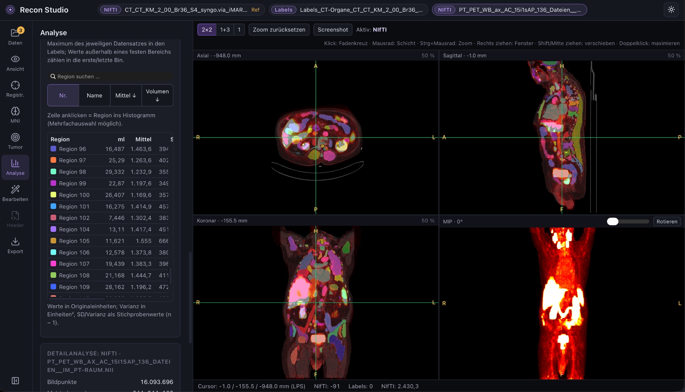

# Recon Studio

Browserbasierte Werkbank für nuklearmedizinische Bilddaten: PET, SPECT, CT und MRT laden, fusionieren, registrieren,
segmentieren, quantifizieren, bearbeiten und exportieren – inklusive SPECT-Rekonstruktion aus Rohdaten.
Alles läuft im Browser; es gibt keinen Server, **die Daten verlassen den Rechner nicht**.



**▶ App starten: [jochenhammes.github.io/Recon](https://jochenhammes.github.io/Recon/)** – läuft direkt im Browser, keine Installation.

**📖 Handbuch: [MANUAL.md](MANUAL.md)** – Bedienung aller Funktionen Schritt für Schritt mit Screenshots.

> Forschungswerkzeug – nicht für die Diagnostik zugelassen.

## Funktionen

| Bereich | Was die App kann |
|---|---|
| **Daten** | DICOM (Datei, Serie, Multi-Frame, JPEG Lossless; auch ohne Dateiendung) und NIfTI (`.nii`, `.nii.gz`); mehrere Serien in einem Upload werden getrennt geladen, unlesbare Dateien übersprungen; beliebig viele Datensätze mit Schlagwort in einer kompakten Liste; Modalität von NIfTI wird erkannt (änderbar); zurückhaltendes Einblenden (nur was räumlich zusammenpasst); Labelbilder werden als Atlas erkannt |
| **Projekt** | Ganze Sitzung als `.recon`-Datei speichern und wieder öffnen (Datensätze inkl. DICOM-Header, Registrierungen, Anzeige, Normalisierung, Ergebnisse) |
| **SPECT-Rekonstruktion** | Projektionen (NM Multi-Frame, 1–2 Köpfe) mit FBP (Rampe, Shepp-Logan, Kosinus, Hamming, Hann, Butterworth) oder OSEM (Subsets, Iterationen) |
| **Ansicht** | Axial, sagittal, koronar und rotierende MIP in Patientenorientierung; beliebig viele Overlays mit eigener Farbtabelle, eigenem Fenster und eigener Deckkraft; Ebenen-Schnellwahl über den Bildern (in jedem Bereich); Farbskala mit Fenster in SUV/HU/…; Region unter dem Cursor; WebGL2-Darstellung; Screenshot mit Farbskala; Fusion als DICOM/NIfTI exportieren |
| **Koregistrierung (Patientenraum)** | Für alle Körperregionen: PET/SPECT (auch dynamisch) auf CT/MRT des Patienten; Basis-Datensatz definiert den Raum; beliebige Datensätze darauf registrieren (rigide/affin; NMI, MI, Correlation Ratio, Kreuzkorrelation; Mehrstufen, Grobsuche); **Ursprung & Landmarken** für Datensätze in verschiedenen Koordinatensystemen (z. B. NIfTI und DICOM): je zwei Landmarken im Einzelansicht-Modus setzen, Ursprung auf Landmarke 1 setzen, mit Landmarke 2 ausrichten, Drehen um den Ursprung (90°-Schritte), Ursprung optional dauerhaft übernehmen (wie SPM „Set origin“); Ergebnis prüfen, übernehmen oder verwerfen; manuelle Feinkorrektur; Matrix als JSON |
| **Standardraum (MNI, Hirn)** | Normalisierung auf Basis eines Patientendatensatzes – T1/T2-MRT (MNI152 2009c), PET/SPECT mit tracerspezifischer Vorlage (FDG, PiB/Amyloid, FP-CIT/DaTSCAN, ¹⁸F-DOPA, Raclopride, Perfusion) oder Kopf-CT; affin und nichtlinear (SPM-artig); Ausgabe wahlweise in 1 mm; danach werden **alle** Datensätze des Patientenraums mitübertragen (Labelbilder mit Regionsnamen, dynamische Serien Frame für Frame); SPM/CAT12-`y_*.nii` importieren/exportieren |
| **Vorlagen & Atlanten** | Katalog im MNI-Raum: MRT-, PET/SPECT- und CT-Vorlagen, Gewebekarten GM/WM/CSF (1 mm), Atlanten CerebrA, Schaefer 2018, Thalamuskerne (1 mm) – mitgeliefert, mit Lizenz und Zitat; Harvard-Oxford, Brainnetome, AAL3, Jülich-Brain, Hammers lädt man selbst von der Quelle, die App erkennt sie am Namen und speichert sie im Browser ([Quellen](Hirnvorlagen-Quellen.md)) |
| **Centiloid & SUVR: Atlas** | Atlas aus dem Katalog oder eigener; regionale Statistik (feiner Atlas auf gröberen Daten per Mehrheit der Teilvoxel, optional nur graue Substanz), Referenzregion, SUVR-Tabelle und SUVR-Bild |
| **Centiloid & SUVR: Centiloid** | Amyloid-PET mit GAAIN-Standard-VOIs (vom Nutzer geladen); MRT-Pipeline (affin) an den GAAIN-Referenzdaten kalibriert (Florbetaben und PiB, Kreuzvalidierung RMSE 4–6 CL), Standardgleichungen für extern normalisierte Daten, eigene Gleichung; PET-only (nicht validiert) |
| **Kinetik (dynamisches PET)** | Dynamische DICOM-Serien und 4D-NIfTI (BIDS-JSON); Bewegungskorrektur der Frames; Übertragung in den MNI-Raum (über T1); Referenzregion aus Atlas; **Patlak (Ki_ref)** und **SRTM (BP_ND, R1)** regional und als Parameterkarten, Kurven, CSV – nach dem MATLAB-Paket der Arbeitsgruppe ([ghaefner/kinetic-modeling](https://github.com/ghaefner/kinetic-modeling)) |
| **CT-Organsegmentierung** | TotalSegmentator „total“ (117 Strukturen, 3 mm) oder Organmodelle 1,5 mm (TotalSegmentator 24 Organe, MOOSE 19 Organe; genauer) direkt im Browser (WebGPU oder CPU); Regionsliste mit Suche, Ein-/Ausblenden und Sprung zur Region; Modellvergleich mit Laufzeit und Dice gegen ein Referenz-Labelbild |
| **Dosimetrie** | Therapie-Dosimetrie aus 1–4 SPECT/CT- oder PET/CT-Zeitpunkten (Lu-177, Tb-161, I-131, Y-90): Zeitachse mit automatischer Zuordnung von SPECT/PET, CT, Organkarte und Läsionen je Aufnahme (DICOM-Datum, FrameOfReference); Organkarte und Läsionen von T1 für alle registrierten Zeitpunkte oder Organkarte je Zeitpunkt; quantitative Bilder in Bq/ml (z. B. xSPECT Quant) ohne Kalibrierfaktor oder Kamera-Profile mit Faktor (auch aus Phantomaufnahme) und Recovery-Koeffizienten; Kurvenfit (mono-/biexponentiell, Trapez, Hänscheid/Madsen) mit Akaike-Gewichten und Unsicherheit nach EANM 2018; Dosis (lokale Deposition), BED je Region; Voxel-Dosiskarte mit DVH, optional Dosis-Voxel-Kernel mit Methodenvergleich; Bericht (HTML/PDF) und CSV; Forschungswerkzeug |
| **Segmentierung & MTV** | CT-Organsegmentierung; Läsionen auf dem PET in SUV: SUV-Schwelle (z. B. 4,0 / 2,5 / PSMA 3), 41 % SUVmax, leberbasiert (PERCIST); TMTV/PSMA-TV, TLG/TL-PSMA, SUVmax/peak/mean, Dmax; automatischer Ausschluss physiologischer Anreicherung über CT-Organe; Knochen/Weichteil; Korrektur per Klick und Pinsel; CSV und Maske |
| **Analyse** | Übersicht aller Datensätze (Min, Mittel, Median, Max, SD, Varianz); Histogramm; SUV aus dem DICOM-Header; VOI auf allen Datensätzen; **Label-Analyse** (Statistik und Histogramm je Region einer Segmentierung oder eines Atlas) mit CSV-Export von Tabellen und Histogrammen je Label; alle Ergebnistabellen groß über dem Viewer mit Suche, Sortierung und CSV |
| **IMCALC** | Voxelweise Rechnung auf Datensätzen gleichen Rasters: a·X + b, a·X₁ + b·X₂, Produkt, Quotient, Gruppen-Mittelwert und -SD, Z-Karten gegen eine Vergleichskohorte; Ergebnisse sind neue Datensätze (anzeigen, exportieren, weiterverarbeiten) |
| **Bearbeiten** | Werteoperationen (Schwelle, Bereich, Begrenzen, linear), VOI (Kugel, Quader, Pinsel), Gauß-Glättung, Spiegeln, Drehen, Resampling (gemeinsam für alle oder ausgewählte Datensätze); rückgängig; **Triple-Window-CT** (Lunge und Skelett aus der Organkarte im eigenen Fenster innerhalb des Weichteilfensters) |
| **DICOM-Header** | Alle Elemente durchsuchen, ändern, löschen, hinzufügen (mit VR-Prüfung); Radionuklid wechseln (10 Nuklide, Halbwertszeit und Positronenanteil werden mitgeschrieben, SUV folgt) |
| **Export** | Beliebige Datensätze per Häkchen, mehrere als ein ZIP; NIfTI oder DICOM (Original-Header byte-genau erhalten bzw. neue Serie aus Vorlage); ohne Resampling im eigenen Raster (Koregistrierung im NIfTI-Header) oder in das Raster eines anderen Datensatzes; PET als NIfTI optional in SUV; Labelbilder mit Regionsnamen; optionale Anonymisierung; Patient-ID im Dateinamen |

Bedienung: einklappbare Karten mit Status, Erläuterungen hinter ⓘ, verbreiterbares Seitenpanel, Aktivitätsanzeige für
laufende Berechnungen in der Kopfzeile – Details im [Handbuch](MANUAL.md).

## Schnellstart

Die App läuft unter [GitHub Pages](https://jochenhammes.github.io/Recon/) (ein Push auf `main` veröffentlicht sie)
oder lokal:

```bash
npm install
npm run dev      # Entwicklungsserver
npm test         # Unit-Tests (vitest)
npm run lint     # oxlint
npm run build    # Type-Check + Produktions-Build
```

Empfohlen: aktueller Chrome/Edge (WebGPU beschleunigt die CT-Segmentierung stark); Safari und Firefox funktionieren,
die CT-Segmentierung läuft dort ggf. auf der CPU.

## Aufbau des Codes

`src/core` Geometrie und Transformationen · `src/dicom`, `src/viewer/volumeLoader.ts` Laden · `src/recon` SPECT-Rekonstruktion ·
`src/viewer` Viewer und WebGL2 · `src/registration` Coregistrierung · `src/normalization` Standardraum ·
`src/atlas` Atlanten, Labelbilder, Regionalstatistik · `src/segmentation` CT-Segmentierung (ONNX Runtime Web) ·
`src/tumor` Läsionen und Tumorlast · `src/kinetics` Kinetikmodelle (Patlak, SRTM), Bewegungskorrektur · `src/centiloid` Centiloid · `src/analysis` Statistik, SUV · `src/edit` Bearbeitung ·
`src/header` DICOM-Header · `src/dosimetry` Dosimetrie · `src/export` DICOM/NIfTI/ZIP · `src/workers` Web Worker · `src/ui`, `src/components` Oberfläche ·
`tools/totalseg-onnx` Export des Segmentierungsmodells nach ONNX.

## Mitgelieferte Daten und Lizenzen

- `public/templates/`: MNI ICBM 152 Nonlinear Asymmetrical 2009c in 1 und 2 mm, T2 und GM/WM/CSF in 1 mm (Fonov et al.
  2009/2011), © McConnell Brain Imaging Centre (`LICENSE-MNI152NLin2009cAsym.txt`); SPM12-PET-, -SPECT- und
  -Transmissionsvorlage (toolbox/OldNorm), GNU GPL v2+ (`LICENSE-SPM12-GPL.txt`); FDG-, PiB- und Raclopride-Vorlage aus
  Magia (Turku PET Centre, MIT, `README-magia.txt`); FP-CIT-SPECT- und ¹⁸F-DOPA-Vorlage (García-Gómez et al. 2013,
  „free use … please cite“, `README-spmtemplates.txt`); Kopf-CT-Vorlage aus der Clinical Toolbox (Rorden et al. 2012,
  BSD-2-Clause, `LICENSE-Clinical-BSD.txt`).
- `public/atlases/`: CerebrA (Manera et al. 2020, Sci Data 7:237), CC0 1.0, in 1 und 2 mm; Schaefer 2018 (100/200/400
  Parzellen, MIT); MIAL67-Thalamuskerne (Najdenovska et al. 2018, CC BY 4.0). Je Atlas eine `README-*.txt`.
- Aufbereitung aller Vorlagen und Atlanten reproduzierbar mit `scripts/prepare-brain-assets.py` (Quellen mit
  SHA-256-Prüfsummen); Recherche und Lizenzen in [Hirnvorlagen-Quellen.md](Hirnvorlagen-Quellen.md).
- `public/models/totalseg-total-3mm/`: TotalSegmentator „total“ 3 mm (Wasserthal et al., Radiology: AI 2023; nnU-Net),
  Apache 2.0, nach ONNX exportiert (`tools/totalseg-onnx/export.py`), siehe `NOTICE.txt`.
- `public/models/totalseg-organs-1.5mm/`: TotalSegmentator-v2-Organmodell 1,5 mm (Dataset291), Apache 2.0, nach ONNX
  exportiert (`tools/ctseg-onnx/export_nnunet.py`), siehe `NOTICE.txt`. Modellvergleich auf AMOS: `tools/ctseg-benchmark/`.
- `public/models/moose-organs-1.5mm/`: MOOSE 3 clin_ct_organs (Shiyam Sundar et al., J Nucl Med 2022; ENHANCE-PET),
  Modellgewichte CC BY 4.0, nach ONNX exportiert (`tools/ctseg-onnx/export_nnunet.py --fold=fold_all`), siehe `NOTICE.txt`.
- `public/coi-serviceworker.js`: coi-serviceworker 0.1.7 (G. Zuidhof), MIT (`LICENSE-coi-serviceworker.txt`), angepasst –
  aktiviert Cross-Origin-Isolation für mehrere CPU-Threads auf GitHub Pages.
- Nicht mitgeliefert: GAAIN-Centiloid-VOIs und -Daten (nur persönliche, nicht-kommerzielle Nutzung), AAL3 (Download von
  [gin.cnrs.fr](https://www.gin.cnrs.fr/en/tools/aal/)).
- Screenshots im Handbuch: synthetische Phantome, öffentliches Beispiel-CT von TotalSegmentator und aus der MNI-Vorlage
  abgeleitete Testbilder – keine Patientendaten.
